# RSNA Pneumonia Detection — ML R&D (HW1: постановка, baseline, протокол оценки)

Домашнее задание №1 курса «ML R&D», задача №16: [RSNA Pneumonia Detection Challenge](https://www.kaggle.com/competitions/rsna-pneumonia-detection-challenge).
Нужно найти и обвести боксами очаги затемнения (opacity), подозрительные на пневмонию, на фронтальной
рентгенограмме грудной клетки.

**TL;DR.** На локальной валидации (4 002 снимка, сплит сгруппирован по NIH-пациенту) метрика соревнования
RSNA mAP@IoU[0.40:0.75] такая:

| модель | val mAP | 95% CI (bootstrap) |
|---|---|---|
| `empty` (ни одного бокса) | 0.0000 | [0.0000, 0.0000] |
| `prior_boxes` (2 k-means бокса на каждом снимке) | 0.0217 | [0.0192, 0.0242] |
| `prior_boxes_ap` (те же 2 бокса, только на AP-снимках; shortcut) | 0.0347 | [0.0305, 0.0393] |
| **CenterNet-lite ResNet-18 @256, seed 0** | **0.1865** | **[0.1718, 0.2014]** |

Парная разница baseline − `prior_boxes_ap` = **+0.1518 [0.1379, 0.1657]**, основная гипотеза H1 на seed 0 подтверждается.
Есть две оговорки. Порог score и эпоха выбраны на этой же val, поэтому число оптимистично
(см. [§5.4](#s5-4)). Сиды 1 и 2 ещё обучаются, `mean ± std` будет позже <!-- SEEDS_PENDING -->.
Почти половина ошибки (48.9 % разрыва 1 − mAP) приходится на ложные боксы на негативных снимках
([§6.5](#s6-5)). Поэтому следующая гипотеза — image-level голова с гейтингом.

**Статус.** HW1 готово, кроме сидов 1–2 (`baseline_s1` обучается). HW2 в работе: конфиги
[`configs/hw2/`](configs/hw2), скрипт [`scripts/run_hw2.sh`](scripts/run_hw2.sh), постобработка `rsna.posthoc`
и отчёт `rsna.report` готовы, прогонов пока нет. Отчёт HW2 появится в `reports/HW2.md`.

---

## Содержание

- [Ответы на обязательные вопросы](#q)
- [Карта репозитория](#map) · [Quickstart](#quickstart) · [Железо и время](#hw) · [Воспроизводимость](#repro)
- [1. Постановка задачи](#s1) · [2. Формализация](#s2) · [3. Данные (EDA)](#s3) · [4. Baseline](#s4)
- [5. Протокол оценки](#s5) · [6. Результаты baseline](#s6) · [7. Выводы](#s7)
- [8. Собственные исследовательские вопросы](#s8) · [9. Источники и заимствования](#s9)

<a id="q"></a>
## Ответы на обязательные вопросы

| # | Вопрос | Короткий ответ | Подробно |
|---|---|---|---|
| Q1 | Что предсказываем и почему такая постановка? | Для каждого снимка предсказываем набор боксов `(confidence, x, y, w, h)`; набор может быть пустым. Это постановка соревнования. Детекция, а не классификация, потому что клинически нужно показать **где** очаг, а метрика оценивает и решение «есть / нет», и локализацию. | [§1](#s1), [§2](#s2) |
| Q2 | Объект, `X`, `y`, что доступно на inference? | Объект — один фронтальный снимок (один RSNA `patientId`). `X` — пиксели 1024×1024 (у нас уменьшены до 256×256). `y` — 0–4 бокса в пикселях исходного снимка. На inference берём **только пиксели**: метаданные DICOM (проекция AP/PA, возраст, пол) намеренно не используем, потому что проекция — shortcut. | [§2](#s2) |
| Q3 | Метрика и протокол валидации, почему корректны? | Метрика — RSNA mAP по 8 порогам IoU 0.40…0.75 со строгим `>`. Снимок «нет GT и нет предсказаний» исключается из среднего, FP на негативе даёт 0. Сплит train/val/test 70/15/15 сгруппирован по **NIH-пациенту**, иначе у 67.4 % val-снимков в train оказался бы снимок того же человека; стратифицирован по `cls×n_boxes×view×sex` и закоммичен. Эпоху и порог выбираем на val, test открываем один раз в конце. Неопределённость оцениваем бутстрап-CI и сидами. | [§5](#s5) |
| Q4 | Baseline, preprocessing, признаки, почему разумная точка отсчёта? | Тривиальные ориентиры (`empty`, `prior_boxes`, `prior_boxes_ap`) и основной baseline CenterNet-lite: ImageNet ResNet-18, 256 px, 6 эпох, без аугментаций, без image-level головы, без TTA и подбора гиперпараметров. Preprocessing: DICOM → uint8 → area-resize 1024→256 → /255 → нормализация ImageNet. Признаки — только пиксели. Обучение одного прогона занимает около 1 ч 50 мин на ноутбуке, модель легко интерпретировать (heatmap центров). | [§4](#s4) |
| Q5 | Основные ошибки, риск лика, следующая гипотеза? | 48.9 % разрыва 1 − mAP дают FP на негативных снимках, прежде всего на классе «No Lung Opacity / Not Normal». 17.5 % дают пропущенные позитивы (особенно PA), 33.6 % — локализация. Лик по пациентам закрыт групповым сплитом. Остаточные риски — пиксельный AP/PA-shortcut и выбор порога на val ([чеклист](#s5-7)). Следующая гипотеза — image-level голова с гейтингом score; верхняя граница с идеальным гейтингом по оракулу 0.3095–0.3506. Затем лёгкие аугментации против переобучения после 4-й эпохи. | [§6](#s6), [§7](#s7) |

<a id="map"></a>
## Карта репозитория

```text
.
├── README.md                    # этот отчёт (HW1)
├── pyproject.toml, uv.lock      # зависимости (Python 3.11, torch 2.15.0, torchvision 0.29.2, mlflow 3.18.0), lock-файл uv
├── configs/
│   ├── baseline.yaml            # HW1 baseline: все гиперпараметры + гипотеза в meta
│   └── hw2/{b_aug,b_cls,full}.yaml  # HW2: копии baseline, отличаются только целевыми ключами (проверяется тестом)
├── scripts/
│   ├── download_data.sh         # Kaggle CLI → fallback HF-зеркало; RSNA→NIH маппинг с проверкой SHA-256
│   ├── prepare_data.sh          # DICOM → кэши 256/384 px, metadata, сплит (сверка с закоммиченным), EDA
│   ├── run_baseline.sh          # тривиальные baseline + CenterNet-lite × 3 сида, всё на VAL; test только с EVAL_TEST=1
│   └── run_hw2.sh               # HW2: план 2×2 + post-hoc варианты (в работе)
├── src/rsna/
│   ├── prepare.py               # чтение DICOM/CSV, валидация разметки, area-resize, кэши images_{256,384}.npy
│   ├── split.py                 # StratifiedGroupKFold по nih_patient → split_v1.csv (+5 CV-фолдов внутри train)
│   ├── eda.py                   # reports/eda_stats.json + reports/figures/eda_*.png
│   ├── dataset.py               # RAM-кэш uint8 + батчинг в основном процессе
│   ├── model.py                 # CenterNetLite (ResNet + FPN-lite neck до stride 8 + 3 головы) и loss
│   ├── targets.py               # гауссовы heatmap-цели, size/offset регрессия (радиус из CenterNet)
│   ├── decode.py                # heatmap peaks → top-K → боксы → NMS; таблицы предсказаний
│   ├── augment.py               # hflip/affine/intensity на батче (в baseline выключены; для HW2)
│   ├── train.py                 # обучение, выбор эпохи и порога на val, MLflow, results/experiments.csv
│   ├── metric.py                # RSNA mAP (единственный источник истины), threshold sweep, bootstrap, paired bootstrap
│   ├── evaluate.py              # метрики run на val/test, срезы, декомпозиция ошибки, oracle gating, compare, summarize
│   ├── baselines.py             # empty / prior_boxes / prior_boxes_ap
│   ├── analysis.py              # анализ ошибок: галереи, калибровка, размеры боксов → reports/figures/hw1_*
│   ├── posthoc.py, report.py    # HW2: офлайн box_scale/гейтинг, сводный отчёт
│   └── tracking.py, utils.py, paths.py
├── tests/                       # 117 тестов pytest (метрика, сплит, цели/декодирование, evaluate, конфиги, ...)
├── data/
│   ├── splits/split_v1.csv      # ЗАКОММИЧЕННЫЙ сплит: patientId, split, cv_fold
│   ├── external/nih_mapping.csv # RSNA patientId → NIH image/patient (закоммичен)
│   └── raw/, processed/         # не версионируются (≈7.4 GB и ≈5.3 GB)
├── docs/research_notes.md       # разбор метрики, маппинга NIH, решений топ-команд, с источниками [S#]
├── reports/
│   ├── eda_stats.json           # все числа EDA
│   └── figures/                 # eda_*.png, hw1_*.png, hw1_baseline_s0_summary.md
├── results/                     # маленькие артефакты прогонов (метрики, предсказания, кривые)
│   ├── baseline_trivial/        # 3 тривиальных варианта + priors.json + val_summary.md
│   ├── baseline_s0/             # config.yaml, meta.json, history.csv, val_metrics.{md,json}, threshold_sweep.csv, ...
│   ├── comparisons/             # парные бутстрап-сравнения
│   └── experiments.csv          # реестр прогонов (run, git sha, конфиг, сид, гипотеза, итог)
├── runs/<run>/best.pt           # чекпойнты (gitignored)
└── mlflow.db                    # MLflow tracking (sqlite)
```

<a id="quickstart"></a>
## Quickstart

```bash
uv sync --extra dev                       # .venv по uv.lock (pytest — в extra "dev")

bash scripts/download_data.sh             # ≈3.7 GB zip → data/raw/; + RSNA→NIH маппинг (SHA-256 проверяется)
#   основной путь: Kaggle CLI (нужны ~/.kaggle/kaggle.json и принятые правила соревнования)
#   fallback: HF-зеркало kellly/RSNA-Pneumonia-Detection; принудительно: FORCE_MIRROR=1
bash scripts/prepare_data.sh              # кэши 256/384 px, metadata.csv, сплит (сверка с split_v1.csv), EDA
bash scripts/run_baseline.sh              # тривиальные baseline + CenterNet-lite × сиды 0 1 2, всё на val
#   SEEDS=0 bash scripts/run_baseline.sh  — один сид; OVERWRITE=1 — переобучить существующий run
#   EVAL_TEST=1 — однократная финальная оценка на test (в HW1 НЕ запускалась)

.venv/bin/python -m rsna.analysis --run results/baseline_s0 --split val --out reports/figures/hw1_baseline_s0
.venv/bin/python -m pytest -q             # 117 passed (≈35 с на CPU)
.venv/bin/mlflow ui --backend-store-uri sqlite:///mlflow.db
```

Про **зеркало**: `huggingface.co/datasets/kellly/RSNA-Pneumonia-Detection` — неофициальная копия архива
соревнования. Наши данные скачаны именно с него, потому что Kaggle CLI на машине не было. Проверка подлинности:

- число файлов совпадает: 26 684 train DICOM, 3 000 test DICOM, 30 227 строк разметки
  (`download_data.sh` и `rsna.prepare` проверяют это ассертами);
- `SOPInstanceUID` и `StudyInstanceUID` всех 26 684 train-снимков совпали с официальным маппингом RSNA→NIH
  (0 расхождений, [research_notes §2.1](docs/research_notes.md)).

Контрольную сумму самого zip сверить не с чем: Kaggle её не публикует.

Устройство выбирается так: `RSNA_DEVICE=cpu|mps|cuda`, по умолчанию mps > cuda > cpu.

<a id="hw"></a>
### Железо и время

| что | значение | источник |
|---|---|---|
| машина | MacBook Air (M4, `hw.model` Mac16,12), 24 GB RAM, PyTorch MPS | `sysctl`, [`meta.json`](results/baseline_s0/meta.json) (`device: mps`) |
| `prepare_data.sh` (декодирование 26 684 DICOM, 8 процессов) | 45.7 с | `data/processed/prepare_report.json` |
| обучение `baseline_s0`, 6 эпох | 108.6 мин чистого обучения, 116 мин wall-clock | [`meta.json`](results/baseline_s0/meta.json) |
| одна эпоха | 14.7–25.9 мин (0.75–1.32 it/s) + валидация 46–125 с | [`history.csv`](results/baseline_s0/history.csv) |

Скорость между эпохами плавает почти в 2 раза. Вероятные причины — троттлинг безвентиляторного Air
и/или параллельная нагрузка на машине. **[не проверено]**: температуру и загрузку не логировали.

<a id="repro"></a>
### Воспроизводимость

- **Сиды.** `seed_everything` фиксирует `random`, `numpy` и `torch`, плюс отдельный `torch.Generator`
  для порядка батчей ([`utils.py`](src/rsna/utils.py)).
- **Детерминизм на MPS не гарантирован.** Ядра MPS не бит-детерминированы, поэтому повтор с тем же сидом
  совпадёт лишь приблизительно (это записано и в `meta.json`). Устойчивость результата меряем разбросом
  по сидам 0/1/2, а не повтором одного сида.
- **Окружение** зафиксировано `uv.lock` и точными версиями torch/torchvision/mlflow в `pyproject.toml`.
- **Сплит** закоммичен ([`data/splits/split_v1.csv`](data/splits/split_v1.csv)). `rsna.split` при повторной
  генерации сверяет результат с файлом и отказывается перезаписывать без `--force`.
  Наша проверка: повторная генерация (`make_split`, seed 42) совпадает с файлом, 0 расхождений в `split` и `cv_fold`.
- **Провенанс прогона.** В каждом `results/<run>/meta.json` и в тегах MLflow лежат git sha (с суффиксом
  `-dirty`, если `src/ configs/ scripts/ pyproject.toml uv.lock` изменены), время, устройство, версии и
  `mlflow_run_id`. Метрики, посчитанные для старой тренировки под тем же именем, `rsna.evaluate` отвергает.
  - Деталь: у `baseline_s0` записан sha `7d837c7`. Это коммит до переписывания истории (правка авторства);
    его дерево (`5ab93af`) идентично коммиту `98baa08` в текущей истории.
- **Гиперпараметры** целиком лежат в [`configs/baseline.yaml`](configs/baseline.yaml); фактически
  использованный конфиг — в [`results/baseline_s0/config.yaml`](results/baseline_s0/config.yaml).
- Рисунок `hw1_val_map_vs_trivial.png` строит [`scripts/plot_hw1_summary.py`](scripts/plot_hw1_summary.py) (читает
  только `results/*/val_metrics.json`).

---

<a id="s1"></a>
## 1. Постановка задачи

| аспект | содержание |
|---|---|
| **Что предсказывается** | Положение очагов затемнения лёгочной ткани (opacity), подозрительных на пневмонию: 0, 1 или несколько осевых прямоугольников с уверенностью. Пустой ответ означает «пневмонии нет». |
| **Объект** | Один фронтальный (AP или PA) рентгеновский снимок грудной клетки из NIH ChestX-ray14, переразмеченный радиологами RSNA/STR. |
| **Данные на момент предсказания** | Только сам снимок: пиксели DICOM и его заголовок. Нет предыдущих снимков пациента, боковой проекции, анамнеза и лабораторных данных. |
| **Практический смысл** | Сортировка (triage) и «второе мнение» при чтении рентгенограмм. Пневмония — частая и опасная инфекция; бокс показывает врачу, куда смотреть, и делает подсказку проверяемой, чего не даёт голая вероятность. |
| **Ограничения** | (1) Шумная разметка: каждый train-снимок читал **один** радиолог, а согласие врачей невысокое [S6, S11]. (2) Целевое понятие — «затемнение, подозрительное на пневмонию», а не подтверждённый диагноз. (3) Границы очагов размыты, поэтому размер бокса субъективен. (4) Один источник данных (NIH, один госпиталь), перенос на другие клиники не проверяется. (5) Вычислительный бюджет — один ноутбук: около 2 ч на прогон, отсюда 256 px и 6 эпох. (6) Скрытый Kaggle-тест размечен иначе (пересечение трёх читателей, больше позитивов), поэтому наши числа с лидербордом напрямую не сравнимы. |

### Основная гипотеза H1

> **Если** вместо тривиального prior-box baseline (два k-means бокса по train-позитивам; сильнейший
> тривиальный вариант `prior_boxes_ap` ставит их только на AP-снимки) использовать предобученный на ImageNet
> ResNet-18 с anchor-free головой CenterNet-lite на 256 px, **то** RSNA mAP на локальной val (grouped split)
> вырастет. **Механизм:** модель смотрит на пиксели лёгких. Поэтому (а) она может не ставить боксы на
> негативные снимки, а по метрике любой FP на негативе даёт снимку 0; (б) она локализует очаг по текстуре
> консолидации, а не по средней позиции лёгкого. ImageNet-признаки переносятся на эту текстуру.

Операционализация (критерий проверки):

| что | как |
|---|---|
| метрика | val RSNA mAP, 4 002 снимка `split_v1` |
| сравнение | Δ = mAP(baseline) − mAP(`prior_boxes_ap`) на одних и тех же снимках, парный бутстрап, 2 000 ресэмплов |
| принять H1 | нижняя граница 95 % CI для Δ > 0 на каждом сиде |
| проверка механизма | (а) FP-image rate на негативах ниже, чем у `prior_boxes_ap` (0.364); (б) mAP на позитивах выше, чем у prior-боксов (0.096 / 0.078) |
| фальсификация | CI для Δ включает 0, или выигрыш получен без снижения FP-rate и без роста mAP на позитивах (т. е. за счёт порога, а не пикселей) |

В [`configs/baseline.yaml`](configs/baseline.yaml) гипотеза была записана до запуска в качественной форме
(«существенно лучше»). Числовой критерий выше сформулирован при оформлении README, после прогона seed 0.

Результат для seed 0: Δ = +0.1518 [0.1379, 0.1657], FP-rate 0.191 < 0.364, mAP на позитивах 0.310 > 0.096.
H1 и оба звена механизма подтверждаются ([§6.1](#s6-1)).

---

<a id="s2"></a>
## 2. Формализация

| | |
|---|---|
| **`X`** | Один снимок: DICOM 1024×1024, 8 бит, MONOCHROME2. В модель подаётся `uint8` 256×256 (area-resize), затем ×1/255, повтор в 3 канала и нормализация ImageNet. |
| **`y`** | Множество боксов `{(x, y, w, h)}`, где `k ∈ {0,…,4}`, в пикселях исходного 1024×1024 (x, y — левый верхний угол). `k = 0` у негативов. |
| **Тип задачи** | **Object detection** с переменным числом объектов одного класса, включая ноль. В терминах списка ДЗ это binary-решение на уровне снимка плюс регрессия координат множества боксов. Метрика учитывает обе части. |
| **Единица наблюдения** | Изображение (*image*). В RSNA поле `patientId` — это id **снимка**, по одному на снимок. Настоящий пациент — `nih_patient` из маппинга RSNA→NIH: 26 684 снимка принадлежат 11 452 людям, это **группа** для сплита ([§5.2](#s5-2)). |
| **Одно предсказание** | Для снимка — множество (возможно пустое) `(confidence, x, y, w, h)`, как строка `PredictionString` в формате Kaggle. После порога по `confidence` остаются боксы, которые идут в метрику. |
| **Признаки на inference** | **Только пиксели.** Заголовок DICOM на inference в реальности доступен, но `ViewPosition` (AP/PA), `PatientAge` и `PatientSex` как признаки **намеренно не используются**. Причины: (1) AP/PA — shortcut: AP-снимки делают лежачим и тяжёлым больным, доля позитивов 38.3 % против 9.3 % у PA, ROC-AUC одного признака `view==AP` 0.706. Хост назвал это корреляцией с таргетом, 2-е место — «пограничной утечкой» [S8, S11]. (2) Соотношение AP/PA зависит от больницы, а модель должна смотреть на лёгкие. (3) NIH-метки (`orig_labels`) добыты NLP из отчётов и запрещены хостом [S11]. Метаданные используются только для стратификации сплита и срезов метрики. Остаточный риск, что сеть «читает» проекцию по пикселям, разобран в [RQ3](#s8). |

Вспомогательные поля разметки, которые **не** являются `y` baseline: `Target` = (k > 0) и 3-классовый `class`
(`Normal`, `No Lung Opacity / Not Normal`, `Lung Opacity`). Класс используется для стратификации и анализа ошибок;
в обучении baseline участвуют только боксы.

---

<a id="s3"></a>
## 3. Данные (EDA)

Все числа — из [`reports/eda_stats.json`](reports/eda_stats.json) и `data/processed/prepare_report.json`.
Код — [`src/rsna/eda.py`](src/rsna/eda.py). Описательная статистика посчитана по всем 26 684 размеченным
снимкам. Всё, что влияет на моделирование (геометрия боксов, prior-боксы), посчитано **только по train**.

### 3.1 Источник и размер

| | |
|---|---|
| источник | Kaggle RSNA Pneumonia Detection Challenge (2018), `stage_2_train_*`; снимки из NIH ChestX-ray14 [S6] |
| размеченные снимки | 26 684 DICOM, все 1024×1024; pixel spacing 0.115–0.199 мм |
| строки разметки | 30 227 (`stage_2_train_labels.csv`), 9 555 боксов |
| неразмеченный test | 3 000 DICOM `stage_2_test_images`, **не используются** |
| типы признаков | изображение (uint8); метаданные: пол (M/F), возраст (int), проекция (AP/PA), pixel spacing; разметка: боксы, `Target`, 3-классовый `class` |

### 3.2 Пропуски и аномалии

| проверка | результат |
|---|---|
| NaN в `metadata.csv` (13 колонок) | 0 |
| NaN-боксы в разметке | только у негативов (так кодируется «нет бокса»); частично заполненных строк 0 |
| `Target` против `class` | расхождений 0; конфликтующих классов у снимка 0 |
| дубли строк `stage_2_detailed_class_info.csv` | 3 543, удалены (без конфликтов) |
| возраст > 100 | 5 значений (148, 150, 151, 153, 155), ошибки заголовка. Оставлены как есть, в срезах попадают в бакет `invalid`; как признак возраст не используется |
| боксы с w·h ≤ 0 или за кадром | 0 |
| точные дубликаты изображений | 1 пара (`08d88a60…`, `8f96ca8e…`): один NIH-пациент, одинаковая разметка, один сплит |

### 3.3 Дисбаланс классов

| класс | снимков | доля | боксы |
|---|---|---|---|
| Normal | 8 851 | 33.2 % | нет |
| No Lung Opacity / Not Normal | 11 821 | 44.3 % | нет (`Target = 0`) |
| Lung Opacity | 6 012 | **22.5 %** | 1–4 |

Боксов на снимок: 0 → 20 672, 1 → 2 614, 2 → 3 266, 3 → 119, 4 → 13.

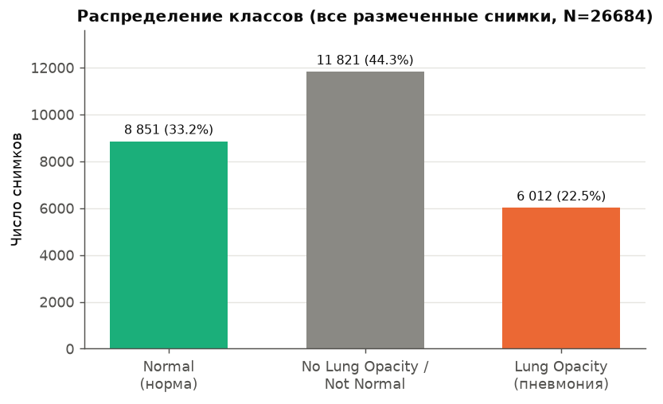

Класс «No Lung Opacity / Not Normal» — это **трудные негативы**: на снимке есть другие патологии
(выпот, кардиомегалия, ателектаз и т. п.), но таргет 0. Как показано в [§6.5](#s6-5), почти все FP модели
приходятся именно на них.

### 3.4 Метаданные и shortcut по проекции

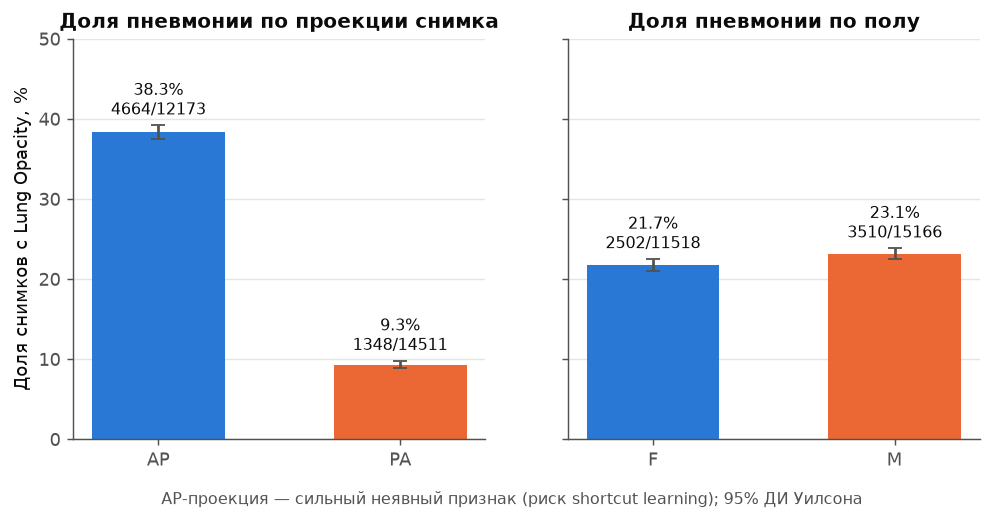

| срез | n | доля позитивов [95 % ДИ Уилсона] |
|---|---|---|
| AP | 12 173 | **38.3 %** [37.5, 39.2] |
| PA | 14 511 | **9.3 %** [8.8, 9.8] |
| F / M | 11 518 / 15 166 | 21.7 % / 23.1 % |
| возраст 0–17 / 18–39 / 40–59 / 60–79 / 80–100 | 1 276 / 7 248 / 11 612 / 6 251 / 292 | 30.2 / 24.2 / 21.7 / 20.5 / 23.6 % |

Отношение AP/PA по доле позитивов равно 4.12, ROC-AUC одного признака `view==AP` на train — 0.706.
В AP-снимках к тому же больше «Not Normal»: 48.2 % против 41.0 % у PA. На многих AP-снимках в кадре есть
надпись `PORTABLE` (видно на [примерах](reports/figures/eda_examples.png)), то есть проекция читается и по пикселям.

Возраст: [`eda_age_positive_rate.png`](reports/figures/eda_age_positive_rate.png),
[`eda_age_by_target.png`](reports/figures/eda_age_by_target.png).

### 3.5 Геометрия боксов (только train, 6 696 боксов)

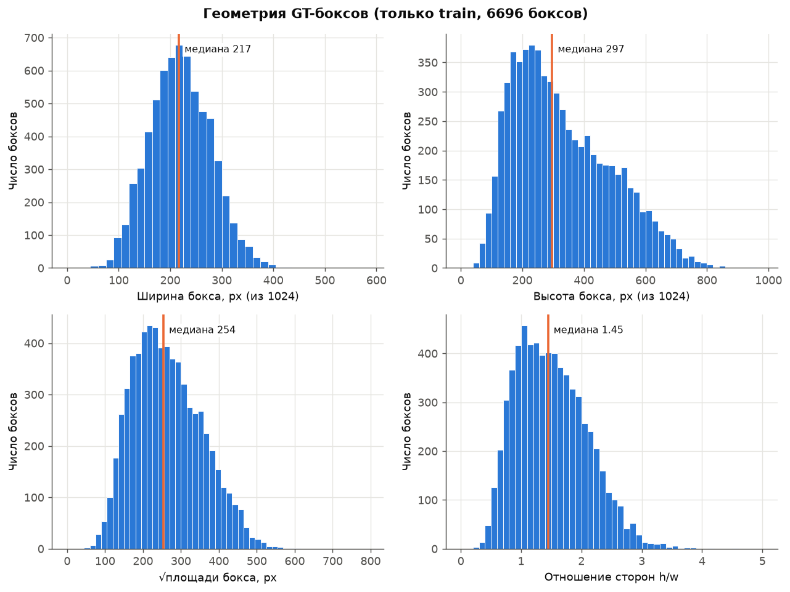

| | медиана | p5–p95 |
|---|---|---|
| ширина, px (из 1024) | 217 | 125–317 |
| высота, px | 297 | 122–623 |
| √площади, px | 254 | 133–425 |
| h / w | 1.45 | 0.68–2.54 |
| ширина × высота на входе 256 px | 54 × 74 | 31–79 × 31–156 |

Медианный бокс на выходной сетке модели (stride 8, сетка 32×32) занимает примерно 6.8 × 9.3 клетки
(54/8, 74/8; наш расчёт). Поэтому разрешение 256 px для этих объектов приемлемо. Медианы на AP / PA:
220×325 / 203×211 px.

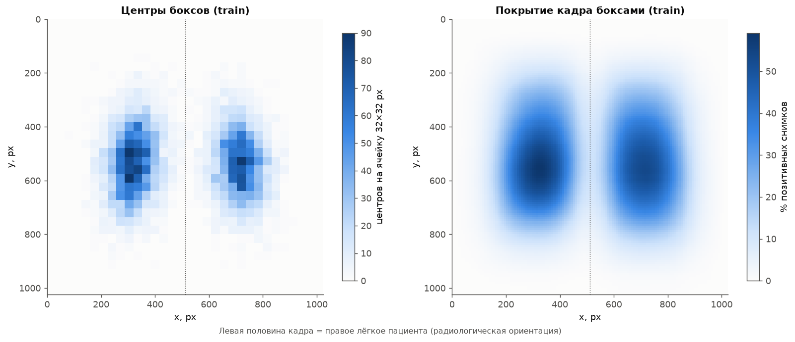

Центры образуют два кластера, по одному на лёгкое; 53.6 % центров лежат в левой половине кадра
(правое лёгкое пациента). На этом построен тривиальный `prior_boxes`.
Распределение числа боксов: [`eda_boxes_per_image.png`](reports/figures/eda_boxes_per_image.png).

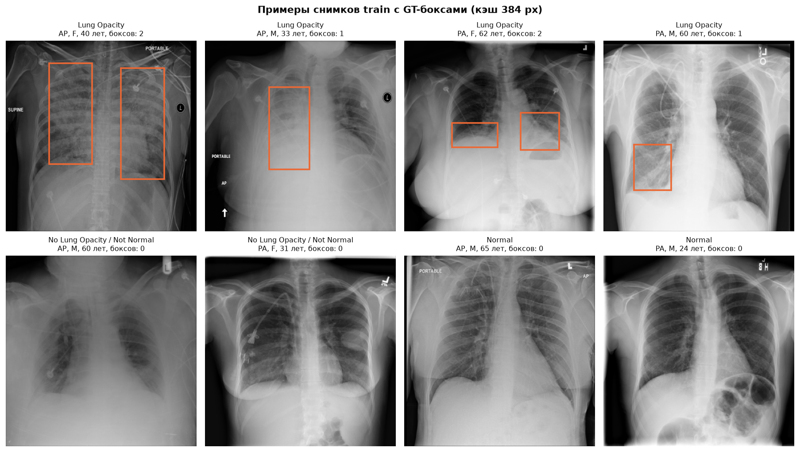

### 3.6 Источники шума в разметке

1. **Один читатель на train-снимок** (6 радиологов, около 5 000 снимков на каждого) [S5, S6]. Kappa не
   публиковали; хост: *"Doctor-doctor agreement for this problem is not exceedingly high"* [S11].
2. **Субъективные границы бокса.** Инструкция просила *"as small as possible but to encompass the entire
   suspicious opacity"* [S6], но край диффузного затемнения размыт.
3. **«Not Normal» против «Lung Opacity».** Граница между ними — решение читателя. Если на снимке был только
   бокс низкой уверенности, снимок помечен «Not Normal» [S5].
4. **Смешанная разметка в `stage_2_train`.** Около 2 500 трижды прочитанных снимков (пересечение боксов)
   растворены среди примерно 24 000 одиночных, и их id не опубликованы [S5].
5. **Противоречия внутри пациента.** У 1 726 из 4 355 многоснимковых NIH-пациентов есть и позитивные, и
   негативные снимки. Это не обязательно шум: исследования сделаны в разные даты.

### 3.7 Источники утечки (leakage)

| источник | масштаб | что делаем |
|---|---|---|
| **Один NIH-пациент в нескольких снимках** | 11 452 пациента на 26 684 снимка; 4 355 пациентов с > 1 снимком покрывают **73.4 %** снимков (до 65 снимков у одного). При случайном сплите 70/15/15 по `patientId` у **67.4 %** val-снимков в train был бы снимок того же человека [research_notes §2.3] | сплит группируется по `nih_patient` ([§5.2](#s5-2)) |
| **AP/PA shortcut** | доля позитивов 38.3 % против 9.3 % | метаданные не являются признаками; срезы по view; пиксельный shortcut проверяем в [RQ3](#s8) |
| **Точный дубликат изображения** | 1 пара | внутри одного пациента, значит, в одном сплите (`groups_crossing_splits: 0`) |
| **NIH-метки** (`orig_labels`, `subset_init_label`) | доля позитивов 32.6 / 16.5 / 8.3 % по страте отбора | не используются вообще |
| **Kaggle hidden test размечен иначе** | пересечение боксов 3 читателей (боксы меньше), около 35 % позитивов против 22 % [S6, S12]; 2 203 из 3 000 его снимков — пациенты из train | с LB не сравниваем и на нём не валидируемся; внутренний test взят из того же single-read пула |

---

<a id="s4"></a>
## 4. Baseline

### 4.1 Тривиальные ориентиры ([`src/rsna/baselines.py`](src/rsna/baselines.py))

| вариант | что делает | зачем |
|---|---|---|
| `empty` | ни одного бокса | Показывает семантику метрики. Негативы без предсказаний **исключаются**, позитивы получают 0, итог **mAP = 0**. Если бы пары «пусто/пусто» считались за 1, пустой ответ дал бы 3102/4002 = 0.775 (наш расчёт). Поэтому mAP нельзя читать как accuracy. |
| `prior_boxes` | 2 центроида k-means (по xywh **train**-позитивов) на каждом снимке с константным score 0.5. Боксы: `[213.0, 374.2, 213.5, 314.4]` и `[601.6, 363.4, 224.8, 346.5]` ([`priors.json`](results/baseline_trivial/priors.json)) | «Бокс на каждое лёгкое» без взгляда на снимок |
| `prior_boxes_ap` | те же боксы, но только на AP-снимках | Цена shortcut по метаданным: что даёт тривиальное image-level правило. **Нелегитимная** модель, только ориентир |

Score у тривиальных вариантов константный, поэтому свип порога вырожден (всё или ничего) и argmax даёт 0.05.

### 4.2 Основной baseline: CenterNet-lite ([`model.py`](src/rsna/model.py), [`targets.py`](src/rsna/targets.py), [`decode.py`](src/rsna/decode.py), [`train.py`](src/rsna/train.py))

**Архитектура** (11.88 M параметров, из них 11.18 M — backbone; посчитано по `build_model`):

```text
uint8 256×256 → /255 → повтор в 3 канала → нормализация ImageNet (mean/std)
→ ResNet-18 (torchvision, IMAGENET1K_V1): C3 (stride 8, 128 ch), C4 (16, 256), C5 (32, 512)
→ FPN-lite neck: 1×1 lateral до 128 ch, top-down (nearest upsample + сложение) до stride 8,
  затем 3×3 conv + BN + ReLU
→ 3 головы (3×3 conv 128 → ReLU → 1×1) на сетке 32×32:
    hm  [1]  — logit центра очага (bias init −2.19, т. е. prior ≈ 0.1)
    wh  [2]  — ширина/высота в клетках сетки
    off [2]  — субклеточное смещение центра
```

**Цели обучения.** Для каждого GT-бокса строится гауссов пик в клетке его центра. Радиус берётся из
`gaussian_radius` CenterNet при `min_overlap = 0.7`; пики сливаются по максимуму. В клетке центра хранятся
`wh` и `off`, маска = 1. У негативного снимка heatmap нулевой, то есть он учит «нигде нет центра».

**Loss** = `focal_hm + 0.1·L1_wh + 1.0·L1_off`:
- `focal_hm` — модифицированный focal loss CenterNet (α = 2, β = 4), нормирован на число позитивных клеток;
- `L1_wh`, `L1_off` — L1 только в клетках центров (RegL1Loss из CenterNet).

**Декодирование** (из heatmap в боксы):
1. sigmoid heatmap → пики 3×3 max-pool → top-K = 10;
2. боксы переводятся в пиксели 1024 и обрезаются по кадру;
3. отбрасываются боксы со score < 0.01, затем NMS IoU 0.5;
4. в метрику идут боксы со `score ≥ thr`, где порог выбран на val.

Image-level score (для ROC-AUC) = максимум heatmap.

**Preprocessing** ([`prepare.py`](src/rsna/prepare.py)):
- DICOM декодируется в uint8 (MONOCHROME2; MONOCHROME1 инвертировался бы, в датасете таких нет);
- area-resize 1024 → 256: PIL `BOX` во float32 с округлением (BOX на uint8 даёт смещение +0.24 уровня серого);
- результат кэшируется в `images_256.npy` (1.67 GB, целиком в RAM при обучении);
- без windowing, CLAHE и нормализации по датасету. Нормализация ImageNet фиксирована, поэтому статистик,
  которые надо было бы «учить» на train, нет и лика через preprocessing нет;
- **аугментаций нет** (`aug.*: false`).

**Зафиксированные гиперпараметры** ([`configs/baseline.yaml`](configs/baseline.yaml)):

| группа | параметр | значение |
|---|---|---|
| data | `image_size` | 256 |
| model | `arch` / `pretrained` | resnet18 / ImageNet (IMAGENET1K_V1) |
| model | `neck_channels` / `head_channels` | 128 / 128 |
| model | `cls_head` | **false** |
| loss | `hm_alpha` / `hm_beta` / `gaussian_min_overlap` | 2.0 / 4.0 / 0.7 |
| loss | `wh_weight` / `off_weight` | 0.1 / 1.0 |
| train | `epochs` × steps | 6 × 1 167 = 7 002 шага (batch 16, drop_last) |
| train | optimizer / lr / weight_decay | AdamW / 3e-4 / 1e-4 |
| train | schedule | линейный warmup 300 шагов, затем косинус до 0 |
| train | `grad_clip` | 10.0 |
| aug | hflip / affine / intensity | **все выключены** |
| decode | `topk` / `nms_iou` / `min_score` / `box_scale` / `score_mode` | 10 / 0.5 / 0.01 / 1.0 / heatmap |
| selection | эпоха; порог score | argmax val mAP; argmax сетки 0.05…0.95 с шагом 0.05 на val |

### 4.3 Почему этот baseline и почему он честный, а не «почти SOTA»

**Почему именно он.**
- Он соответствует жанру «pretrained ResNet + простая голова» из требований ДЗ, но решает именно задачу
  детекции.
- Anchor-free CenterNet — самая простая детекционная голова: три свёрточные головы, без anchors и ROI.
- Он интерпретируем: heatmap центров видно глазами.
- Он быстрый. В коротком синтетическом замере на MPS (случайные изображения, около 10 итераций,
  экстраполяция на эпоху около 21 000 снимков) получилось:

  | модель | мин/эпоха |
  |---|---|
  | torchvision Faster R-CNN MobileNetV3-FPN | ≈ 31 |
  | Faster R-CNN R50-FPN | ≈ 61–95 |
  | RetinaNet R50 | ≈ 76–167 |
  | CenterNet-lite R18 | ≈ 6.5 |

  **[не проверено артефактом]**: замер делался одноразовым скриптом вне репозитория, лог не сохранён.
  Реальная эпоха CenterNet-lite заняла 14.7–25.9 мин, то есть замер оптимистичен в 2–4 раза. Значение
  имеет только соотношение между моделями.

**Почему честный.** В нём сознательно нет того, что дало результат топ-решениям [S7–S9]:
- нет аугментаций;
- нет image-level классификатора и гейтинга;
- низкое разрешение (256);
- одна модель, без ансамблей, TTA, внешнего предобучения на NIH CXR14 и сжатия боксов;
- гиперпараметры не подбирались (в [`results/experiments.csv`](results/experiments.csv) единственный
  полный прогон).

Для сравнения: у 1-го места ансамбль классификаторов и десятки детекторов [S7]. Каждое из этих улучшений —
отдельная проверяемая гипотеза HW2 с абляцией.

---

<a id="s5"></a>
## 5. Протокол оценки

<a id="s5-1"></a>
### 5.1 Основная метрика: RSNA mAP ([`src/rsna/metric.py`](src/rsna/metric.py))

Определение — по официальной странице Evaluation (дословная копия:
[`data/external/kaggle_evaluation_page.md`](data/external/kaggle_evaluation_page.md)) и ответам хоста
([research_notes §1](docs/research_notes.md)):

1. Пороги IoU: `t ∈ {0.40, 0.45, …, 0.75}`. Попадание означает **IoU > t** (строго).
2. Сопоставление на каждом пороге: предсказания по убыванию confidence, каждое берёт свободный GT с
   максимальным IoU, если этот IoU > t; иначе это FP. Непокрытый GT — FN.
3. `P_t = TP / (TP + FP + FN)`; AP снимка = среднее `P_t` по 8 порогам.
4. Граничные случаи:

   | GT | предсказания | AP снимка |
   |---|---|---|
   | ∅ | ∅ | снимок **исключается** из среднего |
   | ∅ | ≥ 1 | **0**, снимок учитывается (число FP неважно) |
   | ≥ 1 | ∅ | 0 |

5. mAP = среднее AP по учитываемым снимкам. Учитываются боксы со `score ≥ thr`.

Отличия от популярного kernel chenyc15 (`>=` вместо `>`, внешний цикл по GT) на этих данных несущественны:
GT-боксы одного снимка почти не пересекаются (максимальный IoU между ними 0.055), а при t ≥ 0.5 варианты
совпадают ([research_notes §1.4](docs/research_notes.md)). Реализация сверяется в тестах с независимой
наивной реализацией ([`tests/test_metric.py`](tests/test_metric.py)); граница «IoU ровно 0.5 при t = 0.5 —
не попадание» проверена отдельно.

**Почему эта метрика.**
- Это метрика задачи. Она одновременно оценивает решение «есть ли пневмония» (любой FP на негативе
  обнуляет снимок) и качество локализации в диапазоне IoU 0.4–0.75.
- Она даёт сравнимость с литературой и решениями соревнования, но только качественную: тест у них другой.

**Следствия, которые надо держать в голове.**

| следствие | что из него вытекает |
|---|---|
| негативы могут только навредить | консервативный порог и гейтинг выгодны |
| знаменатель зависит от модели (`scored` = позитивы + негативы с FP) | бутстрап ресэмплит **все** снимки и берёт `nanmean` ([§5.5](#s5-5)) |
| confidence влияет только через порог | порог score — гиперпараметр; подбирается на val и сообщается вместе с mAP |
| mAP не равен доле верных ответов | пустая модель даёт 0 |

<a id="s5-2"></a>
### 5.2 Сплит ([`src/rsna/split.py`](src/rsna/split.py), [`data/splits/split_v1.csv`](data/splits/split_v1.csv))

**Процедура:**
1. Группа = `nih_patient`.
2. Страта = `cls × min(n_boxes, 3) × view × sex` (20 непустых страт).
3. `StratifiedGroupKFold(20, shuffle, seed 42)` делит данные на 20 кусков по ≈ 5 %:
   куски 0–2 идут в **test**, 3–5 в **val**, 6–19 в **train**.
4. Внутри train заготовлены 5 групповых CV-фолдов (`cv_fold`); в HW1 они не используются.

`check_split` ассертом проверяет, что группы не пересекаются ни между сплитами, ни между фолдами.
Это покрыто тестами [`tests/test_split.py`](tests/test_split.py).

**Проверка закоммиченного файла** (наш перерасчёт):

| | train | val | test |
|---|---|---|---|
| снимков | 18 678 (70.0 %) | 4 002 (15.0 %) | 4 004 (15.0 %) |
| NIH-пациентов | 8 009 | 1 718 | 1 725 |
| позитивы, % | 22.55 | 22.49 | 22.48 |
| Not Normal / Normal, % | 44.31 / 33.14 | 44.25 / 33.26 | 44.28 / 33.24 |
| AP, % | 45.62 | 45.63 | 45.63 |
| F, % | 43.15 | 43.23 | 43.18 |
| n_boxes 1 / 2 / 3+, % | 9.81 / 12.23 / 0.51 | 9.80 / 12.24 / 0.45 | 9.74 / 12.29 / 0.45 |
| медиана возраста | 49 | 49 | 50 |

Пересечение пациентов между сплитами — 0 (8 009 + 1 718 + 1 725 = 11 452).

**Почему такой сплит корректен.**
- Группировка по человеку убирает утечку через узнавание анатомии, катетеров и имплантов: иначе 67.4 %
  val-снимков имели бы «родственника» в train.
- Стратификация держит доли классов, проекций, пола и числа боксов одинаковыми. Без пола в страте доля пола
  в test «уезжала» примерно на 4 п.п. (комментарий в `split.py`).
- Сплит один на все эксперименты HW1–HW2, поэтому модели сравниваются на одних и тех же снимках.

Почему один hold-out, а не k-fold: один прогон занимает около 2 ч на ноутбуке. Неопределённость
оцениваем бутстрапом по снимкам и разбросом по 3 сидам.

<a id="s5-3"></a>
### 5.3 Роли сплитов

| сплит | для чего | что на нём выбирается |
|---|---|---|
| train | обучение; k-means prior-боксов | — |
| **val** | выбор лучшей эпохи; порог score (сетка 0.05…0.95); в HW2 — выбор конфигурации и `box_scale` | всё |
| **test** (внутренний, 4 004) | **один раз в конце** (HW2, `EVAL_TEST=1`) с порогами из val | ничего. В HW1 test не открывался: `test_metrics.json` нет ни у одного прогона |
| Kaggle hidden test | не используется | — |

Код это поддерживает так:
- `rsna.train` не читает test;
- test читают только `rsna.evaluate --split test` и `rsna.baselines --split test`;
- порог для test берётся из `threshold_sweep.csv`, построенного на val;
- `rsna.analysis` читает только указанный сплит.

<a id="s5-4"></a>
### 5.4 Оптимизм val

Порог и эпоха `baseline_s0` выбраны на тех же 4 002 снимках, поэтому val mAP 0.1865 — смещённая вверх оценка.

| источник оптимизма | оценка масштаба |
|---|---|
| выбор порога | по сетке оптимум плоский (0.25 → 0.18647, 0.30 → 0.18645) |
| выбор эпохи | val mAP эпох 2–5 лежит в 0.182–0.186 |

Наша оценка: суммарный оптимизм порядка 0.005, что на порядок меньше эффекта H1. **[оценка, не измерение]**:
честное число даст test в конце HW2. Кривая «val mAP (best thr)» на `curves.png` смещена дважды: порог
подбирается на каждой эпохе, а эпоха тоже выбирается на val.

<a id="s5-5"></a>
### 5.5 Неопределённость

- **Бутстрап CI.** Перцентильный, 2 000 ресэмплов (для срезов 500). Ресэмплятся **все** снимки сплита,
  включая исключённые; в каждой реплике берётся `nanmean`, так что знаменатель меняется так же, как в самой
  метрике.
- **Парный бутстрап** (`rsna.evaluate compare`). Общий ресэмпл по объединению id, `nanmean` для каждой модели
  в каждой реплике. Даёт Δ, 95 % CI и `P(Δ ≤ 0)`.
- **Сиды.** 0/1/2 для каждой конфигурации, `rsna.evaluate summarize` даёт `mean ± std`. Улучшение,
  меньшее разброса по сидам, не заявляем ([RQ4](#s8)).

<a id="s5-6"></a>
### 5.6 Дополнительные метрики ([`evaluate.py`](src/rsna/evaluate.py))

| метрика | зачем |
|---|---|
| image ROC-AUC, PR-AUC по image score (max heatmap) | качество решения «есть / нет» независимо от порога |
| sensitivity (позитив с ≥ 1 боксом при thr) / specificity | рабочая точка |
| **FP-image rate** на негативах | главный источник потерь mAP |
| **mAP только на позитивах** | качество локализации без влияния негативов |
| matched IoU (средний IoU TP-пар при t = 0.4) | точность боксов |
| **декомпозиция 1 − mAP** = FP на негативах + пропущенные позитивы + локализация (точное аддитивное разложение) | куда уходит качество |
| **oracle gating** (боксы только на GT-позитивах) | верхняя граница для любого image-level гейтинга. Оракул, для выбора моделей не используется |
| срезы: view, sex, age (<20 / 20–40 / 40–60 / 60+), cls, n_boxes | устойчивость и shortcut |
| калибровка image score (ECE, Brier) | можно ли трактовать score как вероятность |

**Как выбирается лучшая модель.**
- Внутри прогона — эпоха с максимальным val mAP при лучшем на этой эпохе пороге.
- Между конфигурациями (HW2) — среднее val mAP по 3 сидам плюс парный бутстрап с baseline того же сида.
- Test — однократное подтверждение выбранного, а не выбор.

<a id="s5-7"></a>
### 5.7 Риски утечки: чеклист

| риск | мера | статус |
|---|---|---|
| один человек в train и val/test | group split по `nih_patient`, ассерт `check_split`, тесты | закрыт: 0 общих пациентов |
| дубликаты снимков | поиск точных дублей | закрыт: 1 пара, внутри одного пациента и сплита |
| статистики preprocessing по всем данным | обучаемых статистик нет (фиксированные resize и ImageNet-нормализация); prior-боксы fit только на train (`test_baseline_priors_are_fit_on_train_only`) | закрыт |
| метаданные-shortcut как признак | view/age/sex не подаются в модель | закрыт |
| пиксельный shortcut по проекции (`PORTABLE`, поза) | срезы по view; [RQ3](#s8) | **открыт**: не исключён |
| выбор порога и эпохи на оценочном сплите | выбор только на val; val помечен как оптимистичный; test один раз | **частично**: val смещён ([§5.4](#s5-4)) |
| подгонка под test / LB | test не открывался; LB не используется | закрыт |
| NIH-метки из NLP | не используются | закрыт |
| сравнение моделей на разных сплитах | один `split_v1` на всё; `compare` считает на общих id | закрыт |
| устаревшие метрики после переобучения под тем же именем | `rsna.evaluate` сверяет провенанс с `meta.json` | закрыт |

---

<a id="s6"></a>
## 6. Результаты baseline

<a id="s6-1"></a>
### 6.1 Итоговая таблица (val, 4 002 снимка)

| модель | thr | val mAP | 95% CI | scored | mAP pos | FP-img rate | sens | spec | img ROC-AUC | matched IoU |
|---|---|---|---|---|---|---|---|---|---|---|
| `empty` | 0.05 | 0.0000 | [0.0000, 0.0000] | 900 | 0.0000 | 0.000 | 0.000 | 1.000 | 0.500 | – |
| `prior_boxes` | 0.05 | 0.0217 | [0.0192, 0.0242] | 4002 | 0.0964 | 1.000 | 1.000 | 0.000 | 0.500 | 0.520 |
| `prior_boxes_ap` | 0.05 | 0.0347 | [0.0305, 0.0393] | 2028 | 0.0781 | 0.364 | 0.776 | 0.636 | 0.706 | 0.521 |
| **`baseline_s0`** | 0.25 | **0.1865** | [0.1718, 0.2014] | 1494 | 0.3095 | 0.191 | 0.763 | 0.809 | 0.878 | 0.627 |
| `baseline_s1` | — | — | — | — | — | — | — | — | — | — |
| `baseline_s2` | — | — | — | — | — | — | — | — | — | — |
| **baseline, mean ± std (3 сида)** | — | — | — | — | — | — | — | — | — | — |

<!-- SEEDS_PENDING: заполнить строки s1, s2 и mean ± std из results/baseline_summary/val_summary.md
     (scripts/run_baseline.sh → rsna.evaluate summarize) и results/comparisons/baseline_s{1,2}__vs__prior_boxes_ap__val.md -->

Источники: [`results/baseline_trivial/val_summary.md`](results/baseline_trivial/val_summary.md),
[`results/baseline_s0/val_metrics.md`](results/baseline_s0/val_metrics.md).
Image-level PR-AUC baseline — 0.682 (у константного score 0.225 = доля позитивов).

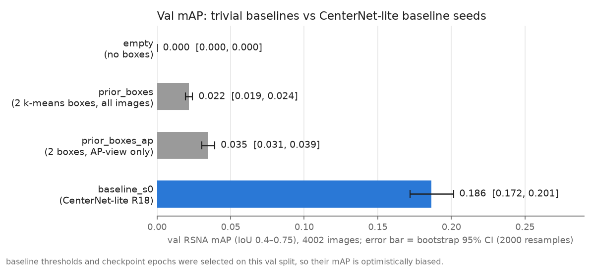

Парные сравнения ([`results/comparisons/`](results/comparisons)):

| A | B | Δ mAP (A − B) | 95% CI | P(Δ ≤ 0) |
|---|---|---|---|---|
| `baseline_s0` (thr 0.25) | `prior_boxes_ap` (thr 0.05) | **+0.1518** | [0.1379, 0.1657] | 0.000 |
| `prior_boxes_ap` | `prior_boxes` | +0.0130 | [0.0105, 0.0157] | 0.000 |

Вторая строка — цена shortcut. Одно правило «боксы только на AP» увеличивает mAP в 1.6 раза: оно убирает FP
на 64 % негативов. При этом mAP на позитивах падает (0.096 → 0.078), потому что PA-позитивы теряются.

Ориентир, а не сравнение: private LB Kaggle — 1-е место 0.255, медиана 0.148 [S14]. Тест там другой
(пересечение 3 читателей, около 35 % позитивов), поэтому числа **несопоставимы**.

<a id="s6-2"></a>
### 6.2 Кривые обучения и переобучение

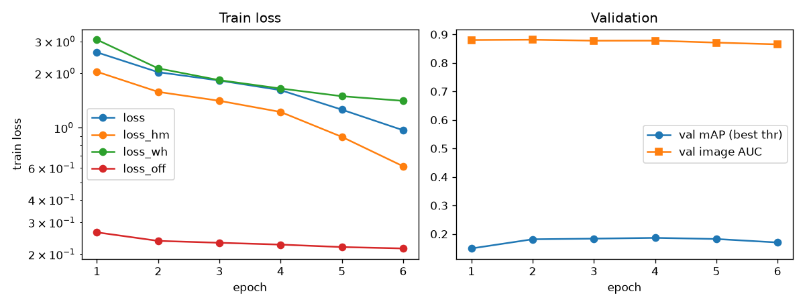

| эпоха | loss | loss_hm | loss_wh | loss_off | val mAP (best thr) | thr | val img AUC | мин |
|---|---|---|---|---|---|---|---|---|
| 1 | 2.610 | 2.039 | 3.066 | 0.264 | 0.1493 | 0.25 | 0.8804 | 15.0 |
| 2 | 2.028 | 1.578 | 2.128 | 0.237 | 0.1815 | 0.25 | 0.8814 | 25.9 |
| 3 | 1.823 | 1.409 | 1.832 | 0.231 | 0.1837 | 0.30 | 0.8780 | 17.5 |
| **4** | 1.613 | 1.222 | 1.647 | 0.226 | **0.1865** | 0.25 | 0.8781 | 16.9 |
| 5 | 1.259 | 0.890 | 1.494 | 0.219 | 0.1824 | 0.30 | 0.8712 | 18.5 |
| 6 | 0.969 | 0.613 | 1.408 | 0.215 | 0.1703 | 0.30 | 0.8651 | 14.7 |

([`history.csv`](results/baseline_s0/history.csv))

После 4-й эпохи train-loss heatmap падает вдвое (1.22 → 0.61), а val mAP снижается (0.1865 → 0.1703) и AUC
снижается (0.878 → 0.865). Это классическое переобучение на фазе малого LR в конце косинуса. Оговорки:
- val-loss не логируется, только val mAP;
- падение mAP на 0.016 сопоставимо с полушириной CI (≈ 0.015), так что для одного сида это сигнал, а не
  доказательство. Его подкрепляет монотонное снижение AUC.

Отсюда гипотеза про аугментации ([§7](#s7)).

### 6.3 Чувствительность к порогу score

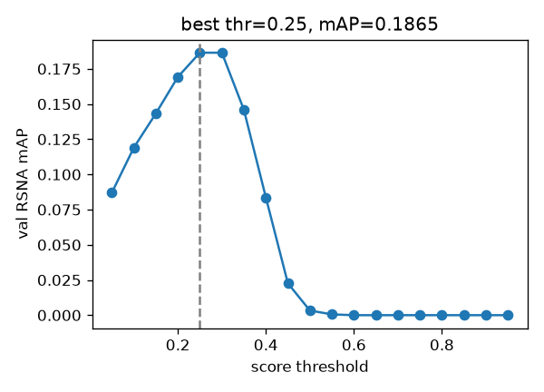

| thr | 0.10 | 0.15 | 0.20 | **0.25** | 0.30 | 0.35 | 0.40 | 0.45 | ≥ 0.60 |
|---|---|---|---|---|---|---|---|---|---|
| val mAP | 0.1191 | 0.1433 | 0.1692 | **0.1865** | 0.1865 | 0.1459 | 0.0837 | 0.0227 | 0.0000 |
| scored | 2645 | 2202 | 1823 | 1494 | 1222 | 1011 | 930 | 907 | 900 |

([`threshold_sweep.csv`](results/baseline_s0/threshold_sweep.csv))

Максимальный score бокса на val — 0.559, поэтому выше примерно 0.5 модель ничего не выдаёт и mAP = 0.
Оптимум узкий (0.25–0.30): сдвиг порога на ±0.10 от 0.25 стоит около 0.04 mAP, а на +0.15 — уже 0.10. Порог — критичный гиперпараметр, и при
другой доле позитивов (как в Kaggle-тесте) его надо пересматривать.

<a id="s6-4"></a>
### 6.4 Срезы

Колонка «доля разрыва» — вклад среза в общий 1 − mAP; внутри каждого среза сумма 100 %.

| срез | значение | n | n_pos | mAP [95% CI] | mAP pos | FP-img rate | sens | доля разрыва |
|---|---|---|---|---|---|---|---|---|
| view | AP | 1826 | 698 | 0.208 [0.190, 0.224] | 0.337 | **0.381** | 0.831 | 73.5 % |
| view | PA | 2176 | 202 | 0.119 [0.095, 0.144] | 0.216 | 0.083 | **0.530** | 26.5 % |
| sex | F | 1730 | 376 | 0.182 [0.160, 0.204] | 0.314 | 0.201 | 0.742 | 43.6 % |
| sex | M | 2272 | 524 | 0.190 [0.172, 0.208] | 0.306 | 0.184 | 0.779 | 56.4 % |
| age | <20 | 337 | 125 | 0.288 [0.237, 0.329] | 0.389 | 0.208 | 0.880 | 9.9 % |
| age | 20–40 | 1087 | 265 | 0.191 [0.165, 0.218] | 0.318 | 0.213 | 0.751 | 29.3 % |
| age | 40–60 | 1598 | 334 | 0.199 [0.173, 0.223] | 0.323 | 0.165 | 0.784 | 35.8 % |
| age | 60+ | 980 | 176 | **0.111** [0.089, 0.134] | 0.215 | 0.206 | 0.659 | 25.0 % |
| cls | Lung Opacity | 900 | 900 | 0.310 [0.290, 0.329] | 0.310 | – | 0.763 | 51.1 % |
| cls | No Lung Opacity / Not Normal | 1771 | 0 | 0 | – | **0.318** | – | **46.3 %** |
| cls | Normal | 1331 | 0 | 0 | – | 0.023 | – | 2.6 % |
| n_boxes | 1 | 392 | 392 | 0.246 [0.217, 0.278] | 0.246 | – | 0.643 | 24.3 % |
| n_boxes | 2 | 490 | 490 | 0.365 [0.340, 0.389] | 0.365 | – | 0.851 | 25.6 % |
| n_boxes | 3+ | 18 | 18 | 0.180 [0.107, 0.252] | 0.180 | – | 1.000 | 1.2 % |

([`val_metrics.md`](results/baseline_s0/val_metrics.md), [`hw1_baseline_s0_summary.md`](reports/figures/hw1_baseline_s0_summary.md))

**Интерпретация.**
- **Проекция.** На AP модель «смелее»: FP-rate 0.381 против 0.083 и sensitivity 0.831 против 0.530. Так и
  выглядел бы выученный prior «AP — чаще больные». Но это не доказательство shortcut: среди AP-негативов
  78 % — «Not Normal», среди PA — 45 % (по долям из EDA; наш расчёт), а на «Not Normal» FP-rate и так
  высокий. Разделить эти объяснения — задача [RQ3](#s8).
- **PA-позитивы** — главный источник пропусков: sensitivity 0.530.
- **Пол** — различий нет, CI перекрываются.
- **Возраст 60+** — худший срез (mAP 0.111, sensitivity 0.659). Дети и подростки — лучший (0.288).
  Причину не проверяли: возможны сопутствующие изменения у пожилых.
- **Один бокс в GT** хуже двух (mAP pos 0.246 против 0.365, sensitivity 0.643 против 0.851). Гипотеза
  **[не проверено]**: модель склонна к двусторонним ответам.

<a id="s6-5"></a>
### 6.5 Декомпозиция ошибки и oracle gating

| источник потерь | снимков | потеря mAP | доля разрыва 1 − mAP (0.8135) |
|---|---|---|---|
| **FP на негативах** (≥ 1 бокс на снимке без GT) | 594 из 3 102 | 0.3976 | **48.9 %** |
| пропущенные позитивы (ни одного бокса ≥ thr) | 213 из 900 | 0.1426 | 17.5 % |
| локализация: боксы есть, AP = 0 | 90 | 0.0602 | 7.4 % |
| локализация: 0 < AP < 1 (неточные, лишние или недостающие боксы) | 568 | 0.2131 | 26.2 % |

Вся локализация вместе даёт 33.6 % разрыва. FP на негативах почти целиком приходятся на «Not Normal»:
FP-rate 0.318 против 0.023 у «Normal»; 46.3 % всего разрыва против 2.6 %.

**Oracle gating** (боксы baseline оставлены только на GT-позитивах) даёт верхнюю границу для любого
классификатора-гейта:
- при том же пороге 0.25 — 0.3095;
- при пороге, перевыбранном для гейтированных предсказаний (0.15), — 0.3506.

Это против 0.1865 у baseline. Реальный классификатор будет далеко от оракула: image-level AUC текущего score
0.878, у классификаторов топ-команд AUC на CV 0.88–0.90 [S7].

<a id="s6-6"></a>
### 6.6 Типичные ошибки (галереи: GT зелёный, боксы ≥ 0.25 красные, лучший бокс ниже порога — оранжевый пунктир)

**(1) FP на трудных негативах.** Верхний ряд — «Normal» (max score 0.31–0.475), нижний — «Not Normal»
(0.45–0.56). На «Not Normal» модель часто ставит боксы на оба лёгких при диффузных изменениях другой природы.
Сама эта граница — источник шума разметки (§3.6).

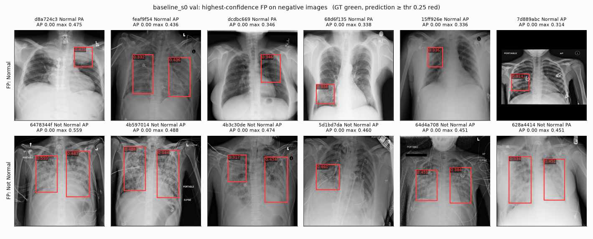

**(2) Пропущенные позитивы** (213 снимков, 17.5 % разрыва). В галерее снимки отсортированы по площади GT.
В примерах галереи даже при крупных GT лучший бокс модели обычно маленький, внутри очага, со score 0.10–0.25, то есть чуть ниже
порога. Пропуски сконцентрированы в PA (sensitivity 0.530) и на снимках с одним боксом (0.643).

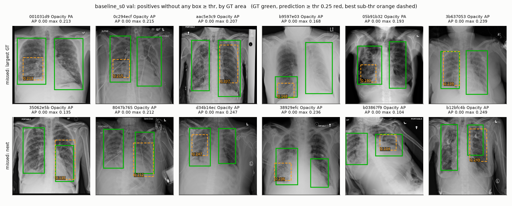

**(3) Локализация с AP = 0** (90 снимков, 7.4 %). Боксы пересекают GT, но IoU ≤ 0.4. Типичный случай —
крупный предсказанный бокс вокруг одного-двух маленьких GT-боксов.

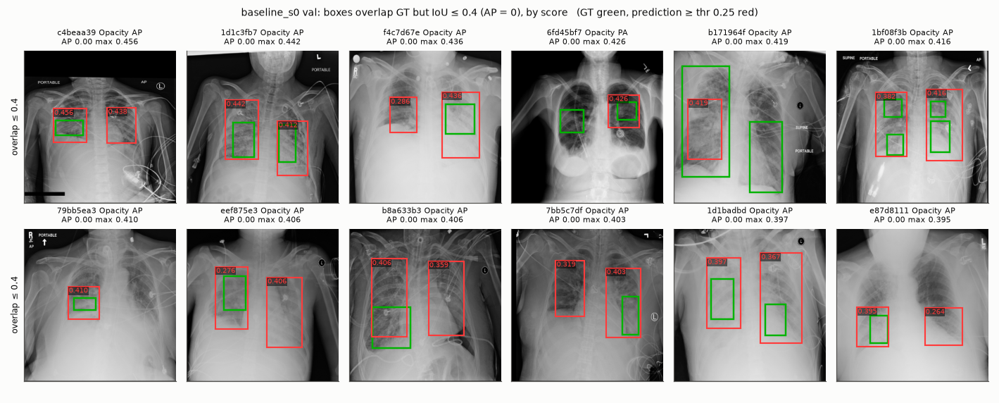

Для контраста — снимки с AP = 1.00:
[`hw1_baseline_s0_good.png`](reports/figures/hw1_baseline_s0_good.png). Распределение image score по классам
и проекциям: [`hw1_baseline_s0_scores.png`](reports/figures/hw1_baseline_s0_scores.png). Около порога 0.25
«Not Normal» сильно перекрывается с «Opacity».

### 6.7 Размеры боксов и калибровка

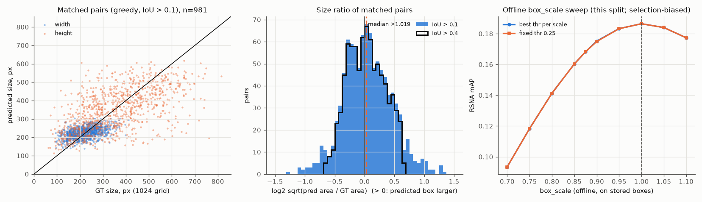

Пар предсказание–GT 981 (жадно по score, IoU > 0.1). Медианное отношение pred/GT:

| | ширина | высота | сторона (√площади) |
|---|---|---|---|
| все пары | ×1.024 | ×1.017 | ×1.019 |
| только IoU > 0.4 (n = 841) | | | ×1.013 |

Предсказание больше GT в 53 % пар. Офлайн-свип `box_scale` (0.70–1.10) на той же val даёт максимум при
**×1.00** (0.1865); ×0.875 даёт 0.1682, ×0.95 — 0.1832.

Вывод: систематического раздувания боксов **нет**. Трюк с сжатием из топ-решений ×0.875 [S7–S9] здесь не
поддержан. Это согласуется с тем, что наш GT single-read, а не пересечение трёх читателей. Свип сделан на
той же val, это диагностика, а не выбор.

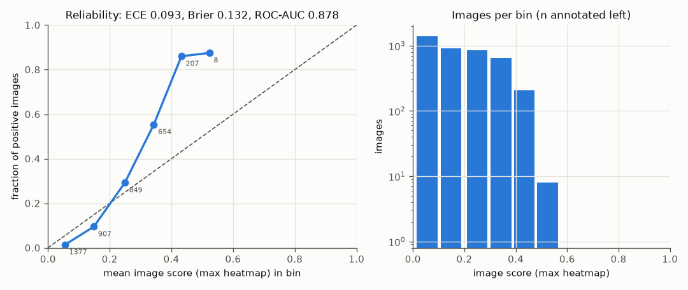

Image score (max heatmap) по построению не вероятность: ECE 0.093 (10 бинов), Brier 0.132. Выше 0.25 score
недоуверенный: при score около 0.43 позитивны около 86 % снимков; в последнем бине только 8 снимков.
Для гейтинга нужен отдельный калиброванный выход.

---

<a id="s7"></a>
## 7. Выводы

**Что получилось.**
- Воспроизводимый пайплайн: данные → закоммиченный групповой сплит → обучение → оценка с CI → анализ ошибок.
  117 тестов, метрика сверена с независимой реализацией.
- CenterNet-lite R18 @256 даёт val mAP 0.1865 [0.172, 0.201] против 0.0347 у лучшего тривиального варианта.
  H1 подтверждена на seed 0, оба звена механизма видны: меньше FP на негативах и лучше локализация на
  позитивах.
- Image-level AUC 0.878 без отдельной классификационной головы.

**Где baseline слаб.**
1. **FP на трудных негативах** («Not Normal») — 48.9 % разрыва.
2. **Пропуски на PA** (sensitivity 0.530) и у пожилых (0.659).
3. **Узкий оптимум порога.** Score не выше 0.56 и плохо откалиброван.
4. **Переобучение после 4-й эпохи** без аугментаций.
5. Возможное использование AP/PA-признаков по пикселям — не исключено.

**Следующая гипотеза (HW2, I1): image-level голова + гейтинг score.**
GAP(C5) → Linear → P(пневмония), обучение multi-task, score бокса × P. Почему именно она:
- она бьёт по крупнейшему источнику потерь (48.9 %);
- oracle gating показывает потолок 0.31–0.35;
- гейтинг — общий элемент топ-решений [S7, S8].

Критическая оговорка: текущий max-heatmap уже работает как image score с AUC 0.878. Поэтому гейтинг поможет,
только если голова разделяет «Not Normal» и «Opacity» лучше, чем heatmap; ожидаемый эффект скромный
(+0.01…0.03 по [`configs/hw2/b_cls.yaml`](configs/hw2/b_cls.yaml)). Абляция `no_gating` (тот же чекпойнт без
умножения) отделит вклад multi-task-признаков от вклада гейтинга.

**Затем (I2): лёгкие аугментации** — hflip, scale ±0.1, translate ±0.05, яркость/контраст/гамма, **без
поворотов**: поворот раздувает осевой бокс. Основание — переобучение после 4-й эпохи (§6.2).
Сжатие боксов (I3) по анализу §6.7 ожидаем нулевым; проверяем его как негативный контроль.

**Ограничения текущего решения.**
- Один сид (s1/s2 в работе) <!-- SEEDS_PENDING -->.
- Val-оценка оптимистична: порог и эпоха выбраны на ней.
- Test ещё не открыт.
- Один источник данных (NIH).
- Шумная single-read разметка, поэтому потолок метрики неизвестен.
- 256 px.
- Результат несопоставим с Kaggle LB.
- MPS не бит-детерминирован.

---

<a id="s8"></a>
## 8. Собственные исследовательские вопросы

| # | Вопрос | Что измеряем | Сравнение | Критерий |
|---|---|---|---|---|
| **RQ1** | Снижает ли image-level гейтинг FP-rate на негативах без потери чувствительности, и даёт ли это прирост mAP больше шума? | Δ val mAP; FP-image rate на негативах (отдельно «Not Normal»); sensitivity при выбранном пороге | `b_cls` против `baseline`, одинаковые сиды, парный бутстрап; плюс абляция `no_gating` | среднее Δ по 3 сидам > 0 **и** > std между сидами, нижняя граница CI > 0 хотя бы в 2 из 3 сидов; FP-rate ↓ при падении sensitivity ≤ 0.02 |
| **RQ2** | Насколько завышается оценка, если делить по `patientId`, а не по NIH-пациенту? | val mAP на «утёкших» снимках (у пациента есть снимок в train) против «чистых» **внутри одной** наивной val | модель, обученная на наивном случайном 70/15/15 сплите (тот же конфиг и сид) | оптимизм = mAP(утёкшие) − mAP(чистые) с бутстрап-CI; считаем утечку существенной, если CI > 0 и разница больше std по сидам |
| **RQ3** | Использует ли модель проекцию AP/PA как shortcut? | FP-rate и sensitivity по view **внутри одного класса** («Not Normal», «Normal»); image AUC внутри каждой проекции против общей | срезы baseline_s{0,1,2}; дополнительно — пороги по проекции, подобранные на одной половине val и проверенные на другой (cross-fit) | shortcut подтверждается, если отношение FP-rate AP/PA внутри «Not Normal» значимо > 1 (бутстрап-CI не содержит 1); раздельные пороги полезны, если cross-fit Δ mAP > 0 с CI > 0 |
| **RQ4** | Каков разброс по сидам и какой минимальный эффект мы вообще можем обнаружить? | std val mAP по 3 сидам; полуширина парного бутстрап-CI | baseline_s0/1/2 | MDE ≈ max(2·std_seed, полуширина CI); меньшие улучшения в HW2 не заявляем как эффекты |
| **RQ5** | Переносится ли сжатие боксов из топ-решений на single-read разметку? | val mAP при `box_scale` ∈ [0.8, 1.3]; медиана pred/GT | `box_scale` подбирается на val, проверяется один раз на test | эффект есть, если test Δ (подобранный против 1.0) > 0 с CI > 0. Прогноз по §6.7 — эффекта нет (оптимум ×1.00) |

RQ1, RQ4 и RQ5 встроены в план HW2 ([`scripts/run_hw2.sh`](scripts/run_hw2.sh)). RQ2 и RQ3 меняют протокол
оценки и требуют отдельного прогона (RQ2) или только анализа существующих предсказаний (RQ3).

---

<a id="s9"></a>
## 9. Источники и заимствования

| что | откуда | что заимствовано | что сделано нами |
|---|---|---|---|
| CenterNet | Zhou, Wang, Krähenbühl, *Objects as Points*, arXiv:1904.07850 (2019); [github.com/xingyizhou/CenterNet](https://github.com/xingyizhou/CenterNet) | Идея anchor-free детекции через heatmap центров. Формула `gaussian_radius` (перенесена дословно, вместе с известной особенностью исходника, см. docstring [`targets.py`](src/rsna/targets.py)). Формулировка focal loss (α = 2, β = 4) и RegL1. Init bias −2.19. Декодирование пиков через 3×3 max-pool | Собственная реализация модели (FPN-lite neck на ResNet), целей, loss, декодирования (+NMS, клиппинг, `box_scale`, гейтинг), тесты round-trip «цели → декодирование» |
| Веса backbone | torchvision `resnet18`, `IMAGENET1K_V1` | предобученные веса | — |
| Определение метрики | Kaggle Evaluation page [S1] (копия в [`data/external/kaggle_evaluation_page.md`](data/external/kaggle_evaluation_page.md)); ответы хоста [S2, S3] | правила метрики | реализация [`metric.py`](src/rsna/metric.py), векторизованный threshold sweep, бутстрап и парный бутстрап с корректной обработкой исключённых снимков |
| Kernel chenyc15 *Mean Average Precision Metric* [S4] | Kaggle | **Код не использован.** Kernel прочитан как справочник по семантике (исключение пар «пусто/пусто», IoU без «+1»); расхождения с официальным текстом разобраны в research_notes §1.4 | Тесты сверяют реализацию с **собственной** наивной реализацией по официальному тексту (`naive_image` в [`tests/test_metric.py`](tests/test_metric.py)), а не с kernel |
| Маппинг RSNA → NIH | RSNA, `pneumonia-challenge-dataset-mappings_2018.json` [S16] | данные маппинга | извлечение `nih_patient`, проверка по DICOM UID, групповой сплит |
| Данные | Kaggle RSNA (2018); неофициальное HF-зеркало `kellly/RSNA-Pneumonia-Detection` (копия архива) | изображения и разметка | проверка целостности (§Quickstart) |
| Описание разметки | Shih et al., *Radiology: AI* 2019 [S6]; пост хоста [S5] | факты о процессе разметки | — |
| Идеи улучшений | разборы 1-го [S7], 2-го [S8], 3-го [S9], 14-го [S10] мест | идеи гейтинга, сжатия боксов, аугментаций без поворота, разрешения; осторожность с AP/PA | **код не заимствован**; каждая идея оформлена как гипотеза с абляцией (HW2) |
| Библиотеки | PyTorch, torchvision, scikit-learn (`StratifiedGroupKFold`, `KMeans`, ROC/PR-AUC), pydicom, Pillow, pandas, matplotlib, MLflow | — | — |

Всё остальное реализовано в этом репозитории: подготовка данных и валидация разметки, групповой
стратифицированный сплит с защитой от перезаписи, тривиальные baseline, обучение и трекинг, оценка со срезами,
декомпозиция ошибки и oracle gating, анализ ошибок, тесты. Полный список источников [S1–S21] с пометками
«проверено / не проверено» — в [`docs/research_notes.md`](docs/research_notes.md).
