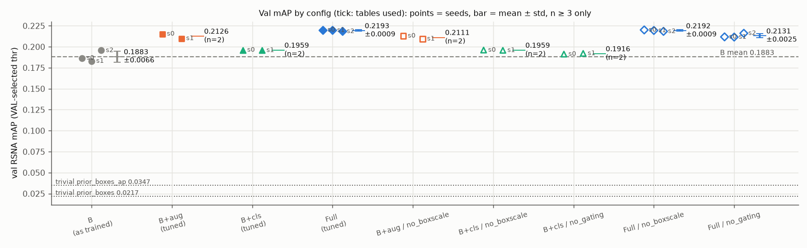
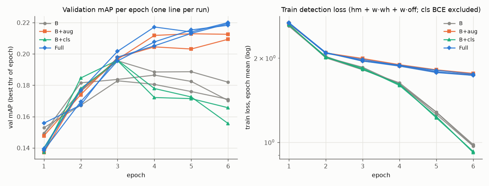
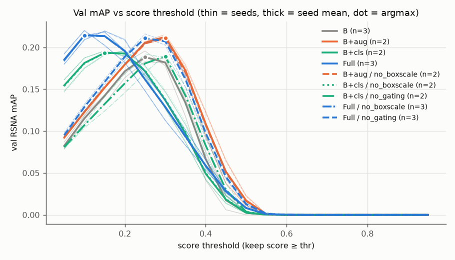
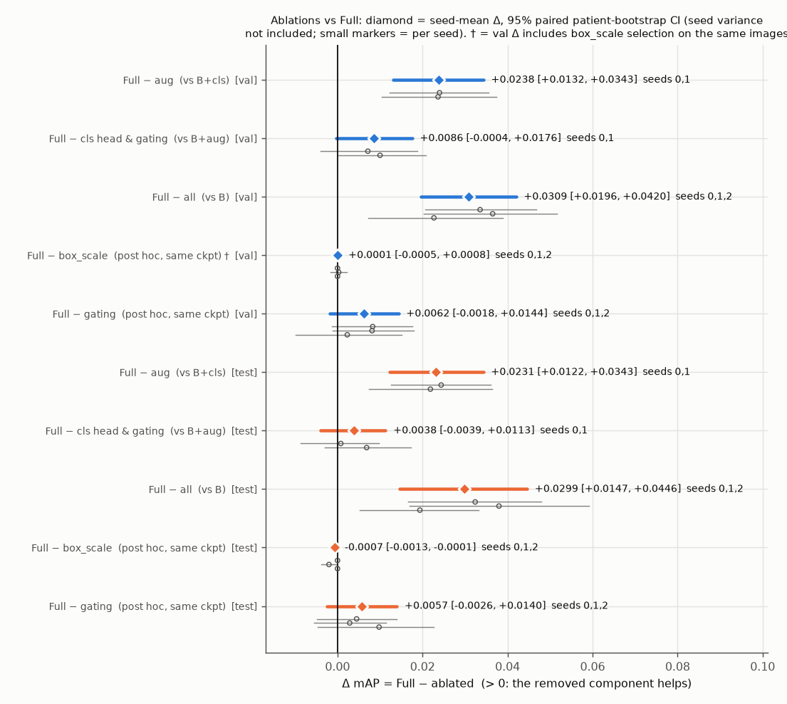
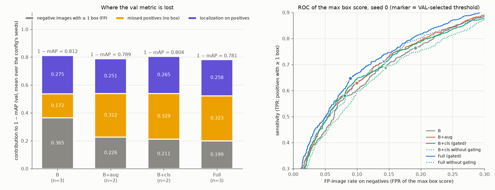

# HW2: улучшения, трекинг экспериментов, абляции

Задача №16, RSNA Pneumonia Detection: детекция очагов затемнения на рентгенограммах грудной клетки.
Работа опирается на baseline из HW1 ([README](../README.md), тег `hw1`). Метрика, сплит, предобработка и правило
решения в HW2 не менялись.

**TL;DR.**

| конфиг | что меняется относительно B | сиды | val mAP (mean ± std) | test mAP (mean ± std) | Δ против B на val [95 % CI]¹ | вердикт по правилу README §5.5 (§5.2) |
|---|---|---|---|---|---|---|
| **B** (baseline HW1) | — | 0, 1, 2 | 0.1883 ± 0.0066 | 0.1908 ± 0.0109 | — | — |
| **B+aug** (I2) | лёгкие аугментации | 0, 1 | 0.2111 ± 0.0025 | 0.2159 ± 0.0005 | **+0.0264** [+0.0134, +0.0387] | **эффект** |
| **B+cls** (I1) | image-level голова + гейтинг score | 0, 1 | 0.1959 ± 0.0002 | 0.1966 ± 0.0056 | +0.0112 [−0.0009, +0.0231] | не обнаружен |
| **Full** (I1 + I2) | обе правки | 0, 1, 2 | **0.2192 ± 0.0009** | **0.2207 ± 0.0032** | **+0.0309** [+0.0196, +0.0420] | **эффект** |

Все числа таблицы — прогоны как обучены (`box_scale` 1.0). ¹ Пары по совпадающему seed. У B+aug и B+cls это сиды 0
и 1, где среднее B равно 0.1847, а не 0.1883. Против среднего B по трём сидам получилось бы +0.0228 и +0.0076,
вердикты те же (§5.2).

- **Сработали аугментации (I2).** Без головы (B+aug − B): +0.026 на val, +0.031 на test. Поверх головы
  (Full − B+cls): +0.024 на val, +0.023 на test. Пик val mAP у моделей с аугментациями приходится на 5–6-ю
  эпоху, а не на 3–4-ю, и он выше. Точечная оценка больше прогноза +0.005…0.02, но 95 % CI [+0.013, +0.039] с
  прогнозом перекрывается.
- **Image-level голова с гейтингом (I1).** Без аугментаций (B+cls − B): +0.011 на val, +0.012 на test. Поверх
  аугментаций (Full − B+aug): +0.009 на val, +0.004 на test. Это ниже заранее заданного порога MDE ≈ 0.013, и CI
  содержит 0, поэтому эффект **не обнаружен**. Гейтинг при этом реально улучшает разделение снимков: AUC
  max-box выше на +0.005…+0.011 на том же чекпойнте, CI > 0 на всех пяти прогонах. Но то же самое дают и
  аугментации, а прирост mAP от гейтинга остаётся малым (§7).
- **Сжатие боксов (I3), проверка, где ждали ноль, эффекта не дало.** Cross-fit оценка на val от −0.002 до
  +0.002. На test Δ = −0.0007, это в 20 раз меньше MDE, и CI определяется одним сидом (§6.2).
- **Финальная проверка на test**, заранее зарегистрированный контраст Full (`tuned`) − B: **+0.0292**
  [+0.0141, +0.0438], по сидам +0.032 / +0.036 / +0.019 (`results/experiments.md`, раздел «Заранее
  зарегистрированный контраст»; §8). Вывод, сделанный на val, подтверждается.

## Содержание

1. [Исходная точка: что показал HW1](#s1)
2. [Гипотезы](#s2)
3. [План экспериментов](#s3)
4. [Трекинг экспериментов](#s4)
5. [Результаты](#s5)
6. [Абляции](#s6)
7. [Механизм: что именно изменилось в ошибках](#s7)
8. [Финальная проверка на test](#s8)
9. [Честность сравнения](#s9)
10. [Выводы](#s10)
11. [Ограничения и что дальше](#s11)
12. [Воспроизведение](#s12)

---

<a id="s1"></a>
## 1. Исходная точка: что показал HW1

Baseline B — CenterNet-lite (ResNet-18 + FPN-lite до stride 8, головы heatmap / size / offset), 256 px,
6 эпох, AdamW, без аугментаций ([`configs/baseline.yaml`](../configs/baseline.yaml)). Val mAP
0.1883 ± 0.0066 по трём сидам.

**Откуда взялись гипотезы.** I1 и I2 сформулированы до анализа ошибок baseline: из семантики метрики, решений
топ-команд Kaggle ([`docs/research_notes.md`](../docs/research_notes.md)) и общих соображений. Они закоммичены в
`meta.hypothesis` конфигов в `eeff34d` (2026-11-14 14:30), когда `baseline_s0` ещё обучался (закончил в 14:49): в
его логе были только val mAP эпох 1–4 (0.149 → 0.186), без падения после пика и без декомпозиции ошибок. Анализ
ошибок HW1 ([README §6](../README.md#s6)) сделан позже, но до любых результатов HW2. Он проверил исходные
предпосылки, и обе подтвердились:

1. **FP-боксы на негативных снимках — крупнейшая статья потерь.** На них приходится 38–49 % разрыва 1 − mAP
   по сидам, прежде всего на классе «No Lung Opacity / Not Normal» (FP-image rate 0.22–0.32 против 0.004–0.023
   у «Normal»). Оракульный гейтинг поднял бы mAP на +0.09…+0.16. Это подтверждает предпосылку **I1**.
2. **Падение val mAP после 3–4-й эпохи на всех трёх сидах**, при том что train loss продолжает падать
   ([README §6.2](../README.md#s6-2)). Аугментаций в baseline не было. Это согласуется с механизмом **I2**.

Третье наблюдение ([README §6.7](../README.md#s6-7)): медиана отношения размеров предсказанного и GT-бокса
≈ 1, оптимум `box_scale` на val ×1.00. Значит, приём «сжать боксы» из топ-решений Kaggle (они обучались на
разметке с консенсусом нескольких врачей) здесь работать не должен. Это **I3**, и мы проверяем его как
контроль: правку, от которой заранее ждём нуля.

**Порог шума.** Два сида одной и той же конфигурации B расходятся до 0.013, причём парный CI по пациентам
у этой пары не содержит 0. Поэтому в HW1 ([README §5.5, RQ4](../README.md#s5-5)) зафиксировано правило:
эффект конфигурации заявляем, только если **(1)** среднее по сидам Δ против B больше **MDE ≈ 0.013** и
**(2)** пулированный по сидам парный бутстрап-CI не содержит 0.

Терминологическая оговорка. Порог 0.013 = 2·SE разности средних по сидам: это уровень значимости около 5 %, а не
MDE в строгом смысле. Истинный эффект ровно такого размера проходит порог примерно в половине случаев. При
мощности 80 % (2.8·SE) надёжно обнаружимый эффект ≈ 0.018 для 2 сидов на сторону и ≈ 0.015 для 3. Название «MDE»
сохранено, чтобы совпадать с README.

---

<a id="s2"></a>
## 2. Гипотезы

**Что когда зафиксировано.** Все формулировки появились до первого HW2-контраста (к 17:55 был известен только
val mAP первой эпохи `full_s0`; его обучение закончилось в 19:01), но в разных коммитах:

| что | коммит, время (2026-11-14) | где |
|---|---|---|
| гипотезы I1, I2, Full: механизм и прогноз | `eeff34d`, 14:30 | `meta.hypothesis` в [`configs/hw2/`](../configs/hw2) |
| критерий механизма RQ1 (sensitivity падает ≤ 0.02), оговорка про AUC heatmap (тогда 0.878 по одному сиду), RQ5 для I3 | `bdb29d2`, 15:06 | README §7, §8 |
| правило решения «Δ > MDE ≈ 0.013 и пулированный CI не содержит 0», AUC 0.881 по 3 сидам, фраза «нижний край прогноза I1 меньше MDE» | `87944cd`, 17:55 (тег `hw1`) | README §5.5, §7, RQ4 |

Последний коммит сделан через 26 минут после старта `full_s0` (17:29), когда закончилась только его первая
эпоха (val 0.1395). Ни одного HW2-контраста к этому моменту не было. Правило 0.013 заменило более раннюю
формулировку из `bdb29d2`: «среднее Δ по 3 сидам > 0 и > std между сидами, нижняя граница CI > 0 хотя бы в 2 из
3 сидов». Старое правило даёт те же вердикты: у B+cls нижние границы CI по сидам −0.0048 и −0.0014, у B+aug и
Full все нижние границы > 0.

Ниже гипотезы в формате «мы считаем, что… поэтому пробуем…». То, чего не было в исходном тексте `meta.hypothesis`,
помечено.

### I1. Image-level голова + гейтинг score ([`b_cls.yaml`](../configs/hw2/b_cls.yaml))

- **Мы считаем, что** основная потеря mAP у baseline — FP-боксы на негативных снимках. По семантике метрики
  негативный снимок хотя бы с одним боксом даёт 0, а негативов 77 %. Классификатор видит снимок целиком и
  может отделять негативы лучше, чем максимум локального heatmap.
- **Поэтому пробуем:** GAP(C5) → Linear → 1 логит, BCE «на снимке есть пневмония», обучение multi-task
  с весом 1.0. На декодировании `score бокса × P(pneumonia)`.
- **Прогноз:** +0.01…0.03 к val mAP.
- **Критерий механизма** (RQ1, `bdb29d2`): FP-image rate на негативах падает, а sensitivity падает не больше
  чем на 0.02.
- **Оговорка** ([README §7](../README.md#s7)). Записана в `bdb29d2`, до прогонов HW2: max-heatmap baseline уже
  работает как image score (тогда AUC 0.878), и гейтинг поможет, только если голова ранжирует снимки лучше.
  В `87944cd` (через 26 минут после старта `full_s0`, до первого HW2-контраста) добавлены AUC 0.881 по трём сидам
  и фраза: нижний край прогноза меньше MDE ≈ 0.013, и такой эффект мы не отличим от шума.
- **Опровержение:** Δ против B ≤ MDE или CI содержит 0.

### I2. Лёгкие аугментации ([`b_aug.yaml`](../configs/hw2/b_aug.yaml))

- **Мы считаем, что** за 6 эпох без аугментаций сеть подгоняется под конкретные положения, размеры и
  экспозицию 18.7 тыс. train-снимков, и это вредит обобщению. *(После регистрации гипотезы HW1 показал падение
  val mAP после 3–4-й эпохи на всех трёх сидах, README §6.2; в исходном тексте этого наблюдения не было.)*
- **Поэтому пробуем:**
  - горизонтальный флип (p = 0.5);
  - масштаб ±10 %, сдвиг ±5 % стороны;
  - яркость, контраст и гамма ±0.1;
  - **без поворота**: поворот раздувает осевой бокс.
- **Прогноз:** +0.005…0.02. Риск: за фиксированные 6 эпох аугментация может замедлить сходимость, и тогда
  эффект будет нулевым или отрицательным.
- **Опровержение:** Δ против B ≤ MDE или CI содержит 0.

### Full = I1 + I2 ([`full.yaml`](../configs/hw2/full.yaml))

- **Мы считаем, что** I1 и I2 бьют по разным источникам ошибки. Гейтинг убирает FP на негативных снимках,
  аугментации улучшают обобщение и детектора, и классификатора. Поэтому их эффекты должны складываться почти
  аддитивно.
- **Поэтому пробуем:** обе правки вместе, остальные ключи как в `baseline.yaml`.
- **Прогноз:** наибольший mAP из четырёх клеток, +0.015…0.04 к B, эффекты близки к аддитивным.
- **Проверка:** план 2×2 (B, B+aug, B+cls, Full) даёт главные эффекты и взаимодействие.
- **Опровержение:** Δ Full против B ≤ MDE или CI содержит 0.

### I3. Сжатие / растяжение боксов (post hoc, контроль)

- **Мы считаем, что** на single-read разметке приём из топ-решений не работает: по §6.7 HW1 оптимум ×1.00.
- **Поэтому пробуем:** подобрать `box_scale` на val на двусторонней сетке 0.80…1.30 (шаг 0.025) у каждого
  чекпойнта. Несмещённая оценка — cross-fit: масштаб выбираем на одной половине val, меряем на другой
  (половины не пересекаются по пациентам). Финальная оценка — test.
- **Прогноз:** эффект ≈ 0 (RQ5).
- **Опровержение** (RQ5): test Δ (подобранный против ×1.0) > 0 с CI > 0.

---

<a id="s3"></a>
## 3. План экспериментов

**План 2×2** (аугментации × голова с гейтингом) на тех же данных, с тем же числом шагов и тем же
расписанием LR. Конфиги отличаются от `baseline.yaml` **только** целевыми ключами; это проверяет
[`tests/test_configs.py`](../tests/test_configs.py).

| клетка | конфиг | изменённые ключи | сиды |
|---|---|---|---|
| B | `configs/baseline.yaml` (HW1) | — | 0, 1, 2 |
| B+aug | `configs/hw2/b_aug.yaml` | `aug.hflip`, `aug.affine`, `aug.intensity`: false → true; `aug.rotate`: 5 → 0 | 0, 1 |
| B+cls | `configs/hw2/b_cls.yaml` | `model.cls_head`: false → true; `decode.score_mode`: heatmap → heatmap_x_cls | 0, 1 |
| Full | `configs/hw2/full.yaml` | все ключи B+aug и B+cls | 0, 1, 2 |

Почему у B+aug и B+cls по 2 сида, а не по 3. Прогон занимает 33–109 минут обучения на ноутбуке (MacBook Air M4,
MPS; разброс из-за нагрузки, §4), очередь из 7 прогонов шла 7.5 часа. Три сида получили клетки главного
контраста Full − B. Цена такого выбора: порог 2·SE для контрастов с 2 сидами ≈ 0.013 против ≈ 0.011 при 3.

**Post-hoc варианты.** Они не требуют переобучения: те же чекпойнты, другое декодирование
([`src/rsna/posthoc.py`](../src/rsna/posthoc.py)). Модель сохраняет «сырые» score heatmap и `cls_prob`,
поэтому любой вариант воспроизводится из таблицы предсказаний.

| вариант | что делает | где используется |
|---|---|---|
| `tuned` | `box_scale`, подобранный на val (I3) | основные строки `results/experiments.md`; заранее зарегистрированный test-контраст Full − B (§8); абляции Full − gating и Full − box_scale |
| `no_gating` | тот же чекпойнт, score = heatmap без умножения на P (свой `box_scale` и порог на val) | B+cls, Full: абляция гейтинга |
| `no_boxscale` | тот же чекпойнт с `box_scale` 1.0 (совпадает с «как обучен») | B+cls, Full |

**Все сравнения конфигов друг с другом** (таблица решений §5.2, абляции конфигов §6, план 2×2 §6.1) идут по
прогонам **как обучены**, `box_scale` 1.0 с обеих сторон. Подбор масштаба на val в них не участвует.

**Порядок очереди** ([`scripts/run_hw2.sh`](../scripts/run_hw2.sh)): full s0 → b_cls s0 → b_aug s0 →
full s1 → b_cls s1 → b_aug s1 → full s2. Самые информативные прогоны шли первыми, чтобы при сбое остался
полный 2×2 хотя бы на одном сиде. Скрипт возобновляемый: шаг пропускается, если его выход уже есть.

---

<a id="s4"></a>
## 4. Трекинг экспериментов

Каждый прогон фиксируется в пяти местах, и они согласованы между собой: столбец «matches a results dir» в
[`results/experiments.md`](../results/experiments.md#mlflow).

| где | что лежит |
|---|---|
| [`results/experiments.csv`](../results/experiments.csv) | реестр: run, дата, git sha, конфиг, overrides, seed, **гипотеза** (из `meta.hypothesis`), лучшая эпоха, val mAP, порог, AUC, минуты обучения |
| [`mlflow.db`](../mlflow.db) (MLflow 3.18, sqlite) | 10 прогонов: **все** ключи конфига как params (51 у прогонов HW2, 49 у `baseline_s*`: в конфиге baseline нет `meta.parent` и `meta.changes`), метрики по эпохам и шагам, теги `git_sha`, `seed`, `device`. Файловые артефакты MLflow (`mlruns/`) не версионируются: на клоне вкладка Artifacts пуста, те же файлы лежат в `results/<run>/` |
| `results/<run>/` | `config.yaml` (фактический конфиг), `meta.json` (sha, устройство, версии, `mlflow_run_id`), `history.csv` (метрики по эпохам), `curves.png`, `threshold.png`, предсказания val/test (CSV), `val_metrics.{json,md}` и `test_metrics.{json,md}` со срезами и декомпозицией ошибки; `posthoc/<variant>/` с `variant.json` |
| [`results/experiments.md`](../results/experiments.md) | сводный отчёт, генерируется `python -m rsna.report` из всего вышеперечисленного: ledger, сводка по конфигам, таблица решений, абляции, 2×2, cross-fit I3, сверка с MLflow, рисунки |
| [`results/logs/`](../results/logs) | полные логи очереди (`run_hw2_*.log`) и обучения (`<run>.train.log`); копии из неверсионируемого `logs/` с относительными путями |

### Таблица экспериментов

Val — порог score выбран на val; test — тот же порог. Все числа — чекпойнт как обучен (`box_scale` 1.0). У
`full_s1` подобранный на val ×0.975 даёт test 0.2204 (§8); у остальных Full выбран ×1.0, и числа совпадают.
«sha» — коммит, на котором шло обучение.

| run | конфиг | гипотеза | seed | sha | лучшая эпоха | val mAP [95 % CI] | test mAP | AUC `image_score`² | обучение, мин |
|---|---|---|---|---|---|---|---|---|---|
| baseline_s0 | B | H1 (HW1) | 0 | `7d837c7`¹ | 4 | 0.1865 [0.163, 0.211] | 0.1846 | 0.878 | 108.6 |
| baseline_s1 | B | H1 (HW1) | 1 | `1f61980` | 3 | 0.1829 [0.160, 0.205] | 0.1845 | 0.881 | 69.0 |
| baseline_s2 | B | H1 (HW1) | 2 | `bdb29d2` | 3 | 0.1956 [0.169, 0.221] | 0.2034 | 0.884 | 79.6 |
| b_aug_s0 | B+aug | I2 | 0 | `87944cd` | 5 | 0.2129 [0.185, 0.241] | 0.2162 | 0.886 | 58.7 |
| b_aug_s1 | B+aug | I2 | 1 | `87944cd` | 6 | 0.2093 [0.180, 0.240] | 0.2156 | 0.887 | 50.5 |
| b_cls_s0 | B+cls | I1 | 0 | `87944cd` | 3 | 0.1960 [0.167, 0.224] | 0.1926 | 0.884 | 74.7 |
| b_cls_s1 | B+cls | I1 | 1 | `87944cd` | 3 | 0.1957 [0.167, 0.223] | 0.2006 | 0.887 | 33.4 |
| full_s0 | Full | I1 + I2 | 0 | `bdb29d2`³ | 6 | 0.2200 [0.192, 0.247] | 0.2170 | 0.893 | 85.5 |
| full_s1 | Full | I1 + I2 | 1 | `87944cd` | 6 | 0.2194 [0.190, 0.248] | 0.2224 | 0.894 | 59.2 |
| full_s2 | Full | I1 + I2 | 2 | `87944cd` | 6 | 0.2183 [0.187, 0.249] | 0.2228 | 0.895 | 50.3 |

¹ Коммит до переписывания авторства; его дерево совпадает с `98baa08` ([README, Воспроизводимость](../README.md#repro)).
² Поле `image_roc_auc` из `val_metrics.json`. У моделей с головой (B+cls, Full) это AUC головы `cls_prob`, у
остальных — AUC максимума heatmap. AUC максимального score бокса для всех единиц — §5.1 и §7.
³ `full_s0` стартовал до коммита `87944cd`. Разница `bdb29d2..87944cd` затрагивает только бутстрап
(`metric.py`), `evaluate.py`, `posthoc.py`, `report.py`, отчёт `prepare.py` и `run_baseline.sh`. Путь обучения
(`train.py`, `model.py`, `targets.py`, `augment.py`, `decode.py`, `dataset.py`) не менялся. Все метрики
пересчитаны текущим кодом.

Времена обучения плавают от 33 до 109 минут на одинаковый объём работы. Причина — нагрузка на ноутбук: во время
очереди системе не хватало памяти, скорость падала с ≈3.5 до ≈0.7 it/s. На результат это не влияет: число шагов
фиксировано (7002), меняется только время.

---

<a id="s5"></a>
## 5. Результаты

### 5.1 Сводка по конфигам (val, как обучены — `box_scale` 1.0; mean ± std по сидам)

| конфиг | val mAP | порог | AUC max-box | sensitivity | specificity | FP-image rate | mAP на позитивах |
|---|---|---|---|---|---|---|---|
| B | 0.1883 ± 0.0066 | 0.25 | 0.881 ± 0.003 | 0.732 ± 0.047 | 0.832 ± 0.034 | 0.168 ± 0.034 | 0.297 ± 0.013 |
| B+aug | 0.2111 ± 0.0025 | 0.30 | 0.887 ± 0.000 | 0.598 ± 0.044 | 0.915 ± 0.021 | 0.085 ± 0.021 | 0.273 ± 0.018 |
| B+cls | 0.1959 ± 0.0002 | 0.17 ± 0.04 | 0.886 ± 0.004 | 0.583 ± 0.003 | 0.922 ± 0.004 | 0.078 ± 0.004 | 0.248 ± 0.003 |
| Full | 0.2192 ± 0.0009 | 0.13 ± 0.03 | 0.894 ± 0.001 | 0.597 ± 0.043 | 0.927 ± 0.015 | 0.073 ± 0.015 | 0.274 ± 0.012 |

«AUC max-box» — AUC максимального score бокса снимка после всех преобразований единицы (у B+cls и Full — с
гейтингом). Sensitivity, specificity и FP-image rate — при val-пороге каждой единицы, поэтому их нельзя
сравнивать между конфигами напрямую (§7). Полная таблица со всеми вариантами и test-столбцом —
[`results/experiments.md`](../results/experiments.md). Там основные строки — вариант `tuned` (например, B+aug
0.2126 ± 0.0038), а числа этой таблицы — строки `/ no_boxscale` (для B — сама строка B). CSV —
[`results/experiments_summary.csv`](../results/experiments_summary.csv).



*Точки — сиды, планка — mean ± std (только при n ≥ 3), пунктир — среднее B и тривиальные ориентиры.*

### 5.2 Решение по заранее заданному правилу

Сравниваются таблицы как обучены, пары по совпадающему seed, общий ресэмпл пациентов для всех сидов. CI отражает
шум выборки пациентов, шум обучения учтён через MDE.

| контраст | сиды | Δ mAP (среднее по сидам) | 95 % CI | Δ по сидам | Δ > MDE 0.013 | вердикт |
|---|---|---|---|---|---|---|
| B+aug − B | 0, 1 | **+0.0264** | [+0.0134, +0.0387] | +0.0264; +0.0265 | да | **эффект** |
| B+cls − B | 0, 1 | +0.0112 | [−0.0009, +0.0231] | +0.0095; +0.0129 | нет | не обнаружен |
| Full − B | 0, 1, 2 | **+0.0309** | [+0.0196, +0.0420] | +0.0335; +0.0365; +0.0227 | да | **эффект** |

**Проверка чувствительности к выбору сидов.** Пары по seed берут из B только сиды 0 и 1. Это два худших
прогона B (0.1865 и 0.1829 против 0.1956 у seed 2). Если сравнивать с B по трём сидам непарно, получится
B+aug − B = +0.0228 на val (+0.0251 на test) и B+cls − B = +0.0076 (+0.0058). Вердикты не меняются: B+aug выше
MDE в обоих вариантах, B+cls ниже. Full − B считается по всем трём сидам, его это не касается.

Те же три контраста на test, только описательно (в решении test не участвует): B+aug − B = +0.0314
[+0.0151, +0.0468], B+cls − B = +0.0121 [−0.0018, +0.0254], Full − B = +0.0299 [+0.0147, +0.0446].

Источник — раздел «Решение по правилу §5.5» в [`results/experiments.md`](../results/experiments.md), CSV —
[`results/experiments_decision.csv`](../results/experiments_decision.csv). Попарные сравнения по каждому
сиду: [`results/comparisons/`](../results/comparisons).

### 5.3 Кривые обучения



*Слева — val mAP по эпохам (линия = прогон), справа — train detection loss (без BCE головы), среднее по
батчам эпохи в том виде, в каком сеть их видела: у аугментированных прогонов батчи аугментированы.*

- **Без аугментаций (B, B+cls)** val mAP достигает пика на 3–4-й эпохе (baseline_s0 на 4-й, остальные на 3-й) и
  затем падает. Train loss к 6-й эпохе проваливается до ≈0.95.
- **С аугментациями (B+aug, Full)** val mAP растёт или держится до 5–6-й эпохи. У всех трёх Full и у b_aug_s1
  пик приходится на последнюю эпоху, когда LR уже снижен до ≈0.
- **Как это читать.** Падение val у B после пика в итоговую метрику не входит: эпоху выбирает val, это и есть
  early stopping. Поэтому выигрыш I2 — это **более высокий пик**, а не избегание поздней деградации.
- **Train loss на выбранных чекпойнтах в близком диапазоне:** 1.61–1.86 у B и B+cls против 1.73–1.78 у B+aug и
  Full ([`results/hw2_summary/mechanism.md`](../results/hw2_summary/mechanism.md), §3). Но у B+aug и Full он
  посчитан на аугментированных батчах и с loss на чистых батчах несопоставим. Вывода «та же степень подгонки под
  train, значит, лучше обобщают» отсюда сделать нельзя.
- **Чего нельзя утверждать.** Разница train loss на 6-й эпохе (≈1.75 против ≈0.95) отчасти возникает по
  построению: loss считается на аугментированных батчах. Val loss и loss на неаугментированном train мы не
  логировали, поэтому разрыв train/val не измерен. И раз у Full пик на последней эпохе, «переобучение снято»
  нельзя отличить от «сходимость медленнее и обрезана на 6 эпохах».

### 5.4 Чувствительность к порогу



У моделей с гейтингом оптимальный порог сдвигается вниз: argmax среднего по сидам 0.10–0.15 против 0.25–0.30,
по отдельным прогонам 0.10–0.20 против 0.25–0.30. Причина в том, что score умножается на P < 1. Ширину плато в
единицах порога нельзя сравнивать между моделями с гейтингом и без: у них разные шкалы score. У всех
конфигураций плато узкое: mAP в пределах 0.005 от максимума держится на 1–2 точках сетки с шагом 0.05. Слабость
HW1 «узкое плато порога» осталась.

---

<a id="s6"></a>
## 6. Абляции

Все абляции — парные разности Δ = mAP(Full) − mAP(Full без компонента) на одних и тех же снимках, с
бутстрапом по пациентам. Для конфигов пары составляются по совпадающему seed, обе стороны как обучены. Post-hoc
варианты — тот же чекпойнт против основной единицы Full (`tuned`). Такая абляция чище: в ней нет шума обучения.

| абляция (Δ = Full − без компонента) | сиды | val Δ [95 % CI] | test Δ [95 % CI]‡ | вывод |
|---|---|---|---|---|
| **убрать аугментации** (Full против B+cls) | 0, 1 | **+0.0238** [+0.0132, +0.0343] | **+0.0231** [+0.0122, +0.0343] | аугментации — главный источник прироста |
| **убрать голову и гейтинг** (Full против B+aug) | 0, 1 | +0.0086 [−0.0004, +0.0176] | +0.0038 [−0.0039, +0.0113] | вклад I1 поверх аугментаций не обнаружен |
| **убрать только гейтинг** (тот же чекпойнт, score = heatmap) | 0, 1, 2 | +0.0062 [−0.0018, +0.0144] | +0.0057 [−0.0026, +0.0140] | плюс на всех сидах, но ниже MDE и CI содержит 0 |
| **убрать подбор `box_scale`** (тот же чекпойнт, ×1.0) | 0, 1, 2 | +0.0001 [−0.0005, +0.0008]† | −0.0007 [−0.0013, −0.0001] | I3 = 0: \|Δ\| ничтожна; на test CI определяет один s1, у s0 и s2 выбран ×1.0 (Δ ≡ 0) |
| **убрать всё** (Full против B) | 0, 1, 2 | +0.0309 [+0.0196, +0.0420] | +0.0299 [+0.0147, +0.0446] | итоговый прирост |

† На val эта Δ включает подбор `box_scale` на тех же снимках и поэтому смещена в пользу Full. Несмещённые оценки
— cross-fit (§6.2) и test.
‡ Заранее зарегистрирован только test-контраст Full (`tuned`) − B (§8). Остальные test-строки описательные и ни на
какой выбор не влияют. Их выдаёт `rsna.report --with-test`, вызов которого стоит в `run_hw2.sh` с `eeff34d`, но
определение конфиг-контрастов после открытия test изменено: вместо Full `tuned` теперь «как обучены» с обеих сторон
(§8). Поэтому строка «убрать всё» (+0.0299) отличается от зарегистрированного контраста (+0.0292).



*Ромб — среднее по сидам, толстая линия — 95 % CI (общий ресэмпл пациентов), кружки — отдельные сиды.*

### 6.1 План 2×2: главные эффекты и взаимодействие (val, сиды 0 и 1, все клетки как обучены)

| эффект | оценка | 95 % CI | P(≤ 0) |
|---|---|---|---|
| главный эффект аугментаций | **+0.0251** | [+0.0160, +0.0338] | 0.000 |
| главный эффект головы и гейтинга | +0.0099 | [+0.0021, +0.0176] | 0.005 |
| взаимодействие aug × cls | −0.0026 | [−0.0167, +0.0121] | 0.624 |

- **Аугментации:** ≈ +0.025, одинаково с головой и без неё (+0.0264 без головы, +0.0238 с ней).
- **Голова и гейтинг:** главный эффект +0.0099, CI не содержит 0, но оценка меньше заранее заданного
  MDE 0.013, поэтому эффектом её не называем.
  - **Оговорка.** Главный эффект усредняет 8 прогонов (по 2 сида в четырёх клетках). Его SE по сидам ≈ σ/√2
    ≈ 0.0047, и по формуле RQ4 (2·SE) порог для него был бы ≈ 0.009. Значит, +0.0099 — на границе. Вердикт по
    I1 от этого не меняется: оба парных контраста I1 не проходят и по CI (B+cls − B: +0.0112 [−0.0009,
    +0.0231]; Full − B+aug: +0.0086 [−0.0004, +0.0176]).
  - **Честная формулировка:** «вероятно, небольшой плюс порядка +0.005…0.01, но заранее заданный критерий
    он не проходит».
  - **Доводы за то, что плюс реален:** post-hoc «Full − gating» положителен на всех трёх сидах и на val, и на
    test (тот же чекпойнт, шума обучения нет), а AUC с гейтингом выше на всех пяти прогонах (§7).
  - **Довод против:** на test поверх аугментаций осталось +0.004.
- **Взаимодействие:** ≈ 0, эффекты совместимы с аддитивностью. Но CI шириной ±0.015 не исключает взаимодействия
  того же порядка, что и сам эффект головы.

### 6.2 I3: cross-fit оценка `box_scale` на val

Масштаб и порог выбираются на одной половине val (половины не пересекаются по пациентам), выигрыш против
×1.0 меряется на другой. Это оценка без смещения от выбора.

| прогон | выбрано на всей val | выигрыш на val (≥ 0 по построению) | cross-fit выигрыш | масштабы по фолдам |
|---|---|---|---|---|
| B+aug s0 | ×0.95 | +0.0024 | +0.0022 | 0.95, 0.95 |
| B+aug s1 | ×0.975 | +0.0005 | −0.0018 | 1.025, 0.95 |
| B+cls s0 | ×1.05 | +0.0001 | −0.0016 | 1.075, 1.0 |
| B+cls s1 | ×1.0 | 0 | −0.0009 | 1.025, 1.0 |
| Full s0 | ×1.0 | 0 | 0.0000 | 1.0, 1.0 |
| Full s1 | ×0.975 | +0.0003 | −0.0001 | 1.0, 0.975 |
| Full s2 | ×1.0 | 0 | −0.0021 | 1.025, 0.975 |

- **Выбранный масштаб нестабилен:** между половинами val он прыгает от 0.95 до 1.075.
- **Подбор на val создаёт видимость выигрыша:** 0…+0.0024 на val (у трёх прогонов из семи ровно 0). Cross-fit
  убирает это смещение: выигрыш в пределах ±0.002, в среднем −0.0006.
- **На test:** у Full s1 выбранный ×0.975 дал −0.0020 [−0.0038, −0.0003]. У s0 и s2 выбран ×1.0, и их
  предсказания совпадают с «как обучен», так что Δ ≡ 0. Пулированный CI [−0.0013, −0.0001] не содержит 0
  только из-за s1. Эффектом мы это не называем: вред −0.0007 практически ничтожен (в 20 раз меньше MDE) и целиком
  определяется одним сидом, у которого подбор сдвинул масштаб на 0.025. Заранее зарегистрированный критерий RQ5
  проверяет только выигрыш (test Δ > 0 с CI > 0), и он не выполнен.

Прогноз «эффекта нет» подтверждён: критерий RQ5 (test Δ > 0 с CI > 0) не выполнен.

### 6.3 Краткое резюме абляций

1. **Аугментации** — единственный компонент с эффектом выше порога. Без них Full теряет 0.024 на val и 0.023 на
   test, и на val эффект одинаков с головой и без неё (+0.026 и +0.024).
2. **Голова + гейтинг.** Поверх аугментаций дают +0.009 на val и +0.004 на test, CI содержит 0. Сам гейтинг на
   том же чекпойнте даёт в среднем +0.006 (по сидам +0.002…+0.008 на val и +0.003…+0.010 на test, плюс на всех
   сидах), но это ниже MDE, и CI содержит 0.
3. **Подбор `box_scale`** — ноль. Контроль показал две вещи. Cross-fit снимает оптимизм от подбора на val. А
   парный CI без порога MDE дал бы ложный «эффект» (s1 на test).
4. **Итог Full − B** = +0.031 на val, +0.030 на test (как обучены). Большая часть (≈ 0.024 из 0.031) — от
   аугментаций.

---

<a id="s7"></a>
## 7. Механизм: что именно изменилось в ошибках



*Слева — точное аддитивное разложение 1 − mAP (README §5.6), среднее по сидам конфига. «Негативы с боксом» —
каждый негативный снимок хотя бы с одним боксом над порогом считается один раз. Справа — ROC максимального score
бокса (TPR = sensitivity, FPR = FP-image rate) для seed 0 каждого конфига и для варианта без гейтинга; маркер —
рабочая точка при val-пороге. Рисунок и таблицу строит [`scripts/plot_hw2_errors.py`](../scripts/plot_hw2_errors.py),
числа ниже — [`results/hw2_summary/error_decomposition.md`](../results/hw2_summary/error_decomposition.md) и
[`results/hw2_summary/mechanism.md`](../results/hw2_summary/mechanism.md) (строит
[`scripts/analyze_hw2_mechanism.py`](../scripts/analyze_hw2_mechanism.py)); оба скрипта вызываются из
`run_hw2.sh`.*

**Сдвиги слагаемых 1 − mAP против B того же seed** (val):

| контраст | сиды | негативы с боксом (FP) | пропущенные позитивы | локализация на позитивах | Δ mAP |
|---|---|---|---|---|---|
| B+aug − B | 0, 1 | −0.167 | +0.166 | −0.025 | +0.0264 |
| B+cls − B | 0, 1 | −0.182 | +0.182 | −0.012 | +0.0112 |
| Full − B | 0, 1, 2 | −0.166 | +0.152 | −0.017 | +0.0309 |

**Главное наблюдение: рабочая точка.** Все три улучшенные конфигурации работают в более консервативной точке.
Потери на FP-снимках падают на 0.17–0.18, а потери на пропущенных позитивах на столько же растут. Чистый выигрыш —
разность двух больших сдвигов плюс небольшой сдвиг локализации. Порог у каждой единицы выбран на val как
оптимальный по mAP, так что это не «неудачный порог». Метрика RSNA сильно штрафует любой бокс на негативном
снимке, и чем лучше модель ранжирует снимки, тем консервативнее её оптимальная точка. Поэтому сравнивать
конфигурации по FP-rate или sensitivity по отдельности нельзя: честное сравнение — по ROC (AUC) или при равном
FP-rate.

**Сравнение при равном FP-rate** (val, [`mechanism.md`](../results/hw2_summary/mechanism.md) §1–2):

| что сравниваем (A против B) | ΔAUC max-box [95 % CI] по прогонам | Δ sensitivity при FP-rate точки A | при FP-rate точки B |
|---|---|---|---|
| гейтинг: тот же чекпойнт с гейтингом (A) против без (B), 5 прогонов | +0.0052…+0.0110, CI > 0 у всех пяти | +0.028…+0.056 | +0.018…+0.032 |
| аугментации: B+aug против B, Full против B+cls (тот же seed), 4 пары | +0.0053…+0.0097, CI > 0 у всех четырёх | +0.020…+0.028 | +0.001…+0.026 |

Sensitivity при заданном FP-rate берётся с ROC так, как её дал бы жёсткий порог (нижняя точка вертикального
отрезка ROC), то есть в той же конвенции, что и собственная sensitivity единицы. У гейтинга прирост положителен в
обеих рабочих точках. У аугментаций в паре Full / B+cls s1, где рабочие точки почти совпадают, он ≈ 0.

**I1: гейтинг улучшает ранжирование, но прирост mAP мал.**
- **Ранжирование улучшилось, хоть и слабо.** AUC с гейтингом выше на +0.005…+0.011 на том же чекпойнте; при равном
  FP-rate sensitivity выше на +0.018…+0.056 в зависимости от рабочей точки. Оговорка HW1 «голова должна ранжировать лучше heatmap»
  выполнена, но с небольшим запасом.
- **Почему критерий RQ1 формально не выполнен.** В зарегистрированном сравнении B+cls − B FP-rate падает
  (0.191 → 0.081 и 0.184 → 0.074), но sensitivity падает на 0.17–0.18 при допуске 0.02. На том же чекпойнте
  (с гейтингом против без) sensitivity падает на 0.07–0.16 (у обоих B+cls и у Full s0, s2). Но точки каждого из
  этих сравнений стоят при разных val-оптимальных порогах (0.25–0.30 без гейтинга, 0.10–0.20 с ним). Падение — следствие более консервативного оптимума, а не того, что гейтинг
  «меняет FP на пропуски»: при равном FP он sensitivity повышает. У Full s1 гейтинг улучшает обе координаты
  (FP 0.067 против 0.076, sensitivity 0.576 против 0.563).
- **Почему тогда так мало mAP.** Улучшение ROC от гейтинга того же порядка, что и от аугментаций, а прирост mAP
  у аугментаций больше (+0.026 против +0.011). В декомпозиции разница приходится на слагаемое локализации
  (−0.025 против −0.012). Но это слагаемое зависит и от рабочей точки. **[не проверено]**: разложить, сколько
  дают аугментации качеству боксов при равном FP, мы не успели.
- **PA-проекция** ([`mechanism.md`](../results/hw2_summary/mechanism.md) §4). У B+cls гейтинг снижает PA-mAP:
  −0.034 [−0.061, −0.008] на s0 и −0.019 [−0.041, +0.002] на s1. У Full знак разный (+0.003, +0.008, −0.019), и все
  CI содержат 0. На AP гейтинг везде даёт плюс (+0.005…+0.010). Позитивов на PA мало (202 из 2 176 против 698 из
  1 826 на AP). Внутри проекции AUC max-box с гейтингом не ниже, чем без него (PA 0.863–0.880 против 0.861–0.875;
  AP 0.831–0.851 против 0.811–0.837), то есть ранжирует голова внутри проекции не хуже heatmap. Но средний P у
  PA-позитивов 0.31–0.38, ниже, чем у AP-негативов (0.20–0.35), и при одном глобальном пороге PA-боксы гаснут. Метаданных голова не видит, то есть проекцию она узнаёт по пикселям. Это пиксельный shortcut из RQ3,
  хотя он может быть и законным: на PA очаги в среднем менее заметны. Разделить эти объяснения может только тест
  с маскированием из RQ3. Отдельный порог по проекции мог бы снять проблему, но это новый выбор на val, которого
  в плане не было.

**I2: что сделали аугментации.**
- **Пик выше и позже** (§5.3): лучшая эпоха 5–6 вместо 3–4.
- **Ранжирование лучше:** ΔAUC +0.005…+0.010 (CI > 0 у всех четырёх пар). Sensitivity при FP-rate аугментированной
  точки выше на 0.020–0.028, при FP-rate точки без аугментаций — на 0.001–0.026. Растёт и AUC головы (0.885 → 0.894 у Full против B+cls). Это согласуется с прогнозом конфига
  «классификатор от аугментаций выигрывает», но разница на двух сидах — слабое свидетельство.
- **Двукратное падение FP на негативах (0.168 → 0.085) — в основном сдвиг рабочей точки, а не механизм.** Порог на
  val вырос с 0.25 до 0.30, и sensitivity упала так же, как при гейтинге (0.732 → 0.598). При FP-rate, как у B,
  B+aug даёт sensitivity 0.781 против 0.763 (s0). То же касается FP на «Not Normal» (0.22–0.32 у B против
  0.12–0.17 у B+aug): числа взяты при разных порогах.
- **Разброс по сидам на val меньше:** std 0.0025 у B+aug и 0.0009 у Full против 0.0066 у B. Объяснить это
  переобучением данные не позволяют. B+cls переобучается так же, как B (пик на 3-й эпохе), а std у него самый
  маленький, 0.0002. Разброс B создаёт в основном seed 2. По 2–3 сидам о механизме судить нельзя.

**Локализация.** По уровню слагаемое локализации у всех четырёх клеток близко (0.25–0.28), но по парным сдвигам
против B оно уменьшилось на 0.012–0.025. У B+aug и B+cls это практически весь чистый выигрыш: сдвиги FP и
пропусков гасят друг друга с точностью до 0.001. У Full — около половины. Часть этого снижения механическая: в
более консервативной точке частично найденные позитивы переходят из «локализации» в «пропуски». Сколько остаётся
на долю реального улучшения боксов, мы не проверили. Целенаправленно в качество боксов ни одна правка не била; это
следующая точка приложения сил (§11).

---

<a id="s8"></a>
## 8. Финальная проверка на test

Test (4 004 снимка, 1 725 NIH-пациентов, не пересекается с train и val) открыт **один раз**, 2026-11-15 в 11:07.
К этому моменту все прогоны, val-метрики всех прогонов и вариантов и все парные val-сравнения
(`results/comparisons/*__val.*`) были готовы, а правило решения (README §5.5) закоммичено с тегом `hw1`. Команда: `EVAL_TEST=1 bash scripts/run_hw2.sh`,
лог [`results/logs/run_hw2_20261115_110708.log`](../results/logs/run_hw2_20261115_110708.log). Порог, `box_scale`
и `score_mode` каждой единицы взяты с val. Ничего не выбиралось по test.

**Что было сделано после открытия test, полностью:**
- **Таблица решений (§5.2) оформлена кодом позже.** Функции `decision_rows` и `decision_verdict` в
  `src/rsna/report.py` дописаны в 11:10, когда test уже считался. Они механически применяют правило README §5.5 к
  val-таблицам «как обучены». Сами val-контрасты (`*__vs__baseline_s*__val.*`) существовали с ночи. Описательные
  test-строки этой таблицы (B+aug − B = +0.0314, B+cls − B = +0.0121) добавлены ещё позже и впервые появились в
  перезапуске [11:37](../results/logs/run_hw2_20261115_113727.log). До открытия test таких test-контрастов в коде
  не было.
- **Перевод абляций на «как обучены».** По итогам ревью сравнения конфиг-против-конфига в абляциях переведены с
  варианта `tuned` на «как обучены», как и в таблице решений и 2×2. Изменились все три конфиг-контраста, не
  больше чем на 0.0013 (val / test): Full − B+aug было +0.0073 / +0.0030, стало +0.0086 / +0.0038; Full − B+cls
  было +0.0239 / +0.0224, стало +0.0238 / +0.0231; Full − B было +0.0310† / +0.0292, стало +0.0309 / +0.0299.
  Вердикты те же. Заранее зарегистрированный контраст Full (`tuned`) − B по-прежнему генерируется отдельной
  строкой (`results/experiments.md`, раздел «Заранее зарегистрированный контраст») и равен +0.0292.
- **Исправления по контрольной проверке:** в анализе механизма выровнены конвенции (sensitivity при заданном
  FP-rate, одинаковый `box_scale` у сторон контраста гейтинга), добавлены AUC и средний P по проекциям, а логи
  закоммичены в `results/logs/`.
- **Добавлены анализы §7** (`plot_hw2_errors.py`, `analyze_hw2_mechanism.py`). Они используют только val.
- **Повторные запуски.** Очередь с `EVAL_TEST=1` запускалась ещё трижды
  ([11:19](../results/logs/run_hw2_20261115_111915.log), [11:37](../results/logs/run_hw2_20261115_113727.log),
  [11:57](../results/logs/run_hw2_20261115_115744.log) — последний, по нему собраны все артефакты), чтобы
  пересобрать сводки и отчёт после этих правок. Инференс на test при этом не повторялся: все test-шаги
  пропущены, перечитаны те же предсказания.

Предсказания, пороги, `box_scale`, `score_mode` и параметры правила после открытия test не менялись. Изменился один
выбор — вариант, по которому считаются абляции конфиг-против-конфига (`tuned` → «как обучены», см. выше); их
val-разности сдвинулись не больше чем на 0.0013, вердикты те же. Анализы §7 посчитаны после открытия test, но
только на val.

**Заранее зарегистрированный контраст: Full (`tuned`) − B, по сидам.**

| seed | test mAP Full (tuned) | test mAP B | Δ | 95 % CI (по пациентам) |
|---|---|---|---|---|
| 0 | 0.2170 | 0.1846 | +0.0324 | [+0.0166, +0.0479] |
| 1 | 0.2204 | 0.1845 | +0.0360 | [+0.0145, +0.0577] |
| 2 | 0.2228 | 0.2034 | +0.0194 | [+0.0053, +0.0331] |
| **среднее** | **0.2201** | **0.1908** | **+0.0292** | **[+0.0141, +0.0438]** |

Строки по сидам — `results/comparisons/full_s*@tuned__vs__baseline_s*__test.*`, пулированная строка —
`results/experiments.md`, раздел «Заранее зарегистрированный контраст» (и `results/experiments_deltas.csv`).
Строка «Full − B» на test в таблице решений и абляций (+0.0299 [+0.0147, +0.0446]) — контраст «как обучены» с
обеих сторон, а не заранее зарегистрированный.

- **Val и test согласованы:**

  | контраст | val | test |
  |---|---|---|
  | Full − B | +0.031 | +0.029 (tuned) / +0.030 (как обучен) |
  | вклад аугментаций | +0.024 | +0.023 |
  | гейтинг на том же чекпойнте | +0.006 | +0.006 |

- **Оптимизм val этим сравнением не измерить.** Full (`tuned`): val 0.2193, test 0.2201; у B то же направление
  (0.1883 и 0.1908). Сравнение абсолютного mAP на разных наборах смешивает смещение от выбора эпохи и порога на
  val с разницей в сложности сплитов. К тому же test-CI отдельного прогона широкий (около ±0.045). Для выводов это
  не критично: эпоха и порог выбирались одинаково для всех единиц, а парный контраст Full − B на val и test
  совпал.
- **Разброс B по сидам на test больше:** 0.1846 / 0.1845 / 0.2034, std 0.011; у Full std 0.0029. Весь разброс B
  даёт один seed 2. Отношение дисперсий при трёх сидах незначимо (F(2,2) = 14, двусторонний p ≈ 0.13).

Полные test-таблицы — `results/<run>/test_metrics.md`, `results/hw2_summary/*/test_summary.md`,
`results/baseline_summary/test_summary.md`; парные сравнения — `results/comparisons/*__test.*`.

---

<a id="s9"></a>
## 9. Честность сравнения

### 9.1 Что одинаково во всех экспериментах и как это обеспечено

| условие | как зафиксировано | как проверено |
|---|---|---|
| **один сплит** | `data/splits/split_v1.csv` закоммичен в HW1; путь к нему — ключ `data.split_file` в каждом конфиге | `rsna.split` отказывается перезаписывать файл; `rsna.report` пропускает таблицы с id не из val; `compare` считает только на общих id |
| **одна метрика** | `rsna.metric.rsna_map` — единственная реализация, сверена с независимой (README §5.1) | обучение, `evaluate`, `posthoc` и `report` импортируют одну функцию |
| **одна предобработка** | один кэш `images_256.npy`, фиксированный resize и ImageNet-нормализация (константы в коде, не параметр конфига), обучаемых статистик нет | `tests/test_configs.py`: ключи `data.*` совпадают с baseline; в сохранённых `results/<run>/config.yaml` у всех 10 прогонов `image_size: 256`, в `meta.json` у всех `n_train` = 18 678 и `n_val` = 4 002 |
| **одинаковый бюджет обучения** | 6 эпох, 7 002 шага, тот же LR-план, batch и оптимизатор | `tests/test_configs.py`: конфиги отличаются от baseline только целевыми ключами |
| **одинаковый выбор эпохи и порога** | эпоха с максимальным val mAP при лучшем пороге этой эпохи; порог — argmax свипа на val | все единицы, включая B, выбраны одинаково, поэтому оптимизм val у них одного порядка |
| **одинаковые сиды** | 0, 1, 2; пары только по совпадающему seed | `seed_pairs` в `report.py`; проверка чувствительности к выбору сидов — §5.2 |
| **одна единица бутстрапа** | NIH-пациент (1 718 в val), 2 000 ресэмплов, общий ресэмпл для обеих сторон и всех сидов | `tests/test_metric.py`, `tests/test_report.py` |
| **одинаковое декодирование в сравнениях конфигов** | везде «как обучены», `box_scale` 1.0 | `tests/test_report.py::test_build_factorial_is_immune_to_box_scale_tuning`: при одинаковых таблицах все контрасты конфигов ровно 0 |

### 9.2 Защита от подгонки

- **Гипотезы и конфиги закоммичены до первого прогона HW2** (`eeff34d`, 14:30; `full_s0` стартовал в 17:29).
  Хронология критериев — в §2. Правило решения окончательно сформулировано через 26 минут после старта
  `full_s0`, до первого HW2-контраста. Время подтверждает и лента активности репозитория на GitHub: push
  `bdb29d2` — 15:06, push `87944cd` — 17:56 (МСК).
- **Скрипт очереди с самого начала (`eeff34d`) содержит всю постобработку, заранее зарегистрированный
  test-контраст (Full − B) и вызов описательных test-абляций против Full (`rsna.report --with-test`).** Код
  `report.py` после открытия test менялся (§8): test-абляции переведены на «как обучены», а test-строки таблицы
  решений появились впервые. Все эти строки описательные и ни на какой выбор не влияют.
- **Сравнение конфигов идёт по таблицам «как обучены».** Подбор `box_scale` на val — дополнительный выбор на тех
  же снимках, поэтому он не входит ни в решение, ни в абляции конфигов, ни в 2×2. Строки, где он есть, помечены †.
- **Несмещённые оценки для того, что выбиралось на val:** cross-fit для `box_scale` и test для всего.
- **Test открыт один раз**, после того как все прогоны и val-сравнения были готовы. Что делалось после — §8.
  Ни один гиперпараметр, порог или вариант не выбирался по test. Kaggle LB не использовался вообще.
- **Неудачные и нулевые результаты не выброшены.** В отчёт вошли все 7 прогонов HW2 и все 3 варианта;
  дополнительных прогонов, которые «не взяли», не было.

### 9.3 Утечки

| риск | мера |
|---|---|
| один пациент в train и val/test | групповой сплит по `nih_patient` (не по `patientId`: у NIH один человек — много снимков), 0 общих пациентов (ассерт `check_split`, тесты) |
| аугментации на val/test | `augment_batch` вызывается только в цикле обучения (`train.py`, ветка `model.train()`); валидация и инференс идут без аугментаций |
| метка головы | «есть пневмония» вычисляется из GT-боксов того же train-батча (`targets.build_targets`), val-метки в обучение не попадают |
| подбор на val с оценкой на нём же | cross-fit с половинами, не пересекающимися по пациентам (`posthoc.val_halves`, `test_val_halves_are_patient_disjoint`); test |
| устаревшие метрики после переобучения под тем же именем | `rsna.evaluate` сверяет провенанс таблиц с `meta.json` и отказывается считать чужие |
| метаданные как признак | view, age и sex в модель не подаются; возможный пиксельный shortcut по проекции — открытый вопрос (RQ3, §7) |

### 9.4 Что могло исказить сравнение и как это учтено

- **Недетерминизм MPS:** повтор с тем же seed совпадает лишь приблизительно. Учтено через сиды и MDE.
- **Разные коммиты обучения** (`bdb29d2` и `87944cd`): путь обучения между ними не менялся (§4, сноска ³).
- **Неравное число сидов** (2 у B+aug и B+cls): контрасты строятся только по совпадающим сидам, MDE для них
  консервативный, и есть проверка чувствительности к выбору сидов (§5.2).
- **Онлайн- и офлайн-оценка.** Val mAP в журнале обучения (`experiments.csv`) и в `val_metrics.json` — одно и то
  же число: у b_aug_s1 0.20935 и 0.209348, расхождение только в последнем знаке округления. Все выводы сделаны
  по `val_metrics.json`.

---

<a id="s10"></a>
## 10. Выводы

**Что дало прирост и почему.**
- **Лёгкие аугментации.** К B: +0.026 на val (B+aug − B), +0.031 на test. Поверх головы (Full − B+cls): +0.024 и
  +0.023. Это единственное изменение, которое прошло правило решения.
  - **Что видно:** пик val сместился с 3–4-й на 5–6-ю эпоху и стал выше. ROC сдвинулась вверх (ΔAUC +0.005…+0.010; sensitivity при равном FP +0.001…+0.028 в зависимости
    от того, в какой рабочей точке сравнивать).
  - **Сравнение с прогнозом:** точечная оценка выше прогноза (+0.005…0.02), но CI [+0.013, +0.039] его
    перекрывает.
  - **Чего не утверждаем.** «Снятие переобучения» как механизм мы не доказали: падение val у B после пика в
    метрику не входит (эпоху выбирает val), а у Full пик упирается в бюджет 6 эпох.
- **Full (I1 + I2):** +0.031 на val, +0.030 на test, стабильно на трёх сидах. Попадает в прогноз +0.015…0.04,
  но в основном за счёт аугментаций.

**Что не сработало и чему это научило.**
- **Голова с гейтингом (I1).** ≈ +0.011 без аугментаций и +0.004…0.009 с ними: ниже MDE, CI содержит 0, эффект не
  обнаружен. Гейтинг при этом честно улучшает ROC, примерно так же, как аугментации. Уроки:
  1. **Оракульный потолок (+0.09…+0.16) ничего не говорит о достижимом приросте.** Оракул знает метку, а голова
     ранжирует снимки лишь на 0.005–0.011 AUC лучше уже имеющегося heatmap.
  2. **Улучшение ROC не переносится в mAP один к одному.** Метрика RSNA сдвигает оптимум в консервативную точку,
     и выигрыш в разделении частично съедается.
  3. **Прежде чем строить гипотезу на оракуле, стоит измерить, насколько новый сигнал ранжирует лучше
     имеющегося.** Это дешёвый пробный прогон.
- **Критерий механизма RQ1** («sensitivity падает не больше чем на 0.02») сформулирован неудачно: он сравнивает
  точки при разных оптимальных порогах. Формально он не выполнен: в зарегистрированном сравнении B+cls − B
  sensitivity падает на 0.17–0.18, на том же чекпойнте — на 0.07–0.16. Но при равном FP гейтинг sensitivity
  повышает. Урок: критерий механизма надо задавать при фиксированной рабочей
  точке (равный FP-rate) или по ROC.
- **Гейтинг вредит PA-проекции на одном чекпойнте** (B+cls s0: −0.034 [−0.061, −0.008] PA-mAP); на остальных
  четырёх эффект на PA не обнаружен.

**Что оказалось шумом.**
- **Подбор `box_scale` (I3).** Выбранный масштаб прыгает между половинами val (0.95…1.075), cross-fit ±0.002, на
  test −0.0007 (определяется одним сидом). Подбор константы на val при нулевом истинном эффекте даёт «выигрыш»
  0…+0.0024 на val, которого нет вне выборки.
- **Главный эффект головы в 2×2 (+0.0099, CI > 0)** по заранее заданному правилу не отличим от шума обучения
  (ниже MDE), хотя, вероятно, это небольшой реальный плюс (§6.1). Без правила решения мы бы назвали его эффектом.
  Оценка пограничная: для контраста из 8 прогонов порог 2·SE был бы ≈ 0.009, а σ по трём сидам известна лишь с
  точностью ×0.6…×4.4 (90 % CI).
- **Разница между сидами одной конфигурации.** У B на test 0.1845 против 0.2034 (Δ 0.019). Шум обучения
  сопоставим с эффектом самой слабой гипотезы, поэтому сравнивать конфиги по одному сиду в этой задаче нельзя.

**Ответы на исследовательские вопросы HW1.**
- **RQ1** (гейтинг даёт прирост больше шума при сохранении sensitivity?) — **нет** по заранее заданным критериям:
  Δ ниже MDE, sensitivity при val-пороге падает больше чем на 0.02. Оговорка — выше: при равном FP гейтинг
  sensitivity повышает.
- **RQ4** (разброс по сидам). Наблюдаемый std val mAP у моделей с аугментациями меньше, чем у B: 0.0025 у B+aug
  (2 сида), 0.0009 у Full (3) против 0.0066. Статистически это не установлено:
  - у B+cls без аугментаций std на val самый низкий (0.0002);
  - на test порядок другой (B+cls 0.0056 > Full 0.0032 > B+aug 0.0005, все как обучены);
  - при 2–3 сидах доверительный интервал для σ охватывает разы.

  MDE ≈ 0.013 оставляем без изменений. Чтобы сравнивать разброс, нужно ≥ 5 сидов на конфигурацию.
- **RQ5** (сжатие боксов переносится?) — **нет**: критерий «test Δ > 0 с CI > 0» не выполнен (Δ −0.0007,
  |Δ| ≪ MDE). Прогноз HW1 подтверждён.
- **RQ2 и RQ3** в HW2 не входили. Для RQ3 есть новое наблюдение (§7): голова распознаёт PA-проекцию по пикселям и
  при общем пороге гасит PA-боксы. Законный ли это сигнал или shortcut, покажет только маскирование.

---

<a id="s11"></a>
## 11. Ограничения и что дальше

- **2 сида у B+aug и B+cls.** Эффект головы ≈ +0.005…0.01. Для мощности 80 % нужно n ≈ 2·(2.8σ/δ)² сидов на
  сторону. При σ = 0.006 (разброс B) это ≈ 6 сидов для δ = 0.01 и ≈ 23 для δ = 0.005. При σ ≈ 0.002 (модели с
  аугментациями) хватило бы 1–3. Оценка σ по 2–3 точкам сама неточна, поэтому эти числа ориентировочные.
- **Один размер изображения (256 px) и 6 эпох.** У Full пик на последней эпохе, так что бюджет эпох мог стать
  ограничением. Это отдельная гипотеза («дольше обучать с аугментациями»), и её надо проверять как гипотезу, а не
  подбором.
- **Локализация остаётся крупнейшей статьёй потерь после FP** (0.25–0.28 у всех). Улучшились ли сами боксы, не
  установлено (§7): сдвиг слагаемого на 0.012–0.025 смешан со сменой рабочей точки. Кандидаты: 384 px (кэш уже есть), другой радиус гауссианы,
  GIoU-loss на размерах.
- **Пороги по проекции** для головы — естественное продолжение §7. Но это новый выбор на val, и его надо заранее
  зарегистрировать.
- **Val loss не логируется.** Чтобы проверять гипотезы про переобучение напрямую, в `train.py` стоит добавить
  detection loss на val или на фиксированном неаугментированном подмножестве train.
- **Val и test — из одного источника (NIH), разметка single-read.** Абсолютные числа несопоставимы с Kaggle LB.

---

<a id="s12"></a>
## 12. Воспроизведение

```bash
# данные и окружение — как в README (Quickstart): uv sync, download_data.sh, prepare_data.sh
EVAL_TEST=1 bash scripts/run_hw2.sh     # на клоне ≈ 1 мин: обучение, постобработка и test-инференс пропускаются
                                        # (их выходы закоммичены); пересчитываются сводки, парные test-сравнения,
                                        # results/experiments.md, рисунки и анализы §7;
                                        # git diff — только строки с датой (лог пишется в
                                        # неверсионируемый logs/; копии логов этой работы — results/logs/)
DRY_RUN=1 bash scripts/run_hw2.sh       # показать план, ничего не запуская
PYTHONPATH=src .venv/bin/python -m rsna.report --primary-variant tuned --with-test   # results/experiments.md + рисунки
PYTHONPATH=src .venv/bin/python scripts/plot_hw2_errors.py                          # рисунок и таблица §7
PYTHONPATH=src .venv/bin/python scripts/analyze_hw2_mechanism.py                    # проверки механизма §7
.venv/bin/mlflow ui --backend-store-uri sqlite:///mlflow.db                          # MLflow
```

Без `EVAL_TEST=1` скрипт перегенерирует `results/experiments.md` без test-строк: так он работал до финальной
оценки.

**Обучить один прогон заново** (на примере `full_s0`):
1. Удалить старые парные сравнения: `rm -f results/comparisons/full_s0__* results/comparisons/full_s0@*`.
   Иначе они останутся: шаги пропускаются по наличию файла.
2. `PYTHONPATH=src .venv/bin/python -m rsna.train --config configs/hw2/full.yaml --seed 0 --run-name full_s0
   --overwrite`. Команда удаляет `results/full_s0/` целиком, включая posthoc и test-метрики.
3. `EVAL_TEST=1 bash scripts/run_hw2.sh` — пересчитает постобработку, сравнения, test-метрики, сводки и отчёт.

Ожидаемое время обучения — 33–110 минут на MacBook Air M4 (MPS), в зависимости от нагрузки на машину. Из-за недетерминизма MPS числа совпадут
приблизительно, в пределах разброса по сидам. В `results/experiments.csv` и MLflow прогон появится второй раз:
это журнал, а отчёт берёт числа из `results/<run>/`.

Код, использованный для HW2: обучение — коммиты `bdb29d2` / `87944cd`; оценка, анализ и отчёт — коммит с тегом
`hw2`.
