# HW3: анализ ошибок, проверка устойчивости и ограничения модели

Задача №16, RSNA Pneumonia Detection: детекция очагов затемнения на рентгенограммах грудной клетки.
HW3 продолжает HW2 ([`reports/HW2.md`](HW2.md), тег `hw2`). Новых улучшений и повторных абляций здесь нет:
исследуется выбранное решение. План, гипотезы и критерии зафиксированы до запуска переобучений в
[`HW3_plan.md`](HW3_plan.md) (коммит `35b43a3`); отклонения от него перечислены в [§6](#s6).

**TL;DR.**

- **Решение:** Full из HW2 (CenterNet-lite ResNet-18 @256 + image-level голова с гейтингом + аугментации), val
  mAP 0.2193 ± 0.0009. Всё — на v1 val, test не открывался.
- **Ошибки систематичны:** 83 % пропусков и 69 % FP повторяются у всех трёх сидов. Крупнейшая статья — пропуски
  (41 % разрыва): малые, одиночные очаги, PA-снимки (sensitivity 0.35 против 0.67 на AP), пожилые (0.46). FP почти
  целиком — на снимках с другой патологией («Not Normal»); у трёх четвертей уверенных FP в независимой разметке
  NIH стоит пневмония, консолидация или инфильтрат. Локализация: в основном границы бокса, а не «не то место»
  (точные границы дали бы +0.175 mAP, удаление боксов вне очагов — +0.022).
- **Срезы:** после поправки на долю позитивов AP лучше PA (+0.046 [+0.002, +0.087]), пожилые хуже молодых
  (−0.085 [−0.139, −0.031]); различия по полу не обнаружено. P(пневмония) зависит от проекции даже на здоровых
  (AUC ≈ 0.74 внутри класса); маскирование краёв кадра этот сигнал почти не убирает, а откуда он берётся
  (анатомия, оставшиеся надписи, тяжесть пациентов), не установлено.
- **Устойчивость:** незаметный шум σ = 0.01 стоит −0.034 mAP — сопоставимо со всем эффектом аугментаций HW2 (+0.026); JPEG 50,
  128 px и размытие 1 px — около −0.02; гамма 1.4 — −0.017; контраст и гамма в диапазоне аугментаций — до −0.007.
  При сильных искажениях боксовый выход при фиксированном пороге «замолкает» (падают и sensitivity, и FP-rate),
  а P(пневмония) теряет разделение классов. Объём train: −0.023 / −0.049 / −0.068 при 50 / 20 / 10 %, плато нет.
  Четыре разбиения (v1 + 3 новых): разброс 0.0069, меньше ожидаемого — по критерию плана v1 val не нетипична.
- **Утечка через пациента (RQ2 из HW1)** измерена контролируемым экспериментом: +0.006 [−0.012, +0.024]; на
  наивном сплите завышение по грубой экстраполяции (0.674 × DiD) ≈ +0.004 [−0.008, +0.017]. Предсказание плана
  (+0.01…+0.05) не подтвердилось.
- **Итог:** протоколу оценки HW1–HW2 и абсолютному уровню Full доверять можно; модели как инструменту — только
  как исследовательскому прототипу (§5). Отклонения от плана — §6.

## Содержание

0. [Выбранное решение и условия анализа](#s0)
1. [Анализ ошибок: пять типовых ошибок](#s1)
2. [Диагностика по срезам](#s2)
3. [Проверки устойчивости](#s3)
4. [Ограничения модели](#s4)
5. [Выводы: что это значит для доверия к модели](#s5)
6. [Отклонения от плана](#s6)
7. [Воспроизведение](#s7)

---

<a id="s0"></a>
## 0. Выбранное решение и условия анализа

| | |
|---|---|
| Решение | **Full** = baseline + I1 (image-level голова, score бокса = heatmap × P(пневмония)) + I2 (лёгкие аугментации), вариант `tuned` (`box_scale` подобран на val; у сидов 0/2 он 1.0, у сида 1 — 0.975) |
| Конфиг | [`configs/hw2/full.yaml`](../configs/hw2/full.yaml), без изменений |
| Эксперимент HW2 | `results/full_s{0,1,2}` (MLflow `rsna-pneumonia`, run id в `results/full_s*/meta.json`); [HW2 §5.2](HW2.md#s5) |
| Метрика | RSNA mAP@IoU 0.40:0.75, порог score сида выбран на val в HW2 (0.10 / 0.15 / 0.15) |
| Val mAP | **0.2193 ± 0.0009** (сиды 0/1/2: 0.2200 / 0.2196 / 0.2183); против baseline +0.031 [+0.020, +0.042] |
| Почему Full | Только B+aug и Full прошли правило решения HW2, Full лучше на val; baseline как объект анализа не нужен |
| Данные анализа | **v1 val** (4 002 снимка, 900 позитивов, 1 718 NIH-пациентов). Test в HW3 не открывался ни разу |
| Неопределённость | всё — среднее по трём сидам; 95 % CI — кластерный бутстрап по NIH-пациентам (2 000 повторов, одна выборка пациентов на все сиды), т. е. шум выборки val; разброс по сидам показан отдельно |

Ошибка считается **систематической**, если снимок попадает в одну и ту же категорию у всех трёх сидов.
Объяснения причин помечены: **[подтверждено]** — проверено данными этого анализа; **[гипотеза]** — данные
не противоречат, но прямой проверки нет.

---

<a id="s1"></a>
## 1. Анализ ошибок: пять типовых ошибок

Источник чисел — [`results/hw3/errors.md`](../results/hw3/errors.md) (генерируется
[`scripts/analyze_hw3_errors.py`](../scripts/analyze_hw3_errors.py)), потабличные данные по снимкам —
[`results/hw3/per_image.csv`](../results/hw3/per_image.csv).

### 1.0 Где Full теряет mAP

| категория снимка (у позитива — по AP) | снимков, среднее (мин–макс по сидам) | во всех 3 сидах | хотя бы в 1 | потеря mAP | доля разрыва 1 − mAP |
|---|---|---|---|---|---|
| FP на негативе (≥ 1 бокс на снимке без GT) | 225 (189–278) | 156 | 309 | 0.199 | 25.5 % |
| пропуск позитива (ни одного бокса ≥ порога) | 362 (318–387) | 299 | 420 | 0.323 | **41.4 %** |
| боксы есть, AP = 0 | 42 (39–46) | 22 | 67 | 0.037 | 4.8 % |
| 0 < AP < 1 | 467 (443–511) | 380 | 549 | 0.221 | 28.3 % |

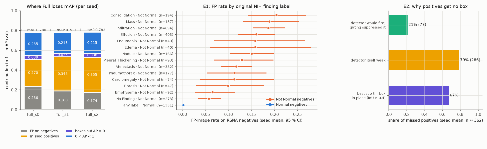

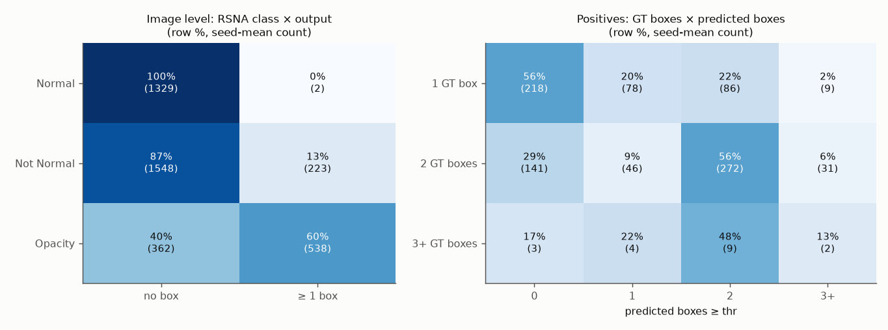

У baseline главной статьёй были FP на негативах (38–49 % разрыва, README §6.5). Гейтинг и аугментации HW2
сдвинули рабочую точку: у Full крупнейшая статья — **пропуски** (41 %), затем неточная локализация (33 %),
и только потом FP (26 %). Ошибки сильно систематичны: из 362 пропусков в среднем 299 повторяются во всех трёх
сидах, из 225 FP — 156. Значит, они определяются самим снимком, а не случайностью обучения, и смена сида их не
исправит.

<a id="s1-1"></a>
### E1. Ложные боксы на «Not Normal» — снимках с другой патологией

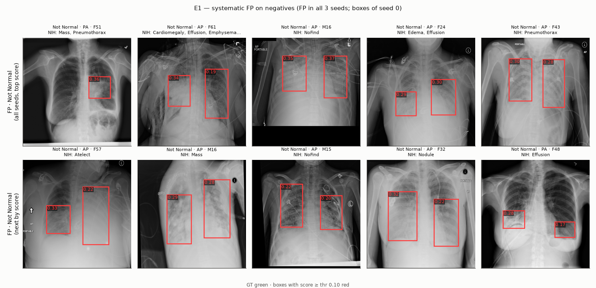

*Снимки «Not Normal», где FP есть у всех трёх сидов, а в NIH-заключении нет Pneumonia / Consolidation / Infiltration
(такие FP — меньшинство; примеры с этими метками — в галерее E5); по убыванию score, боксы сида 0. Подпись: класс
RSNA · проекция · пол и возраст; ниже — исходные метки NIH ChestX-ray14 этого снимка.*

- FP-rate (доля негативов с ≥ 1 боксом): «Not Normal» **0.126** [0.104, 0.148], «Normal» **0.002** [0.000, 0.004].
  Из 156 систематических FP-снимков 155 — «Not Normal».
- Внутри «Not Normal» FP зависит от того, что на снимке есть (исходные NIH-метки, мульти-метка): Consolidation
  0.20, Mass 0.19, Infiltration 0.19, Effusion 0.16, Atelectasis 0.12, Pneumothorax 0.11, Emphysema 0.07,
  «No Finding» 0.06. Разность «pneumonia-like» (Pneumonia / Consolidation / Infiltration) − «No Finding» внутри
  «Not Normal»: **+0.126** [+0.088, +0.163].
- Гейтинг эти FP не снимает: медиана P(пневмония) на FP-снимках 0.52 / 0.65 / 0.66 по сидам, то есть
  классификатор их не отсекает (у сида 0 медиана лишь чуть выше 0.5).

**Причина.** [подтверждено] FP почти целиком приходятся на «Not Normal», и внутри «Not Normal» их больше на
снимках с pneumonia-like NIH-меткой (Pneumonia / Consolidation / Infiltration), чем с «No Finding» (+0.126
[+0.088, +0.163]); для прочих NIH-находок разница с «No Finding» не проверялась. Крайние группы
разделяются: Consolidation 0.204 [0.143, 0.268] против Emphysema 0.065 [0.027, 0.113] и «No Finding» 0.057
[0.034, 0.084]. Порядок меток в середине (Mass, Infiltration, Effusion, Pneumonia, Nodule, Atelectasis) данными
не разрешён: CI перекрываются, а сама метка Pneumonia (0.158, n = 40) не выше прочих. [гипотеза] Модель
реагирует на затемнение лёгочной ткани как таковое; степень затемнения в анализе не измерялась. Граница «Lung Opacity» против «Not Normal» в RSNA — клиническое решение читателя («похоже
на пневмонию» против «другая причина затемнения»). По одному снимку без анамнеза её часто не провести, поэтому
этот тип ошибки не уйдёт от простого роста модели.

**Для доверия.** На популяции без патологии (скрининг здоровых) модель почти не даёт ложных тревог. Там, где много
другой лёгочной патологии (стационар, реанимация), каждый восьмой негатив получает бокс; на AP-снимках «Not
Normal» — каждый пятый (0.200 против 0.053 на PA, [§2.4](#s2-4)).

<a id="s1-2"></a>
### E2. Пропуски малых, одиночных и PA-очагов

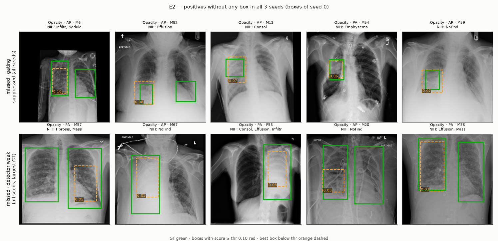

*Позитивы без единого бокса у всех трёх сидов. Зелёный — GT, оранжевый пунктир — лучший бокс модели ниже порога.
Верхний ряд — детектор без гейтинга дал бы бокс (гейтинг «погасил»), нижний — сам детектор слаб.*

- Чувствительность (доля позитивов с ≥ 1 боксом) по размеру очага (терцили по снимкам: √ средней площади GT-боксов
  снимка, квантили по **train**-позитивам: < 210, 210–288, > 288 px на сетке 1024): **0.43** / 0.61 / **0.76**; по числу GT-боксов: один — **0.44**, два — 0.71;
  по проекции: PA — **0.35**, AP — 0.67.
- Эффекты не сводятся друг к другу. Один бокс хуже двух внутри каждой терцили размера: 0.33 против 0.56
  (малые), 0.49 против 0.69 (средние), 0.66 против 0.80 (крупные). А PA-позитивы мельче AP: малых среди них 53 %
  против 30 %, так что часть разрыва PA/AP — это размер.
- Среди 299 систематических пропусков малых очагов 52 % (против 35 % среди всех позитивов), PA — 38 % (против 22 %).

**Причина.** В 65–69 % пропусков лучший бокс ниже порога стоит на месте (IoU с GT ≥ 0.4), в 41–45 % его score
не ниже половины порога. [гипотеза] Модель часто локализует очаг, но с низкой уверенностью; без сравнения с
тривиальным prior (крупные боксы на лёгких тоже часто пересекаются с GT) это не доказано. Медиана P(пневмония) на пропусках
0.19–0.29 против 0.68–0.79 на найденных: так считают обе головы, а не только гейтинг. Гейтинг виноват редко:
детектор без него дал бы бокс в 6–36 % пропусков (сильно зависит от сида и порога no_gating), а систематически во
всех трёх сидах — лишь у 10 из 299. [гипотеза] Малые и одиночные очаги на 256 px теряют текстуру. Малый очаг
(сторона < 210 px из 1024) на входе модели меньше 52 px, на выходной сетке stride 8 — меньше 7 клеток.

**Для доверия.** Отрицательный ответ модели слабо исключает пневмонию: на PA-снимках она находит только треть
позитивов. Порог снижать бесполезно: он уже оптимален по mAP на val. Ниже порога пропуски превращаются в FP на
«Not Normal» (E1).

<a id="s1-3"></a>
### E3. Неточные границы боксов (главная статья потерь на локализации)

- Пары «бокс — GT» (жадно по score, IoU > 0.1) на позитивах: IoU < 0.4 (ноль на всех порогах метрики) — 11 %,
  0.4–0.75 (частичный зачёт) — **70 %**, ≥ 0.75 (полный зачёт) — 20 %; медиана IoU 0.625.
- Контрфакты на тех же снимках (среднее по сидам; вся потеря на локализации — 0.258 mAP):

| если бы… | прирост val mAP |
|---|---|
| каждый сопоставленный бокс имел точные границы своего GT | **+0.175** |
| убрать боксы, не касающиеся ни одного GT (IoU ≤ 0.1) | +0.022 |
| убрать дубли (касаются GT, уже занятого боксом с большим score) | +0.002 |
| всё вместе | +0.229 |

- У хорошо совпавших пар (IoU > 0.4, 89 % пар) систематического смещения размера нет: медиана
  √(площадь бокса / площадь GT) ×**1.011**, бокс больше GT в 52 % пар. По всем парам (IoU > 0.1) — ×1.030 и
  54 %. У плохо совпавших пар (IoU 0.1–0.4, 11 %; они дают ноль на всех порогах метрики) боксы систематически
  крупнее GT: ×1.686, больше GT в 75 % пар.

**Причина.** [подтверждено] У боксов, попавших в очаг (IoU > 0.4), ошибка размера — разброс, а не сдвиг; у
промахов с IoU < 0.4 бокс, как правило, завышен (ср. E4). Поэтому равномерное сжатие боксов (I3 в HW2) и не
помогло: хорошо совпавшим парам оно не нужно. [гипотеза] Значимая часть разброса — шум самой разметки. Границы диффузного затемнения субъективны, а
каждый train-снимок размечен одним читателем (README §3.6), поэтому точность границ ограничена сверху.
Прямой проверки нет: повторной разметки тех же снимков у нас нет.

**Для доверия.** «Где» модель показывает правильно, «насколько большой очаг» — приблизительно. Боксы годятся,
чтобы привлечь внимание, но не для измерения размера очага или его динамики.

<a id="s1-4"></a>
### E4. Лишний бокс и неверное число очагов

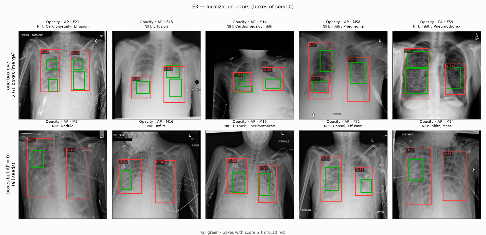

*Верхний ряд — один бокс накрывает два GT-бокса; нижний — боксы есть, но AP = 0 у всех трёх сидов: модель
ставит пару крупных боксов на оба лёгких, намного больше GT-очагов (на части снимков очаг один, на части — по
очагу в каждом лёгком).*

- Среди позитивов с боксами предсказано больше боксов, чем в GT, в **23 %** случаев (средний AP 0.27 против 0.56
  при совпадающем числе), меньше — в 11 % (AP 0.25).
- Позитивы с одним GT-боксом: 22 % получают **два** бокса. С двумя: 9 % получают один (матрица справа на
  рисунке матриц ошибок).
- Боксы, не касающиеся ни одного GT (IoU ≤ 0.1), есть на 105 позитивах; их удаление дало бы +0.022 mAP (E3).
  На какой стороне они стоят, не проверялось.
  Слияние двух очагов в один бокс редко (1.4 %).

**Причина.** [гипотеза] Выученный «двусторонний» prior. В данных двухбоксовых позитивов больше, чем однобоксовых
(3 266 против 2 614 по всему набору), центры боксов образуют два кластера, по одному на лёгкое (README §3.5). Получается, что
модель ставит пару там, где очаг один. В пользу гипотезы — то, что лишний бокс не сводится к крупным очагам:
среди позитивов с одним GT-боксом и хотя бы одним боксом ≥ 2 бокса получают 53 % малых, 51 % средних и 62 %
крупных ([`errors.md`](../results/hw3/errors.md) §4). Сторона второго бокса не измерялась, так что «двусторонность»
не проверена напрямую. Против полной уверенности — то, что часть «лишних» боксов может быть пропущенным читателем вторым очагом (E5).

**Для доверия.** Число очагов модель указывает ненадёжно (22 % одноочаговых получают два бокса, 9 % двухочаговых —
один). [гипотеза] Значит, ненадёжна и сторона поражения, но сторона боксов не проверялась.

<a id="s1-5"></a>
### E5. Неоднозначная разметка: модель «ошибается» там, где расходятся и источники меток

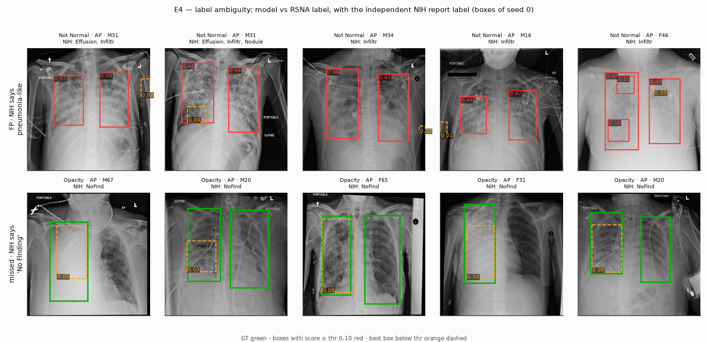

*Верхний ряд — систематические FP, у которых в независимом NIH-заключении есть Pneumonia / Consolidation /
Infiltration. Нижний — систематические пропуски, у которых NIH-заключение «No Finding».*

NIH-метки ChestX-ray14 извлечены NLP из текстовых заключений. В модели и при отборе они не используются; здесь
это второй, независимый и тоже шумный источник мнения о снимке.

| NIH-группа \ класс RSNA | Normal | Not Normal | Lung Opacity |
|---|---|---|---|
| No Finding | 593 | 273 | 85 |
| другая находка | 223 | 636 | 172 |
| pneumonia-like | 515 | 862 | 643 |

- Среди уверенных систематических FP (n = 39) NIH-группа «pneumonia-like» у **74 %** против 44 % у всех
  негативов val. FP-rate на негативах RSNA: NIH «No Finding» 0.018, «pneumonia-like» 0.116.
- Позитивы RSNA с NIH «No Finding» (85) модель находит хуже: чувствительность 0.49 против 0.64 у «pneumonia-like».
  Среди систематических пропусков таких 13 % против 9 % у всех позитивов.
- Но модель **не повторяет** NIH-метки вслепую: на 471 RSNA-«Normal» с NIH-меткой Infiltration FP-rate всего
  0.005. Там, где RSNA-читатель видел норму, модель согласна с ним.

**Причина.** [гипотеза] Часть «ошибок» — пограничные случаи, на которых расходятся и сами эксперты (RSNA-читатель
против автора заключения). Доказать, что метка неверна, мы не можем: оба источника шумные. Вывод скромнее:
**потолок метрики на этой разметке заметно ниже 1**, и небольшие различия mAP между моделями частично отражают шум
меток.

**Для доверия.** Оценка модели по single-read разметке шумна. Для клинического решения нужна валидация на
разметке консенсуса нескольких читателей (как в hidden test соревнования).

---

<a id="s2"></a>
## 2. Диагностика по срезам

Источник — [`results/hw3/slices.md`](../results/hw3/slices.md) (и `slices.csv`). Срезы выбраны по особенностям
задачи: **проекция** (AP — лежачие, обычно тяжёлые пациенты; доля позитивов 38 % против 9 % у PA, README §3.4),
**возраст** (дети и пожилые — разные паттерны пневмонии; группы < 30 / 30–60 / ≥ 60 из задания и отдельно < 18),
**пол** (контроль на смещение), **размер очага** и **число GT-боксов** (геометрия задачи), **исходная NIH-метка**
(сопутствующая патология).

**Почему не только mAP.** В RSNA mAP негатив без бокса не учитывается, а негатив с боксом даёт 0. Поэтому внутри
группы mAP = n_pos · mAP_pos / (n_pos + n_neg · FP-rate) и механически зависит от доли позитивов. Чтобы сравнивать
группы, рядом дан **std-mAP** = π · mAP_pos / (π + (1 − π) · FP-rate) при π = 0.225 (доля позитивов всей val):
это mAP, который был бы у группы при средней доле позитивов. Это наша поправка, не метрика соревнования.

| срез | группа | n | позит. | доля поз. | mAP [95 % CI] | std-mAP [95 % CI] | mAP pos | FP-rate | sens | AUC |
|---|---|---|---|---|---|---|---|---|---|---|
| проекция | AP | 1 826 | 698 | 38 % | 0.244 [0.210, 0.275] | **0.198** [0.174, 0.222] | 0.306 | 0.158 | 0.669 | 0.850 |
| проекция | PA | 2 176 | 202 | 9 % | 0.134 [0.103, 0.165] | **0.153** [0.118, 0.187] | 0.165 | 0.024 | **0.350** | 0.875 |
| пол | F | 1 730 | 376 | 22 % | 0.224 [0.174, 0.268] | 0.226 [0.181, 0.266] | 0.284 | 0.074 | 0.594 | 0.887 |
| пол | M | 2 272 | 524 | 23 % | 0.216 [0.180, 0.251] | 0.215 [0.183, 0.246] | 0.267 | 0.071 | 0.600 | 0.899 |
| возраст | < 30 | 888 | 266 | 30 % | 0.247 [0.189, 0.296] | 0.227 [0.180, 0.270] | 0.304 | 0.100 | 0.663 | 0.902 |
| возраст | 30–60 | 2 134 | 458 | 21 % | 0.238 [0.195, 0.276] | 0.240 [0.202, 0.275] | 0.295 | 0.065 | 0.611 | 0.898 |
| возраст | ≥ 60 | 980 | 176 | 18 % | **0.134** [0.095, 0.165] | **0.142** [0.104, 0.173] | 0.175 | 0.067 | **0.462** | 0.863 |
| возраст | < 18 (часть < 30) | 281 | 115 | 41 % | 0.310 [0.202, 0.375] | 0.247 [0.180, 0.306] | 0.379 | 0.157 | 0.803 | 0.908 |
| размер очага | малый | 313 | 313 | 100 % | 0.120 [0.098, 0.144] | – | 0.120 | – | 0.431 | – |
| размер очага | средний | 293 | 293 | 100 % | 0.277 [0.233, 0.319] | – | 0.277 | – | 0.608 | – |
| размер очага | крупный | 294 | 294 | 100 % | 0.435 [0.373, 0.491] | – | 0.435 | – | 0.764 | – |
| GT-боксов | 1 | 392 | 392 | 100 % | 0.165 [0.142, 0.190] | – | 0.165 | – | 0.444 | – |
| GT-боксов | 2 | 490 | 490 | 100 % | 0.365 [0.313, 0.410] | – | 0.365 | – | 0.712 | – |
| GT-боксов | 3+ ⚠ | 18 | 18 | 100 % | 0.179 [0.096, 0.282] | – | 0.179 | – | 0.833 | – |
| NIH-метка | No Finding | 951 | 85 | 9 % | 0.187 [0.125, 0.249] | 0.208 [0.143, 0.274] | 0.221 | 0.018 | 0.490 | 0.935 |
| NIH-метка | pneumonia-like | 2 020 | 643 | 32 % | 0.237 [0.207, 0.267] | 0.212 [0.186, 0.237] | 0.297 | 0.116 | 0.639 | 0.871 |
| NIH-метка | другая находка | 1 031 | 172 | 17 % | 0.168 [0.126, 0.213] | 0.181 [0.137, 0.225] | 0.217 | 0.057 | 0.494 | 0.859 |

⚠ — меньше 50 позитивов: оценка нестабильна (CI шире ±0.08). AUC — ROC-AUC P(пневмония) внутри группы; на
всей val он 0.894. CI для mAP pos / FP-rate / sens — в `slices.md`.

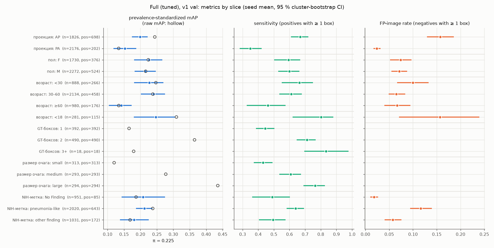

**Разности между группами** (одни и те же снимки, кластерный бутстрап):

| контраст | mAP | std-mAP | mAP pos | FP-rate | sensitivity |
|---|---|---|---|---|---|
| AP − PA | +0.110 [+0.064, +0.152] | **+0.046** [+0.002, +0.087] | +0.140 [+0.085, +0.190] | +0.134 [+0.106, +0.162] | +0.319 [+0.230, +0.406] |
| ≥ 60 − < 30 | −0.113 [−0.171, −0.048] | **−0.085** [−0.139, −0.031] | −0.129 [−0.202, −0.053] | −0.033 [−0.076, +0.010] | −0.201 [−0.355, −0.049] |
| ≥ 60 − < 30, только AP | | | −0.135 [−0.219, −0.051] | −0.042 [−0.125, +0.033] | −0.191 [−0.374, −0.027] |
| ≥ 60 − < 30, только PA | | | −0.007 [−0.100, +0.095] | −0.002 [−0.024, +0.018] | +0.005 [−0.183, +0.198] |
| F − M | +0.008 [−0.050, +0.063] | +0.011 [−0.043, +0.062] | | +0.003 [−0.024, +0.032] | −0.006 [−0.119, +0.101] |
| малый − крупный очаг | | | −0.315 [−0.376, −0.247] | | −0.333 [−0.404, −0.260] |
| 1 − 2 GT-бокса | | | −0.199 [−0.249, −0.145] | | −0.268 [−0.330, −0.199] |


**Что видно.**
- **Проекция — самый сильный срез по FP-rate** (AP − PA +0.134) и, среди срезов по всем снимкам (проекция,
  пол, возраст), по чувствительности (+0.319; по ней она сопоставима с размером очага, −0.333). По std-mAP
  точечная оценка эффекта проекции (+0.046) меньше возрастной (≥ 60 − < 30: −0.085), но CI перекрываются, и
  разность не проверялась; по сырому mAP они сопоставимы (+0.110 и −0.113). На PA модель находит только 35 % позитивов против 67 % на AP. На AP зато в
  6.6 раза чаще FP (0.158 против 0.024). Сырой mAP на AP выше на +0.110, но больше половины этого — доля
  позитивов: после стандартизации разница +0.046 [+0.002, +0.087], на границе значимости. Внутри проекции
  AUC ниже, чем на всей val (0.850 и 0.875 против 0.894): часть глобального разделения снимков даёт сама
  проекция (подробно — [§2.4](#s2-4)).
- **Пожилые (≥ 60) — худшая возрастная группа и после стандартизации** (−0.085 [−0.139, −0.031] против < 30).
  Дело в чувствительности (0.46 против 0.66), а не в FP. Проекция объясняет только часть разрыва: у < 30
  AP-снимков больше (58 % против 43 % у ≥ 60; среди позитивов 86 % против 70 %), а на AP чувствительность выше.
  Внутри AP возрастной разрыв чувствительности сохраняется: −0.191 [−0.374, −0.027]. Внутри PA он не
  воспроизводится (+0.005 [−0.183, +0.198]), но в этом сравнении всего 88 позитивов (36 у < 30 и 52 у ≥ 60), так
  что этот срез неинформативен. Малых очагов у ≥ 60 больше (43 % против 31–36 %), это частичное объяснение.
  [гипотеза] Остальное — фон: у пожилых больше сопутствующих изменений (застой, ателектазы, выпот), на фоне которых
  очаг хуже виден.
- **Дети (< 18)** — лучшая группа по сырому mAP (0.310), но после стандартизации (0.247) она в пределах шума от
  взрослых: у детей просто много позитивов (41 %). n = 281, CI широкий.
- **Пол** — различий нет ни по одной из проверенных метрик (mAP, std-mAP, FP-rate, sensitivity: все CI содержат 0).
- **Размер и число очагов** — самые сильные эффекты на позитивах (−0.32 и −0.20 mAP pos), см. E2.
- **NIH-группы** после стандартизации неразличимы (0.21 / 0.21 / 0.18), но устроены по-разному: на
  «pneumonia-like» больше FP, на «No Finding» и «другой находке» — пропусков (E5).

<a id="s2-4"></a>
### 2.4 Использует ли модель проекцию как shortcut (RQ3 из HW1)

Источник — [`results/hw3/shortcut/shortcut.md`](../results/hw3/shortcut/shortcut.md)
([`scripts/analyze_hw3_shortcut.py`](../scripts/analyze_hw3_shortcut.py)), только inference на v1 val, сиды 0/1/2.

**Тест 1: смещение по проекции внутри одного класса.** На снимках «Normal» искать нечего, поэтому score не должен
зависеть от проекции. Он зависит:

| негативы | n AP / PA | AUC(проекция ∣ P(пневмония)) | медиана P: AP / PA | FP-rate AP | FP-rate PA |
|---|---|---|---|---|---|
| Normal | 248 / 1 083 | **0.736** | 0.022 / 0.007 | 0.008 [0.000, 0.020] | 0.000 [0.000, 0.001] |
| Not Normal | 880 / 891 | **0.744** | 0.231 / 0.059 | **0.200** [0.166, 0.234] | **0.053** [0.038, 0.069] |

По одной P(пневмония) можно отличить AP от PA с AUC ≈ 0.74 внутри каждого класса. На «Normal» до FP это почти не
доходит, потому что все score там малы. На «Not Normal» FP-rate на AP в 3.8 раза выше.
Оговорка: [гипотеза] AP-«Not Normal», вероятно, тяжелее PA (лежачие пациенты; допущение README §8, в данных не
измерялось), так что отношение 3.8 — только необходимый признак shortcut, а не доказательство.

**Тест 2: маскирование вне поля лёгких** (заранее зарегистрирован в README §8 и плане). Пиксели вне
прямоугольника заменяются медианой снимка.

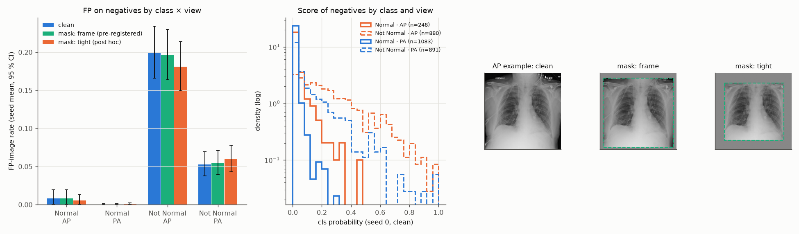

| | маска frame (из плана) | маска tight (после ревью, не из плана) |
|---|---|---|
| поле, px из 1024 (доля train-боксов целиком внутри) | x 43–986, y 69–1001 (98.0 %) | x 122–914, y 137–903 (82.3 %) |
| надпись / маркер видны после маски (32 первых AP-снимка val, визуально) | ≈ 27 из 32 | 11 из 32 |
| Δ FP-rate, Not Normal · AP | −0.003 [−0.009, +0.002] | **−0.019** [−0.031, −0.006] |
| Δ FP-rate, Not Normal · PA | +0.001 [−0.001, +0.005] | +0.007 [+0.002, +0.013] |
| DiD: Δ AP − Δ PA (Not Normal) | −0.005 [−0.011, +0.001] | **−0.026** [−0.039, −0.012] |
| отношение FP-rate AP / PA (Not Normal) | 3.8 → 3.6 | 3.8 → 3.0 |
| Δ sensitivity, позитивы AP / PA | −0.008 / −0.003 | **−0.044** / +0.012 |
| AUC(проекция ∣ P(пневмония)) внутри Normal / Not Normal | 0.736 / 0.741 | 0.734 / 0.724 |
| Δ mAP всей val | −0.003 [−0.006, +0.000] | −0.009 [−0.015, −0.003] |

**Вывод по RQ3.**
- Маска из плана снимает только край кадра: надписи `PORTABLE` и маркеры остаются почти везде. Поэтому её нулевой
  результат **не опровергает** shortcut по надписям, как предполагало правило плана. Это недосмотр плана, найденный
  при ревью кода.
- Узкая маска выполняет критерий «поддержан» лишь частично. FP на AP значимо падает (−0.019 [−0.031, −0.006]),
  но на PA значимо растёт (+0.007 [+0.002, +0.013], 0.053 → 0.060), а критерий требовал, чтобы на PA FP не
  менялся. Отношение AP/PA сокращается с 3.8 до 3.0, но примерно половина этого — рост FP на PA (при неизменном
  PA было бы 0.181 / 0.053 ≈ 3.4). Дифференциальный эффект есть: DiD −0.026 [−0.039, −0.012].
- На AP падает и чувствительность (−0.044 [−0.059, −0.031]): маска уменьшает число боксов выше порога у
  негативов и у позитивов, а не только ложных. При этом медианная P(пневмония) AP-негативов не падает, а слегка
  растёт (Normal 0.022 → 0.031, Not Normal 0.231 → 0.235; на PA тоже растёт), то есть меняются пики box-score
  (heatmap × P), а не image-level вероятность. Причину это не разделяет. Возможны три объяснения: внелёгочные
  подсказки (надписи, трубки, электроды, край кадра); срезанная часть лёгких (узкое поле целиком вмещает только
  82 % train-боксов); сдвиг распределения от самой маски (P растёт во всех ячейках класс × проекция).
- **Сигнал проекции в P(пневмония) маскированием не снимается:** AUC(проекция ∣ P(пневмония)) почти не
  меняется ни от одной маски (0.74 → 0.72–0.74). Для box-score (heatmap × P), на который маска действует, AUC
  проекции не считался. Маска frame надписи почти не убирает, поэтому информативна только tight.
  Остаток сидит внутри центрального прямоугольника. Это не сегментация лёгких, и часть сигнала может давать
  надпись или маркер, видимые после узкой маски на 11 из 32 AP-снимков. [гипотеза] Остальное модель читает по позе
  и анатомии: увеличенная тень сердца на AP, положение лопаток и ключиц, качество снимка у лежачего пациента.
- **Итог:** P(пневмония) внутри одного класса зависит от проекции (подтверждено, тест 1; чище всего — на
  «Normal», AUC 0.736). Кодирует ли модель саму проекцию или коррелирующие с ней признаки пациента, тест 1 не
  разделяет. Узкая маска (не из плана) уменьшает FP на AP
  сильнее, чем на PA, но этот эффект нельзя однозначно приписать внелёгочным подсказкам. Основная часть сигнала
  маскированием краёв не снимается; откуда она берётся (анатомия, оставшиеся надписи или реальная разница тяжести
  AP- и PA-пациентов), по этим данным не разделить.

---

<a id="s3"></a>
## 3. Проверки устойчивости

Каждая проверка меняет **один** фактор. Переобучение делается тем же [`full.yaml`](../configs/hw2/full.yaml) без
подбора гиперпараметров: меняется только `data.split_file` (`--set`, записано в `results/<run>/config.yaml` и в
MLflow-эксперименте `rsna-pneumonia-hw3`). Эпоха, порог и `box_scale` выбираются тем же протоколом на val самого
прогона. Очередь — [`scripts/run_hw3.sh`](../scripts/run_hw3.sh), разбиения —
[`src/rsna/split_variants.py`](../src/rsna/split_variants.py) → `data/splits/hw3/`.

| # | фактор | исходное условие | изменение | метрика сравнения |
|---|---|---|---|---|
| R1 | размер train | 100 % v1 train (18 678 снимков), `full_s0/s1` | 50 / 20 / 10 % — вложенные подвыборки, сгруппированные по NIH-пациенту и стратифицированные; val = v1 val | Δ val mAP на одних и тех же снимках, парно по сиду (0, 1) |
| R2 | разбиение | split_v1, `full_s0` | 3 новых разбиения non-test пула по протоколу v1 (seed 1/2/3); test тот же | разброс val mAP между разбиениями против ожидаемого |
| R3 | искажения входа | чистая v1 val, чекпойнты `full_s0/1/2` | шум, размытие, разрешение, JPEG, контраст, гамма (inference) | Δ val mAP при фиксированном пороге |

Источник R1 и R2 — [`results/hw3/robustness.md`](../results/hw3/robustness.md)
([`scripts/analyze_hw3_robustness.py`](../scripts/analyze_hw3_robustness.py)).

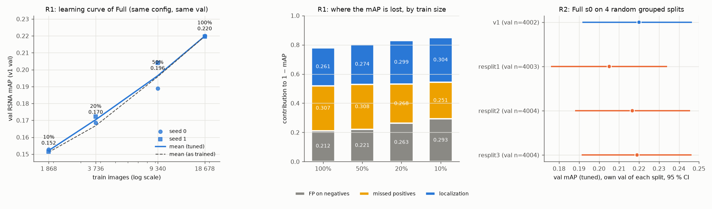

<a id="s3-1"></a>
### R1. Объём обучающей выборки

Подвыборки train вложены друг в друга (10 % ⊂ 20 % ⊂ 50 % ⊂ 100 %), сгруппированы по NIH-пациенту и
стратифицированы теми же стратами, что split_v1. Val не меняется (v1 val, 4 002 снимка), поэтому Δ считается
парно: подвыборка сида s против `full_s{s}` на одних и тех же снимках.

| train | снимков | mAP сид 0 / сид 1 | Δ к 100 % [95 % CI] | AUC | FP-rate | sens | mAP pos | потери: FP / пропуски / локализация |
|---|---|---|---|---|---|---|---|---|
| 100 % | 18 678 | 0.2200 / 0.2196 | – | 0.893 | 0.078 | 0.611 | 0.279 | 0.212 / 0.307 / 0.261 |
| 50 % | 9 340 | 0.1888 / 0.2040 | **−0.023** [−0.032, −0.015] | 0.886 | 0.084 | 0.608 | 0.254 | 0.221 / 0.308 / 0.274 |
| 20 % | 3 736 | 0.1686 / 0.1721 | **−0.049** [−0.062, −0.037] | 0.876 | 0.104 | 0.638 | 0.232 | 0.263 / 0.268 / 0.299 |
| 10 % | 1 868 | 0.1527 / 0.1516 | **−0.068** [−0.082, −0.053] | 0.869 | 0.121 | 0.646 | 0.215 | 0.293 / 0.251 / 0.304 |

Потери — вклад категорий в 1 − mAP (в единицах mAP), как в §1.0.

**Что видно.**
- **Падение монотонное, кривая не выходит на плато.** Линейная аппроксимация по log₂ объёма даёт +0.020 mAP на
  каждое удвоение train. Предсказания плана: 20 % (−0.03…−0.06) и 10 % («ещё ниже») подтвердились; для 50 %
  ожидалось «в пределах −0.02», получилось −0.023 [−0.032, −0.015] — на границе, CI включает −0.02.
  [гипотеза] Модель ограничена данными. Больше размеченных снимков (весь train соревнования, внешние датасеты),
  вероятно, дало бы прирост; экстраполяция за 100 % и сравнение с подбором архитектуры не проверялись.
- **Предсказание «сильнее всего вырастут FP на негативах» в целом подтвердилось, но сводное разложение потерь
  смешивает объём train с выбором порога.** В среднем по сидам потери на FP растут на +0.081 (0.212 → 0.293), на
  локализации — на +0.043, а на пропусках снижаются (−0.056). Снижение пропусков и рост sensitivity (0.61 → 0.65) —
  целиком сид 1: его порог, выбранный на val, сменился с 0.15 на 0.10. Чище сравнение у сида 0, где порог один и
  тот же (0.10 на 100 % и 10 %): sensitivity даже падает (0.647 → 0.628), потери на пропусках не меняются
  (0.270 → 0.270), а FP-rate растёт (0.090 → 0.110), потери на FP — на +0.038, на локализации — на +0.029,
  mAP на позитивах падает 0.288 → 0.210. Меньший train даёт больше FP на негативах (по всем негативам; разбивка
  по «Not Normal» для подвыборок не считалась) и худшие боксы.
- **Ранжирование «есть / нет пневмонии» страдает заметно меньше, чем mAP:** AUC 0.893 → 0.869 при 10 % данных
  (−3 % против −31 % по mAP; сиды согласуются до 0.003, CI для ΔAUC не считался). [гипотеза] Основная часть
  потерь — рабочая точка и геометрия боксов, а не ранжирование cls-головы.
- **Разброс между сидами немонотонен:** |Δ| между двумя сидами 0.0004 / 0.015 / 0.0035 / 0.0011 при
  100 / 50 / 20 / 10 %. Большой разрыв на 50 % (сид 0: −0.031, сид 1: −0.016 к 100 %) совпадает с разными порогами,
  выбранными на val (0.15 у сида 0 против 0.10 у сида 1). Одному сиду на подвыборке верить нельзя, а двух сидов
  мало, чтобы судить о том, как разброс зависит от объёма.
- **Оговорка (из плана).** Число эпох фиксировано (6), поэтому на 10 % модель делает в 10 раз меньше шагов. Факторы
  «меньше разных снимков» и «меньше шагов оптимизации» здесь не разделены. Лучшая эпоха у всех прогонов 5–6, то
  есть недообучение не исключено.

<a id="s3-2"></a>
### R2. Другое разбиение train / val

Три новых разбиения non-test пула (seed 1 / 2 / 3) тем же протоколом, что split_v1: StratifiedGroupKFold по
NIH-пациенту, те же страты, 3/17 пула в val. Test не меняется. Каждая модель (сид 0) оценивается на **своей** val:
вопрос — насколько число HW2 зависит от того, какие пациенты попали в val.

| разбиение | val: снимков / доля поз. / доля AP | mAP [95 % CI] | AUC | FP-rate | sens | лучшая эпоха | порог | box_scale |
|---|---|---|---|---|---|---|---|---|
| v1 | 4 002 / 22.5 % / 45.6 % | 0.2200 [0.192, 0.247] | 0.893 | 0.090 | 0.647 | 6 | 0.10 | 1.0 |
| resplit1 | 4 003 / 22.5 % / 45.6 % | 0.2051 [0.176, 0.234] | 0.886 | 0.082 | 0.577 | 5 | 0.15 | 1.0 |
| resplit2 | 4 004 / 22.6 % / 45.7 % | 0.2166 [0.188, 0.246] | 0.893 | 0.081 | 0.603 | 5 | 0.15 | 1.025 |
| resplit3 | 4 004 / 22.6 % / 45.7 % | 0.2190 [0.191, 0.246] | 0.889 | 0.090 | 0.614 | 5 | 0.15 | 1.025 |

**Что видно.**
- **Разброс по разбиениям — 0.0069** (std по 4 точкам; размах 0.2051–0.2200). Ожидаемый разброс от выборки val и
  шума обучения — √(SE²_бутстрап + sd²_сид) = √(0.0140² + 0.0009²) = 0.014. Наблюдаемый разброс вдвое **меньше**
  ожидаемого (χ²(3) = 0.72). По критерию плана (разброс > 2 × ожидаемого) v1 val **не нетипична**. Вывод не
  зависит от того, какую величину брать за ожидаемую: в плане она была занижена до 0.006–0.007 (§6, п. 9), но и
  с ней порог 2× ≈ 0.013 больше наблюдаемых 0.0069.
- Почему разброс меньше ожидаемого: val новых разбиений стратифицированы (доля позитивов и AP совпадает до 0.1 %),
  а бутстрап — нет; к тому же val разных разбиений частично пересекаются. Ожидаемая величина — оценка сверху.
- **v1 оказалась лучшей из четырёх**: на +0.006 выше среднего трёх новых разбиений (0.2136) и лишь на 0.001 выше
  второго (resplit3, 0.2190). Это в пределах шума: порог и эпоха на всех разбиениях выбираются на своей val, так что оптимизм выбора у всех
  одинаковый. Абсолютные числа HW2 стоит читать как «0.21–0.22», а не как точное 0.2193. Test HW2 (0.2201), посчитанный один раз, этому не
  противоречит.
- Протокол стабилен: эпоха (5–6), порог (0.10–0.15) и `box_scale` (1.0–1.025) выбираются похоже на всех
  разбиениях. Абсолютный уровень Full и протокол выбора не держатся на удачной val. Сравнения конфигураций HW2
  (Full − B и др.) на других разбиениях не перепроверялись: переобучался только Full, сид 0. Их опора —
  заранее зарегистрированный контраст на test HW2, +0.029 [+0.014, +0.044].
- Оговорки: 4 точки — мало для оценки std; разбиения меняют одновременно train и val; сид один (0).

<a id="s3-3"></a>
### R3. Искажения входа (без переобучения)

Источник — [`results/hw3/noise/noise.md`](../results/hw3/noise/noise.md)
([`scripts/analyze_hw3_noise.py`](../scripts/analyze_hw3_noise.py)). Искажение накладывается на вход модели
(256 px, uint8) с фиксированным seed: все сиды видят одни и те же испорченные снимки. **Основная метрика** — mAP
при пороге, выбранном на чистой val в HW2: в эксплуатации порог никто не перенастроит. Дополнительно дан mAP
при лучшем пороге для этого искажения (оракул): разница двух чисел — сдвиг калибровки, остаток — потеря
ранжирования и локализации. Проверка воспроизведения: чистый mAP, пересчитанный этим скриптом, совпадает с HW2 до
4-го знака (0.2200 / 0.2196 / 0.2183).

| искажение | уровень | mAP @ фикс. порог (± std по сидам) | Δ mAP [95 % CI] | mAP @ лучший порог | AUC | sens | FP-rate | медиана P(пневмония): нег. / поз. |
|---|---|---|---|---|---|---|---|---|
| чистые | – | 0.2193 ± 0.0009 | – | 0.2193 | 0.894 | 0.597 | 0.073 | 0.036 / 0.559 |
| гауссов шум σ | 0.01 (≈ 2.5 уровня серого) | 0.1855 ± 0.0113 | **−0.034** [−0.045, −0.024] | 0.1947 | 0.887 | 0.482 | 0.051 | 0.063 / 0.455 |
|  | 0.02 | 0.1268 ± 0.0227 | **−0.092** [−0.108, −0.078] | 0.1492 | 0.866 | 0.360 | 0.038 | 0.138 / 0.423 |
|  | 0.05 | 0.0086 ± 0.0079 | −0.211 [−0.238, −0.183] | 0.0521 | 0.799 | 0.029 | 0.003 | 0.242 / 0.364 |
|  | 0.1 | 0.0000 | −0.219 [−0.247, −0.190] | 0.0009 | 0.710 | 0.000 | 0.000 | 0.370 / 0.402 |
| размытие σ, px | 0.5 | 0.2148 ± 0.0008 | −0.004 [−0.009, −0.000] | 0.2148 | 0.894 | 0.595 | 0.075 | 0.038 / 0.559 |
|  | 1.0 | 0.1974 ± 0.0059 | −0.022 [−0.031, −0.012] | 0.2001 | 0.889 | 0.561 | 0.069 | 0.058 / 0.512 |
|  | 2.0 | 0.1201 ± 0.0294 | −0.099 [−0.119, −0.081] | 0.1553 | 0.860 | 0.323 | 0.033 | 0.083 / 0.354 |
| разрешение, px (вниз и обратно) | 128 | 0.1975 ± 0.0065 | −0.022 [−0.032, −0.012] | 0.2003 | 0.887 | 0.568 | 0.074 | 0.077 / 0.523 |
|  | 96 | 0.1716 ± 0.0127 | −0.048 [−0.061, −0.034] | 0.1861 | 0.874 | 0.481 | 0.058 | 0.099 / 0.448 |
|  | 64 | 0.1312 ± 0.0244 | −0.088 [−0.108, −0.069] | 0.1574 | 0.855 | 0.362 | 0.044 | 0.131 / 0.395 |
| JPEG quality | 50 | 0.1950 ± 0.0077 | −0.024 [−0.034, −0.015] | 0.1997 | 0.884 | 0.565 | 0.081 | 0.104 / 0.508 |
|  | 20 | 0.1450 ± 0.0250 | −0.074 [−0.090, −0.059] | 0.1686 | 0.860 | 0.421 | 0.058 | 0.158 / 0.428 |
|  | 10 | 0.0614 ± 0.0228 | −0.158 [−0.185, −0.134] | 0.1097 | 0.825 | 0.201 | 0.026 | 0.185 / 0.374 |
| контраст × | 0.7 | 0.2162 ± 0.0020 | −0.003 [−0.009, +0.003] | 0.2174 | 0.893 | 0.581 | 0.072 | 0.029 / 0.552 |
|  | 0.9 (в диапазоне аугментаций) | 0.2169 ± 0.0016 | −0.002 [−0.006, +0.001] | 0.2176 | 0.894 | 0.593 | 0.074 | 0.034 / 0.560 |
|  | 1.1 (в диапазоне аугментаций) | 0.2126 ± 0.0034 | −0.007 [−0.010, −0.003] | 0.2146 | 0.894 | 0.581 | 0.072 | 0.038 / 0.546 |
|  | 1.3 | 0.2089 ± 0.0017 | −0.010 [−0.017, −0.004] | 0.2091 | 0.893 | 0.567 | 0.070 | 0.041 / 0.524 |
| гамма | 0.7 | 0.2162 ± 0.0045 | −0.003 [−0.010, +0.004] | 0.2165 | 0.892 | 0.640 | 0.093 | 0.053 / 0.598 |
|  | 0.91 (в диапазоне аугментаций) | 0.2175 ± 0.0013 | −0.002 [−0.006, +0.002] | 0.2175 | 0.894 | 0.607 | 0.078 | 0.040 / 0.571 |
|  | 1.1 (в диапазоне аугментаций) | 0.2132 ± 0.0027 | −0.006 [−0.010, −0.002] | 0.2154 | 0.894 | 0.570 | 0.067 | 0.032 / 0.532 |
|  | 1.4 | 0.2021 ± 0.0054 | −0.017 [−0.025, −0.010] | 0.2065 | 0.893 | 0.520 | 0.054 | 0.024 / 0.481 |

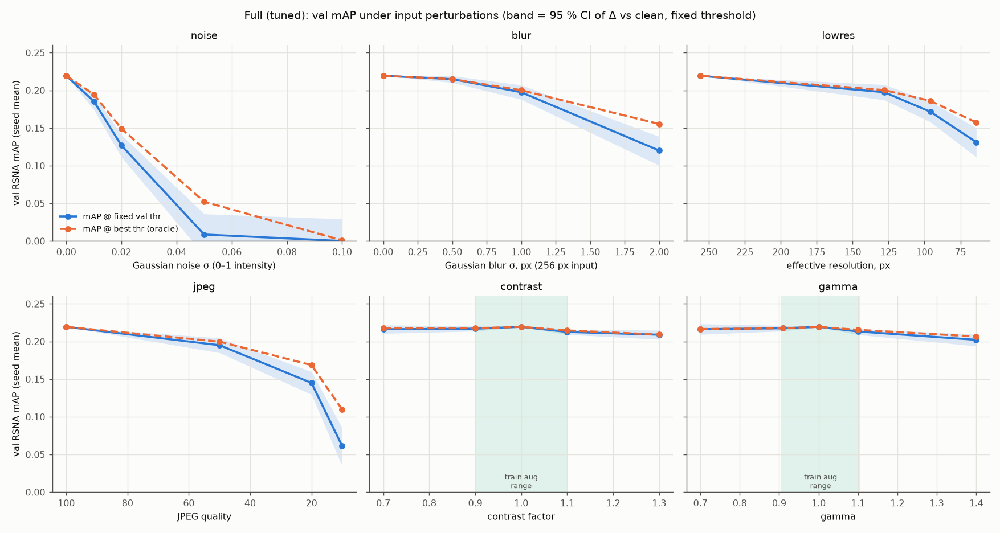

**Что видно.**
- **Контраст и гамма — устойчиво.** В диапазоне аугментаций Δ от −0.002 до −0.007; за его пределами
  (контраст ×0.7 / ×1.3, гамма 0.7 / 1.4) — не хуже −0.017 (гамма 1.4 — почти как размытие 1 px). AUC меняется
  меньше чем на 0.002. Предсказание плана для контраста и гаммы подтвердилось, хотя изменения внутри диапазона
  (×1.1) малы, но статистически отличимы от нуля. Яркость (аддитивный сдвиг, в обучении ±0.1) в R3 не
  проверялась.
- **Шум — главная уязвимость, и это не было предсказано по масштабу.** σ = 0.01 в единицах интенсивности
  (≈ 2.5 уровня серого из 255, на глаз незаметно) отнимает 0.034 mAP — сопоставимо со всем вкладом аугментаций в HW2
  (+0.026; CI перекрываются). При σ = 0.05 модель почти перестаёт ставить боксы (sensitivity 0.03). При фиксированном пороге падают и
  sensitivity, и FP-rate (σ = 0.01: 0.597 → 0.482 и 0.073 → 0.051): в абсолютных пунктах сильнее падает
  sensitivity, в относительных — FP-rate (−19 % против −29 %). Это согласуется с общим сдвигом box-score вниз;
  распределения box-score отдельно не измерялись. Image-level AUC падает гораздо медленнее mAP (−0.007 при
  σ = 0.01), а перевыбор порога возвращает лишь около четверти потери (0.1947 против 0.1855 при чистых 0.2193).
  Значит, при слабом шуме основная часть потери — на уровне боксов, а не в одном сдвиге калибровки.
  [гипотеза] Причина — подготовка данных: модель видит снимки, уменьшенные с 1024 до 256 px усреднением по
  площади. Это гасит шум детектора, и вход получается неестественно гладким. Шумовой аугментации в обучении не было.
- **Размытие, понижение разрешения, JPEG** ухудшают mAP монотонно по силе искажения. Умеренные уровни (σ = 1 px,
  128 px, JPEG 50) стоят 0.02–0.024. [гипотеза] По масштабу это может быть сопоставимо с различиями между
  аппаратами и форматами экспорта; на наших данных это не проверялось (все снимки из одного центра).
- **Боксовый выход «замолкает», вероятность — нет.**  При сильных искажениях box-score (heatmap × P) уходят ниже
  фиксированного порога: падают и sensitivity, и FP-rate. Модель не ставит лишних боксов, а перестаёт ставить
  боксы вообще; для скрининга это опаснее, потому что пропуски не видны. Но P(пневмония) image-level головы при
  этом не обнуляется, а сближается между классами (растёт на негативах и падает на позитивах): медиана на негативах растёт с 0.036 до 0.138 при σ = 0.02 и до
  0.242 при σ = 0.05 (JPEG 10: 0.185), на позитивах падает с 0.559 до 0.364 при σ = 0.05. Голова теряет разделение
  (AUC 0.894 → 0.799 при σ = 0.05). Если по P(пневмония) делать триаж с низким порогом, ложных тревог станет больше.
- **Сдвиг калибровки.** Перевыбор порога (оракул) возвращает от 0 до ≈ 40 % потери (σ = 0.01: 27 %, JPEG 50:
  19 %, размытие 0.5 px: 0 %). Для шума (до σ = 0.05), размытия, разрешения и JPEG абсолютный сдвиг калибровки
  растёт с силой искажения; для контраста и гаммы он ≈ 0 и не монотонен. При σ ≥ 0.05, размытии 2 px и JPEG 10
  лучший порог упирается в нижний край сетки (0.05) у большинства сидов, так что для них доля, возвращаемая
  калибровкой, — оценка снизу. Для умеренных искажений остаток — потеря на уровне боксов (ранжирование и
  локализация; эта проверка их не разделяет). Ранжирование на уровне снимка при
  самых слабых искажениях (размытие 0.5 px, контраст и гамма в диапазоне аугментаций) почти не меняется
  (AUC ±0.001), при σ = 0.01 и JPEG 50 — на −0.007…−0.010.

---

<a id="s4"></a>
## 4. Ограничения модели

<a id="s4-1"></a>
### 4.1 Границы применимости

| условие | что показал анализ | вывод |
|---|---|---|
| PA-снимки (амбулаторные, стоя) | sensitivity 0.35 [0.28, 0.42] против 0.67 на AP (§2) | на PA модель пропускает две трети пневмоний; использовать её здесь как «исключающий» тест нельзя |
| малые и одиночные очаги | sensitivity 0.43 (малые), 0.44 (один бокс) против 0.76 / 0.71 (E2) | ранние и ограниченные пневмонии — слабое место |
| пожилые (≥ 60) | sensitivity 0.46, std-mAP −0.085 [−0.139, −0.031] против < 30 (§2) | худшая возрастная группа; проекцией объясняется лишь частично (внутри AP разрыв сохраняется) |
| много другой лёгочной патологии (стационар, ОРИТ, AP) | FP-rate 0.126 на «Not Normal», 0.200 на AP «Not Normal» (E1, §2.4) | каждый пятый такой AP-негатив получает ложный бокс |
| шумный или пережатый вход, другое разрешение | шум σ = 0.01 → −0.034, JPEG 50 → −0.024, 128 px → −0.022 mAP, падает чувствительность (R3) | перенос на другие аппараты и форматы не гарантирован; нужна проверка на своих данных |
| размер и сторона очага | медиана IoU 0.63; у 22 % позитивов с одним GT-боксом предсказано два бокса (E3, E4); сторона второго бокса не проверялась | бокс — указатель области, не измерение; сторону поражения не доверять |
| сама постановка | модель воспроизводит мнение **одного** читателя RSNA «затемнение, подозрительное на пневмонию» по одному фронтальному снимку | это не диагноз пневмонии: нет клиники, анамнеза, боковой проекции, сравнения с прошлыми снимками |

Вне проверенной области — всё, чего нет в данных: боковые проекции, КТ, другие клиники и аппараты (все снимки из
NIH Clinical Center, 8 бит, уменьшены), COVID-19 и другие эпидемические паттерны (датасет 2018 года).

<a id="s4-2"></a>
### 4.2 Источники ошибок

- **Данные и разметка.** Каждый train-снимок размечен одним читателем; границы диффузного затемнения субъективны
  (E3); граница «Lung Opacity» / «Not Normal» — клиническое решение (E1); независимый источник (NIH) расходится с
  RSNA на заметной части снимков (E5). Потолок метрики на такой разметке ниже 1.
- **Постановка и метрика.** RSNA mAP обнуляет негатив с любым боксом, поэтому оптимальный по mAP порог
  консервативен. Это сдвигает рабочую точку в сторону пропусков (у Full они 41 % разрыва), а клинически
  пропуск обычно дороже ложной тревоги. Порог, эпоха и `box_scale` выбраны на val, так что val mAP
  оптимистичен (на test HW2 это смещение оказалось малым: 0.2201 против 0.2193).
- **Вход модели.** [гипотеза] 256 px вместо 1024 ограничивает малые очаги: сторона малого очага на выходной сетке
  (stride 8) меньше 7 клеток (E2); разрешение не варьировалось. Вход неестественно гладкий после усреднения;
  [гипотеза] отсюда чувствительность к шуму (R3).
- **Объём данных.** Кривая обучения не вышла на плато: +0.020 mAP на каждое удвоение train (R1). Меньше данных —
  больше FP на негативах (по всем негативам) и хуже боксы. Объём данных и число шагов в R1 не разделены
  (эпохи фиксированы), так что это [гипотеза] про данные, а не установленный источник.
- **Проекция.** P(пневмония) зависит от проекции (AUC ≈ 0.74 внутри класса, §2.4). Если в новой популяции связь
  «AP ↔ болезнь» другая, качество изменится непредсказуемо.

<a id="s4-3"></a>
### 4.3 Риски практического применения

- **Молчаливые отказы.** При шуме и сильных искажениях детектор при фиксированном пороге не ставит лишних
  боксов, а молчит (R3: падают и sensitivity, и FP-rate); при умеренных (JPEG 50, 128 px) падает в основном
  sensitivity, а FP-rate не снижается (JPEG 50: 0.073 → 0.081). Пользователь не увидит, что модель «ослепла». Вероятность P(пневмония)
  при этом теряет разделение: на негативах она растёт, так что image-level триаж с низким порогом дал бы больше
  ложных тревог. Нужен контроль качества входа (оценка шума и разрешения) до
  инференса.
- **Неравное качество по группам.** Пожилые и PA-пациенты получают заметно худшую чувствительность. Средний mAP
  это скрывает. Перед применением нужна отчётность по подгруппам, а не одна цифра.
- **Различия в составе.** В выборке, где больше AP-снимков «Not Normal» (реанимация), FP-rate будет выше, чем на
  val: до ≈ 0.20 против 0.073 (≈ 2.7×), если почти все негативы такие (оценка по срезам val, на другой популяции
  не проверялась); на амбулаторном PA-потоке — наоборот, больше пропусков.
- **Калибровка.** P(пневмония) обучена как вспомогательный выход для гейтинга. Её калибровку как вероятности
  риска мы не проверяли; отдавать её врачу как «вероятность пневмонии» нельзя.
- **Медицинская валидация.** Все оценки — ретроспективные, на одном источнике, по single-read разметке. Для
  клинического применения нужны внешняя валидация (другие клиники и аппараты), разметка консенсусом нескольких
  радиологов, проспективное исследование и регуляторная оценка как медицинского изделия. Без этого модель — только
  исследовательский прототип.
- **Automation bias.** Уверенные боксы на «Not Normal» (E1) выглядят убедительно; врач может принять другую
  патологию за пневмонию.

<a id="s4-4"></a>
### 4.4 Утечки данных

| источник утечки | контроль | статус после HW3 |
|---|---|---|
| один NIH-пациент в train и val/test | групповой сплит по `nih_patient`, `check_split`, тесты; новые разбиения HW3 строятся так же (`check_variant`) | закрыт; размер эффекта измерен ниже (RQ2) |
| выбор порога, эпохи, `box_scale` на val | test открыт один раз в HW2; в HW3 test не открывался | val mAP оптимистичен; на test HW2 смещение малое |
| shortcut по проекции | метаданные не подаются в модель; срезы и RQ3 | **открыт**: P(пневмония) зависит от проекции внутри класса; признаки берутся из пикселей (§2.4) |
| NIH-метки | в обучении и отборе не используются; в HW3 — только для анализа ошибок (E1, E5) | закрыт |
| дубликаты снимков | точные дубли (1 пара, внутри пациента и сплита); околодубли не проверялись | частично |
| предобработка, обученная на всех данных | нет обучаемых статистик; поле лёгких для RQ3 и терцили размера — по train | закрыт |
| подгонка анализа под val | срезы и критерии — из плана до запуска; новые разрезы, включая стратифицированные (возраст × проекция, число боксов × размер), перечислены в §6 | контролируется |

**RQ2 из HW1: насколько утечка через пациента завышает val?** Источник —
[`results/hw3/leakage.md`](../results/hw3/leakage.md)
([`scripts/analyze_hw3_leakage.py`](../scripts/analyze_hw3_leakage.py)). Групповой сплит HW1 закрывал утечку
по построению, но её размер оставался неизвестен. Здесь он измерен контролируемым экспериментом
(дизайн — в [плане](HW3_plan.md)). Он заменил дизайн HW1 ([README §8](../README.md#s8): модель на наивном
сплите по `patientId`) ещё до запуска: при наивном сплите меняется и состав train, и состав val, а здесь
фиксированы объём train (18 678) и оцениваемые снимки: обе модели сравниваются на одних и тех же 3 308 val-снимках.
Кроме пересечения пациентов, меняются ещё две вещи: 694 случайных train-снимка (20 % позитивов) заменены
снимками-донорами (32 % позитивов), и leak-модель выбирает эпоху, порог и `box_scale` на своей val из 3 308
снимков, а не из 4 002. Эти побочные изменения поглощает контроль DiD, но не устраняет. Случайная половина многоснимковых val-пациентов отдаёт ⌊k/2⌋ своих снимков в
train; остальные их снимки остаются в val («утёкшие», 823 снимка, 327 пациентов). Вторая половина таких
пациентов — контроль: все их снимки остаются в val (1 421 снимок, 327 пациентов). Размер train выровнен с v1.
Модель `hw3_leak_s{0,1}` сравнивается с `full_s{0,1}` того же сида на одних и тех же снимках.
Эффект — difference-in-differences: прирост на утёкших минус прирост на контроле. Контроль поглощает изменения,
которые одинаково действуют на утёкших и контрольных пациентов (допущение DiD; группы сопоставимы: многоснимковые,
28 % и 26 % позитивов).

| метрика | leak-модель: утёкшие / контроль | v1-модель: утёкшие / контроль | DiD [95 % CI] |
|---|---|---|---|
| mAP | 0.241 / 0.211 | 0.231 / 0.207 | **+0.006** [−0.012, +0.024] |
| mAP на позитивах | 0.304 / 0.260 | 0.296 / 0.260 | +0.008 [−0.013, +0.028] |
| sensitivity | 0.630 / 0.600 | 0.624 / 0.605 | +0.012 [−0.019, +0.044] |
| FP-rate | 0.101 / 0.082 | 0.109 / 0.091 | +0.001 [−0.020, +0.019] |

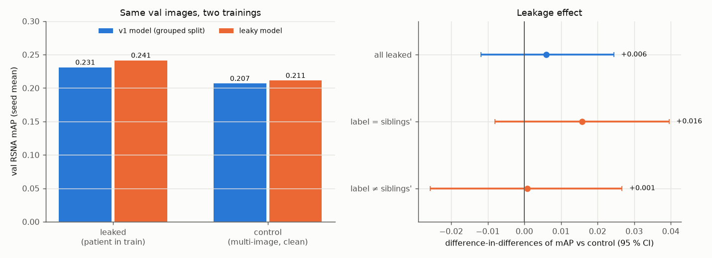

- **Эффект не обнаружен.** По сидам DiD −0.000 [−0.025, +0.024] (сид 0) и +0.012 [−0.010, +0.037] (сид 1), вместе
  +0.006 [−0.012, +0.024]. Критерий плана («существенна, если CI DiD > 0») не выполнен, более строгий критерий HW1 (CI > 0 и эффект
  больше MDE ≈ 0.013) — тоже. Предсказание плана
  (+0.01…+0.05) не подтвердилось: точечная оценка ниже диапазона, а эффекты больше +0.024 исключены.
- **Механизм — в ожидаемую сторону, но в пределах шума.** На утёкших снимках, чья метка совпадает с меткой
  большинства отданных в train снимков того же пациента (527 снимков), DiD +0.016 [−0.008, +0.040]. Там, где метка
  не совпадает (194), — +0.001 [−0.026, +0.027]. Так выглядело бы запоминание пациента, но различие не значимо.
  102 снимка пациентов без большинства (поровну позитивов и негативов среди отданных) исключены.
- **Пересчёт на наивный сплит по `patientId`** (там у 67.4 % val-снимков пациент есть в train, README §3.7):
  ожидаемое завышение ≈ 0.674 × DiD = **+0.004 [−0.008, +0.017]**. Это грубая оценка: в наивном сплите «доза»
  другая (сколько снимков пациента в train и какие).
- **Что это значит для HW1–HW2.** Для этой модели (ResNet-18, 256 px, 6 эпох, аугментации) утечка через пациента
  мала. Групповой сплит HW1 не исправлял большого искажения, но и лишним не был: верхняя граница +0.017 того же
  порядка, что MDE HW2 (0.013) и эффект аугментаций (+0.026). Сравнения такого масштаба наивный сплит мог бы
  сместить. [гипотеза] Более ёмкая модель, высокое разрешение или долгое обучение запоминали бы пациентов
  сильнее; эти выводы на такой режим не переносятся.
- Оговорки: 2 сида; утёкшие — только многоснимковые пациенты (доля позитивов у них 26–28 % против 7 % у односнимковых); отдана
  примерно половина снимков каждого пациента.

---

<a id="s5"></a>
## 5. Выводы: что это значит для доверия к модели

| анализ | что показал | как меняет доверие |
|---|---|---|
| ошибки (§1) | 41 % разрыва — пропуски, 33 % — неточная локализация, 26 % — FP; 83 % пропусков и 69 % FP повторяются у всех трёх сидов | **к числу mAP — выше, к модели — ниже.** Ошибки предсказуемы и привязаны к типам снимков, а не к случайности обучения; смена сида их не исправит. [гипотеза] Систематическую часть вряд ли уберёт и ансамбль сидов (не проверялось) |
| FP на «Not Normal» (E1, E5) | 155 из 156 систематических FP — снимки с другой патологией; у 74 % уверенных систематических FP (n = 39) в NIH стоит Pneumonia / Consolidation / Infiltration (против 44 % среди всех негативов val) | часть «ошибок» — неоднозначность разметки, а не сбой модели. Потолок метрики ниже 1; рост mAP на этих снимках не обязательно означает прогресс |
| срезы (§2) | PA: sensitivity 0.35; ≥ 60 лет: std-mAP −0.085 к < 30; малые и одиночные очаги — 0.43–0.44 | **средний mAP скрывает неравенство.** Для PA-потока и пожилых модель не годится как «исключающий» тест |
| shortcut (§2.4) | score различает AP и PA даже на здоровых (AUC ≈ 0.74); основная часть сигнала остаётся после маскирования краёв (AUC 0.72–0.74); узкая маска снижает FP на AP сильнее, чем на PA (DiD −0.026 [−0.039, −0.012]), но этот эффект нельзя однозначно приписать внелёгочным подсказкам | при другой связи «проекция ↔ болезнь» в новой больнице качество сместится непредсказуемо (shortcut и реальная разница тяжести AP/PA не разделены) |
| искажения (R3) | шум σ = 0.01 → −0.034, JPEG 50 / 128 px / размытие 1 px → около −0.02, в основном через чувствительность; при сильных искажениях (σ ≥ 0.02, JPEG ≤ 20, размытие 2 px) боксовый выход при фиксированном пороге «замолкает», а P(пневмония) теряет разделение | **[гипотеза] вероятно, крупный риск при переносе** (реальный сдвиг между аппаратами не измерялся). Отказ незаметен для пользователя; без контроля качества входа применять нельзя |
| объём train (R1) | +0.020 mAP на удвоение, плато нет (на 10–100 %); на малых данных растут FP | [гипотеза] вероятно, выигрыш даст больше данных (за 100 % не проверено; меньше данных здесь — и меньше шагов). Повышение разрешения выше 256 px и подбор гиперпараметров в HW3 не проверялись |
| другое разбиение (R2) | разброс 0.0069 — меньше ожидаемого; v1 выше среднего трёх новых разбиений на +0.006 и выше второй (resplit3) лишь на 0.001 (в пределах шума) | **абсолютный уровень Full и протокол выбора не артефакт удачной val** — читать как «0.21–0.22». Сравнения конфигураций HW2 на других разбиениях не перепроверялись; их опора — контраст на test HW2, +0.029 [+0.014, +0.044] |
| утечка (RQ2) | DiD +0.006 [−0.012, +0.024]; на наивном сплите завышение ≈ +0.004 [−0.008, +0.017] (грубая экстраполяция 0.674 × DiD) | протокол HW1 корректен, числа HW1–HW2 утечкой через пациента не завышены. Утечка такого масштаба опасна только для сравнений с эффектом ≈ MDE |

**Итог.** Доверие к **протоколу оценки** HW1–HW2 и к абсолютному уровню Full после HW3 выросло: по критерию
плана v1 val не нетипична, утечки через пациента почти нет, числа воспроизводятся. Сравнения конфигураций HW2
по-прежнему опираются на контраст на test HW2, R2 их не перепроверял. Доверие к **модели как инструменту** — ограниченное. Лучше всего она работает на
крупных и двусторонних очагах и на AP-снимках (sensitivity 0.67–0.76). Она пропускает две трети пневмоний на PA и
около половины у пожилых (sensitivity 0.46 [0.33, 0.57]), ставит уверенные боксы на другую патологию, а при незаметном шуме теряет
чувствительность без какого-либо сигнала для пользователя.
Это исследовательский прототип. Перед практическим использованием нужны:
- контроль качества входа (шум, разрешение, сжатие) до инференса;
- отчёт по подгруппам (проекция, возраст, размер очага) вместо одного числа;
- внешняя валидация на других аппаратах и клиниках с разметкой консенсусом нескольких радиологов.

[гипотеза] Следующие шаги для самой модели — больше данных и разрешения (R1, E2), шумовая аугментация (R3) и
отдельная работа с «Not Normal»-негативами (E1). Ни один из них в HW3 не проверялся.

---

<a id="s6"></a>
## 6. Отклонения от плана

План — [`HW3_plan.md`](HW3_plan.md), коммит `35b43a3`, сделан до обучения прогонов HW3. После него код анализа
прошёл ревью: каждое замечание отдельно проверялось попыткой его опровергнуть; подтвердилось 15 замечаний. Всё, что изменилось по сравнению с планом:

1. **Формула std-mAP.** В плане: π·mAP_pos + (1 − π)·(1 − FP-rate). Ревью показало, что это не стандартизация RSNA
   mAP: формула даёт верному негативу кредит 1, а метрика такие снимки не считает. Заменено на
   π·mAP_pos / (π + (1 − π)·FP-rate) — точную формулу mAP группы при доле позитивов π. **С формулой плана вывод по
   проекции был бы противоположным** (AP − PA = −0.072 вместо +0.046), а возрастной эффект исчез бы (−0.004
   вместо −0.085).
2. **RQ3, маска.** Поле из плана (99 % GT-боксов) срезает только край кадра и оставляет надписи (§2.4), поэтому
   правило плана «Δ ≈ 0 → shortcut опровергнут» к нему неприменимо. Добавлена узкая маска (q = 0.05) — не из плана.
   Формулировка «накрывающий 99 % GT-боксов» на деле — квантили 0.5 / 99.5 % каждого края, целиком внутри 98.0 %
   train-боксов.
3. **R3, уровни.** Добавлены уровни внутри диапазона аугментаций (контраст ×0.9 / ×1.1, гамма 0.91 / 1.1), чтобы
   проверить предсказание плана про этот диапазон. Гамма 0.9 из первой версии была заменена на 0.91: 0.9 лежит
   вне exp(±0.1).
4. **R2, критерий.** Помимо правила плана (разброс > 2 × ожидаемого) приведён χ²-тест отношения дисперсий и
   оговорено, что ожидаемый разброс посчитан нестратифицированным бутстрапом и поэтому завышен.
5. **Ошибки.** В плане 4 кандидата (E1–E4). В отчёте 5: E3 плана разделена на «неточные границы» (E3) и
   «неверное число боксов» (E4), добавлены контрфакты локализации. Определения «лишних» боксов уточнены по ревью:
   боксы, не касающиеся GT, и дубли считаются отдельно.
6. **RQ2.** Добавлен разбор механизма (совпадает ли метка снимка с меткой отданных в train снимков того же
   пациента); пациенты без большинства исключены из этого разбора.
7. **Нулевые доли.** Для групп без единого события (FP-rate 0) вместо вырожденного CI [0, 0] даётся точная
   односторонняя граница 1 − 0.025^(1/n) по числу пациентов.
8. **Мелкое:** «30–60» реализовано как 30 ≤ возраст < 60; галереи строятся по снимкам, ошибочным у всех трёх сидов.
9. **R2, ожидаемый разброс.** В плане он оценён в 0.006–0.007; это занижение: бутстрап-SE val mAP одного прогона
   ≈ 0.014 (полуширина CI ≈ 0.027). В отчёте используется 0.014. Вывод от этого не зависит: наблюдаемый разброс
   0.0069 меньше удвоенной величины в обоих вариантах (§3, R2).
10. **Стратифицированные разрезы, не из плана.** Добавлены после первых результатов как проверка конфаундинга:
    контрасты ≥ 60 − < 30 отдельно внутри AP и внутри PA (§2), чувствительность по числу GT-боксов внутри каждой
    терцили размера и доля малых очагов по проекции и возрасту (E2, §2), доля лишних боксов по терцилям размера
    (E4). Выводы «проекция объясняет только часть возрастного разрыва» и «эффекты не сводятся друг к другу»
    опираются на эти post-hoc разрезы.
11. **R3, вероятность классификатора.** Медиана P(пневмония) на негативах и позитивах при каждом искажении добавлена
    после сверки отчёта: без неё вывод «модель молчит» описывал только боксы.

---

<a id="s7"></a>
## 7. Воспроизведение

```bash
# всё ДЗ3: разбиения, 11 переобучений (≈ 4.5 ч на ноутбуке с MPS: 4–41 мин на прогон, resumable), затем анализы (val only)
bash scripts/run_hw3.sh
# только анализы по готовым результатам (≈ 40 с на закоммиченных кэшах; ANALYSIS_DEVICE по умолчанию mps, если доступен)
TRAIN=0 bash scripts/run_hw3.sh
# по отдельности:
PYTHONPATH=src .venv/bin/python scripts/analyze_hw3_errors.py       # §1, §2 — нужны только results/full_s*
RSNA_DEVICE=mps PYTHONPATH=src .venv/bin/python scripts/analyze_hw3_noise.py     # R3 — нужны runs/full_s*/best.pt
RSNA_DEVICE=mps PYTHONPATH=src .venv/bin/python scripts/analyze_hw3_shortcut.py  # §2.4
PYTHONPATH=src .venv/bin/python scripts/analyze_hw3_robustness.py   # R1, R2
PYTHONPATH=src .venv/bin/python scripts/analyze_hw3_leakage.py      # §4.4, RQ2
PYTHONPATH=src .venv/bin/python -m pytest -q                        # тесты, включая tests/test_hw3.py
```

- **Детерминизм.** Разбиения HW3 детерминированы (seed в `split_variants.py`) и закоммичены в `data/splits/hw3/`;
  `rsna.split_variants` отказывается их перезаписать, если результат другой. Сиды обучения 0 / 1 записаны в имени
  прогона и `config.yaml`. MPS не бит-детерминирован, повторное обучение совпадёт приблизительно.
- **Кэш.** Предсказания на искажённых входах лежат в `results/hw3/noise/cache/` и `results/hw3/shortcut/cache/`
  вместе с устройством (все — `mps`) и описанием условия (семейство и уровень); при несовпадении пересчитываются.
  Изменение кода `rsna.perturb` пересчёта не вызывает: в этом случае кэш нужно удалить вручную. На кэше анализы R3 и RQ3 идут
  за секунды, без него — ≈ 40 с на условие и сид на MPS.
- **Трекинг.** Прогоны HW3 — в MLflow-эксперименте `rsna-pneumonia-hw3` (`mlflow.db`) и в `results/experiments.csv`
  (строки `hw3_*`); отчёт HW2 их игнорирует и воспроизводится без изменений. Логи обучения — `results/logs/hw3/`.
- **Test** в HW3 не читается ни одним скриптом.


